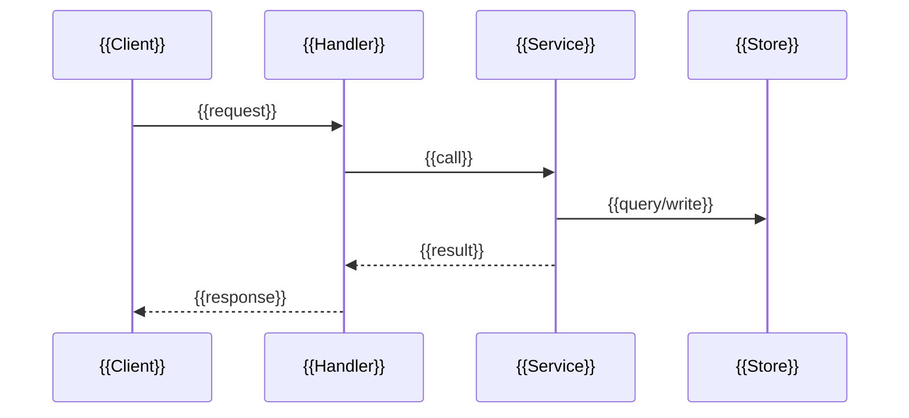

# Architecture

<!-- Explain how the system is built and why it behaves the way it does. Diagrams answer one question each;
     every diagram is followed by prose. Link to source for every non-obvious claim. -->

## System context

```mermaid
flowchart LR
  actor([{{Actor}}]) -->|{{protocol}}| system[{{System}}]
  system -->|{{protocol}}| ext[{{External service}}]
```

{{Who and what the system talks to, and over which channels.}}

## Runtime building blocks

<!-- Deployable/runnable units: web app, API, SPA, workers, schedulers, databases, caches, queues, object storage. -->

```mermaid
flowchart TB
  subgraph runtime[{{System}}]
    web[{{Web/API process}}]
    worker[{{Background worker}}]
  end
  web --> db[({{Database}})]
  web --> queue[[{{Queue}}]]
  queue --> worker
```

| Unit | Responsibility | Entry point | Scales / restarts how |
| --- | --- | --- | --- |
| {{web}} | {{serves HTTP}} | [{{file}}]({{../path}}) | {{notes}} |

## Code organization

<!-- The modules/packages/layers that actually exist, with what each owns. Do not impose a layering the code does not follow. -->

| Module / directory | Owns | Depends on |
| --- | --- | --- |
| [`{{path}}`]({{../path}}) | {{responsibility}} | {{modules}} |

## Request lifecycle

<!-- Follow one representative request from entry to response, naming the real middleware/handlers/services. -->



{{Prose walk-through with links to each step.}}

## Cross-cutting concerns

<!-- Keep only the rows that exist in this project; add rows for project-specific mechanisms. -->

| Concern | How it works here | Where |
| --- | --- | --- |
| Authentication | {{}} | {{}} |
| Authorization | {{}} | {{}} |
| Validation and errors | {{}} | {{}} |
| Transactions and consistency | {{}} | {{}} |
| Background jobs and scheduling | {{}} | {{}} |
| Caching | {{}} | {{}} |
| Files and media | {{}} | {{}} |
| Notifications / email | {{}} | {{}} |
| Logging and observability | {{}} | {{}} |
| Localization | {{}} | {{}} |
| Multi-tenancy / extension system (if any) | {{}} | {{}} |

## Extension points

{{How new behavior is added without editing the core: registries, events, plugin/module contracts, DI bindings. Link the development guide's "adding a feature" section.}}

## Architectural decisions

{{Link recorded decisions in decisions/. Describe observed patterns as patterns; do not invent rationale.}}
