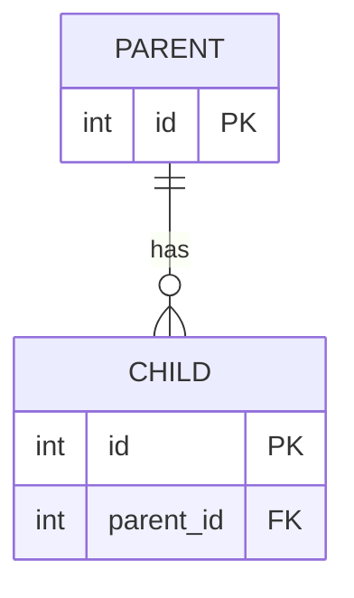
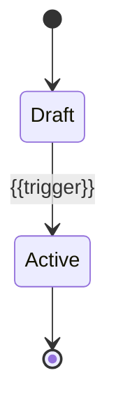

# Data model

<!-- Built from schema declarations (migrations, ORM models, schema files). Say which source is canonical.
     Migration files describe intended schema; they are not proof of a live database's state. -->

## Stores

| Store | Kind | Holds | Schema source |
| --- | --- | --- | --- |
| {{primary}} | {{PostgreSQL}} | {{core entities}} | [{{migrations dir}}]({{../path}}) |

## Entities

| Entity | Purpose | Key fields | Owned by feature |
| --- | --- | --- | --- |
| [`{{Model}}`]({{../path}}) | {{purpose}} | {{fields}} | [{{feature}}](features/{{slug}}.md) |

## Lifecycles and state machines

<!-- For every entity with a status field, show the allowed transitions and what triggers each. -->

## Data rules

{{Uniqueness, ownership/isolation rules, soft deletes, retention, money/time-zone conventions, denormalized copies and how they stay in sync.}}

## Changing the schema

{{How to add a migration, how migrations are applied in each environment, and backfill conventions. Link deployment.md for release ordering.}}
