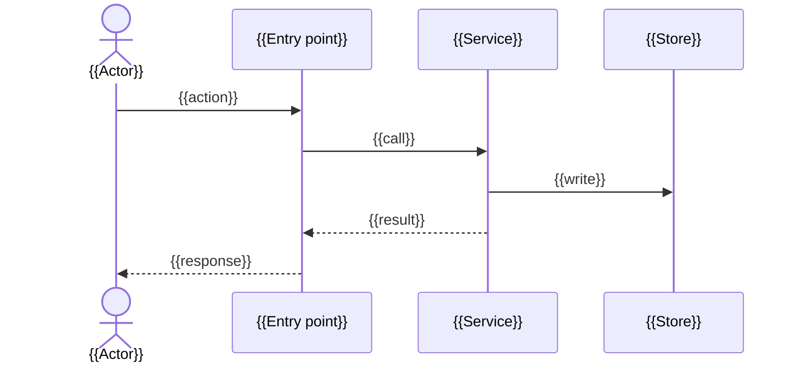

# {{Feature name}}

<!-- One page per capability. The first half is for people who USE the feature; the second half is for
     people who CHANGE or OPERATE it. Write "Not applicable: <reason>" under a heading rather than deleting it. -->

## Overview

{{What it lets someone accomplish, who can use it, and when it is available (roles, plan, flag, module enabled).}}

**Status:** {{live / behind flag / experimental / deprecated}} · **Owners:** {{module/package}} · **Related:** [{{feature}}]({{slug}}.md)

## How to use

<!-- Real labels, menu paths, URLs, API calls or commands. Use synthetic example data. Cover each actor separately. -->

### {{Actor}}: {{task}}

1. {{Go to ... / call ... / run ...}}
2. {{Fill ... / choose ...}}
3. {{Submit}}. You see {{expected result}}.

**If something goes wrong:** {{message the user sees}} means {{cause}}; {{what to do}}.

### Rules users notice

- {{Validation rule, limit, pricing rule, eligibility condition, state that blocks an action}}

## How it works

### Flow

1. **Entry:** [`{{Route/Page/Command}}`]({{../../path#L1}}) receives {{input}}.
2. **Checks:** {{validation}} in [`{{Validator}}`]({{../../path}}); {{permission}} in [`{{Policy}}`]({{../../path}}).
3. **Work:** [`{{Service::method}}`]({{../../path}}) {{does what, inside which transaction}}.
4. **Side effects:** {{events, jobs, emails, webhooks, cache invalidation}}.
5. **Result:** {{response / redirect / UI update}}.

### Asynchronous and failure paths

{{What runs later, retries, idempotency, what happens on partial failure, duplicate submissions, external outages.}}

### States

<!-- Include when the feature moves an entity through statuses. -->

### Data

| Entity / field | Read or written | Notes |
| --- | --- | --- |
| [`{{Model}}`]({{../../path}}) | {{read/write}} | {{}} |

### Interfaces

| Interface | Details |
| --- | --- |
| `{{METHOD /path}}` | {{request, response, errors; link interfaces.md}} |

## Configuration

| Setting / flag / env var | Effect | Default |
| --- | --- | --- |
| `{{NAME}}` | {{effect}} | {{default}} |

**Enabling / rollout:** {{migrations, seed data, flags to flip, processes that must run (worker, scheduler), order of steps, how to roll back}}.

## Testing

- Automated: [{{test file}}]({{../../tests/path}}) covers {{scenarios}}. Run `{{command}}`.
- Manual smoke test: {{steps}} -> expect {{result}}.
- Not covered: {{gaps}}.

## Troubleshooting

| Symptom | Likely cause | Check | Fix |
| --- | --- | --- | --- |
| {{symptom}} | {{cause}} | {{log line / table / screen}} | {{action}} |

## History

- {{YYYY-MM}}: {{notable change}} ({{commit/PR/changelog link}})
