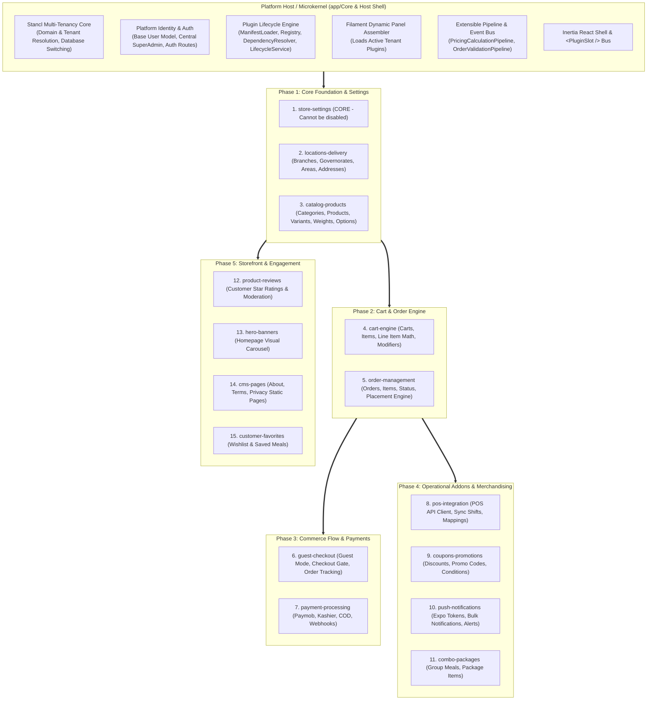

# Master Migration Roadmap: Everything-is-a-Plugin Architecture

> **System Target:** Turbo Tenant SaaS (Laravel 12.x / Stancl Tenancy 3.9.x / Filament 4.2.x / Inertia React 2.x)  
> **Destination Path:** `.plan/migration_to_plugins/`  
> **Status:** Final Architectural Roadmap (Aligned with User Decisions)  
> **Reference Context:** [Conversation: Applying Plugin Design Patterns](conversation://068bfa6b-2161-40b1-99c6-7ccf92802765)  

---

## 1. Executive Vision & Architecture Baseline

In this architecture, `turbo_tenant` is structured into an ultra-lean **Platform Host (Microkernel)** with modular, stateful, hot-pluggable extensions.

Every single business capability—including foundational data structures, user acquisition modes (**Guest Mode**), and **Store Settings**—is isolated as an independent plugin living in `app/Plugins/{StudlyName}/`.

### Key Architectural Decisions Confirmed:
1. **Settings as a Permanent Core Plugin (`store-settings`):**
   - Holds store profile, currency, timezone, tax rates, logos, social links, and business hours.
   - Declared with `"is_core": true`.
   - **Cannot be disabled or uninstalled** by tenant admins (`PluginLifecycleService` throws a `RuntimeException`).
   - Auto-activated during tenant creation and grandfathered for all existing tenants.
2. **Existing Tenant Grandfathering (Approved):**
   - All existing active tenants in production are automatically populated with all 15 plugins marked as `active` in `tenant_plugins`.
   - Guarantees 100% zero downtime and zero feature regression for existing stores.
3. **Guest Mode Redirect Behavior (Approved):**
   - When `guest-checkout` is **active**: Storefront renders guest accordion, allows guest checkout, and enables order tracking at `/orders/track`.
   - When `guest-checkout` is **deactivated**: Any unauthenticated access to `/checkout` immediately **redirects to `/login`** with a return intent and a flash message ("Please sign in or create an account to proceed"). Direct API requests reject unauthenticated payloads.
4. **Execution Sequence (Catalog-Aligned):**
   - Migration executes sequentially in the **exact order of the Master Plugin Catalog**, building upward from foundation layers to commerce flow, operational add-ons, and storefront features.

---

## 2. Microkernel Host vs. Plugin Ecosystem

---

## 3. Master Plugin Catalog & Inventory (15 Plugins)

| # | Plugin ID | Studly Name | Category | Is Core? | Primary Dependencies | Code Footprint Highlights |
| :-: | :--- | :--- | :--- | :---: | :--- | :--- |
| **1** | `store-settings` | `StoreSettings` | `foundation` | **YES** | *None* | `Setting` model, `SettingService`, `settings` table, Settings Filament page. **Permanent (cannot be disabled).** |
| **2** | `locations-delivery` | `LocationsDelivery` | `foundation` | NO | *None* | `Branch`, `Governorate`, `Area`, `Address`, Address Filament resources, `AddressController`. |
| **3** | `catalog-products` | `CatalogProducts` | `foundation` | NO | *None* | `Product`, `Category`, `ProductVariant`, `WeightOption`, `ExtraOption`, `Section`, 5 Filament resources, Product controllers & views. |
| **4** | `cart-engine` | `CartEngine` | `foundation` | NO | `catalog-products` | `Cart`, `CartItem`, `CartItemExtra`, `CartService`, `CartController`, Cart React components. |
| **5** | `order-management` | `OrderManagement` | `foundation` | NO | `cart-engine`, `locations-delivery` | `Order`, `OrderItem`, `OrderItemExtra`, `PlaceOrderService`, `OrderController`, Orders Filament resource, Order views. |
| **6** | `guest-checkout` | `GuestCheckout` | `commerce` | NO | `order-management` | `GuestUser`, `GuestUserService`, `GuestUsers` Filament resource, `/orders/track` route, Checkout guest toggle. **Redirects to `/login` when disabled.** |
| **7** | `payment-processing` | `PaymentProcessing` | `commerce` | NO | `order-management` | `PaymentGatewayFactory`, `PaymobService`, `KashierService`, Payment webhook controllers, Kashier & Callback React views. |
| **8** | `pos-integration` | `PosIntegration` | `addon` | NO | `order-management`, `catalog-products` | `ProductPosMapping`, `POSApiClient`, `OrderPOSService`, `ProductPOSImporterService`. |
| **9** | `coupons-promotions` | `CouponsPromotions` | `marketing` | NO | `cart-engine` | `Coupon`, `CouponService`, `Coupons` Filament resource, `CouponController`, Cart discount pipe. |
| **10** | `push-notifications`| `PushNotifications` | `communication`| NO | *None* | `BulkNotification`, `UserNotification`, `BulkNotifications` Filament resource, `NotificationController`. |
| **11** | `combo-packages` | `ComboPackages` | `marketing` | NO | `catalog-products` | `Package`, `PackageGroup`, `PackageItem`, `Packages` Filament resource. |
| **12** | `product-reviews` | `ProductReviews` | `addon` | NO | `catalog-products` | `Review`, `ReviewController`, `ReviewForm.tsx` React component. |
| **13** | `hero-banners` | `HeroBanners` | `storefront` | NO | *None* | `HeroSlider`, `HeroSliderResource`, `HeroSlider.tsx` React component. |
| **14** | `cms-pages` | `CmsPages` | `storefront` | NO | *None* | `Page`, `Pages` Filament resource, `PageController`, `Page.tsx` React view. |
| **15** | `customer-favorites`| `CustomerFavorites` | `storefront` | NO | `catalog-products` | Customer wishlist actions, `Favorites.tsx` React view. |

---

## 4. Phase Migration Index (Catalog-Order Execution)

The migration is divided into 6 focused phases following the catalog order:

| Phase File | Plugins Included | Focus & Milestones |
| :--- | :--- | :--- |
| [`01_phase1_core_foundation_plugins.md`](file:///d:/turbo_tenant/.plan/migration_to_plugins/01_phase1_core_foundation_plugins.md) | `store-settings` (Core), `locations-delivery`, `catalog-products` | Core settings isolation, branch/address structure, catalog taxonomy, products & variants. |
| [`02_phase2_cart_and_order_engine.md`](file:///d:/turbo_tenant/.plan/migration_to_plugins/02_phase2_cart_and_order_engine.md) | `cart-engine`, `order-management` | Cart state & item math, order state machine, extensible pipeline bus (`OrderValidationPipeline`, `PricingCalculationPipeline`). |
| [`03_phase3_commerce_flow_guest_and_payments.md`](file:///d:/turbo_tenant/.plan/migration_to_plugins/03_phase3_commerce_flow_guest_and_payments.md) | `guest-checkout`, `payment-processing` | Guest user decoupling, redirect-to-login gate, order tracking, Paymob & Kashier gateways with webhook encapsulation. |
| [`04_phase4_operational_addons_and_merchandising.md`](file:///d:/turbo_tenant/.plan/migration_to_plugins/04_phase4_operational_addons_and_merchandising.md) | `pos-integration`, `coupons-promotions`, `push-notifications`, `combo-packages` | External POS sync, discount rules, push alerts (Expo), combo meal bundles. |
| [`05_phase5_storefront_and_engagement_plugins.md`](file:///d:/turbo_tenant/.plan/migration_to_plugins/05_phase5_storefront_and_engagement_plugins.md) | `product-reviews`, `hero-banners`, `cms-pages`, `customer-favorites` | Ratings & moderation, homepage slider carousel, static content pages, user favorites. |
| [`06_phase6_microkernel_zero_coupling_and_grandfathering.md`](file:///d:/turbo_tenant/.plan/migration_to_plugins/06_phase6_microkernel_zero_coupling_and_grandfathering.md) | Host Shell, Router, AdminPanelProvider, Seeder | Stripping monolithic routes, dynamic Filament panel injection, tenant grandfathering seeder, regression verification. |
