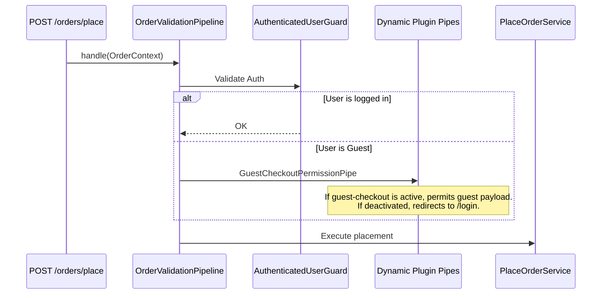

# Phase 2 Migration Plan: Cart & Order Engine

> **Milestone:** M2  
> **Plugins:** `cart-engine`, `order-management`  
> **Scope:** Basket calculation, line items, order state machine, checkout, and pipeline buses  
> **Target Path:** `.plan/migration_to_plugins/02_phase2_cart_and_order_engine.md`  

---

## 1. Objectives & Overview

Phase 2 builds the core commercial transactions layer. It establishes:
1. **`cart-engine`**: Stateless and session/customer-bound carts, line item modifier math, weight multipliers, and cart synchronization.
2. **`order-management`**: Order persistence, status progression, item records, and the central **Order Placement Pipeline Bus**.

---

## 2. Plugin 4: `cart-engine`

### 2.1 Manifest Specification (`app/Plugins/CartEngine/plugin.json`)
```json
{
  "id": "cart-engine",
  "name": "Cart & Calculations Engine",
  "version": "1.0.0",
  "category": "foundation",
  "description": "Cart storage, line-item modifiers, pricing calculation, and cart synchronization.",
  "author": "Turbo Tenant Team",
  "is_core": false,
  "dependencies": [
    "catalog-products"
  ],
  "providers": [
    "App\\Plugins\\CartEngine\\CartEngineServiceProvider"
  ]
}
```

### 2.2 Files to Migrate & Relocate
- **Models:**
  - `app/Models/Cart.php` $\to$ `app/Plugins/CartEngine/src/Models/Cart.php`
  - `app/Models/CartItem.php` $\to$ `app/Plugins/CartEngine/src/Models/CartItem.php`
  - `app/Models/CartItemExtra.php` $\to$ `app/Plugins/CartEngine/src/Models/CartItemExtra.php`
- **Services:**
  - `app/Services/CartService.php` $\to$ `app/Plugins/CartEngine/src/Services/CartService.php`
  - `app/Services/Cart/*` (Calculators, Validators, Resolvers, Formatters, Repositories) $\to$ `app/Plugins/CartEngine/src/Services/`
- **Controllers & Routes:**
  - `app/Http/Controllers/CartController.php` $\to$ `app/Plugins/CartEngine/src/Http/Controllers/`
  - Routes extracted from `routes/tenant.php`: `/cart`, `/cart/items`, `/cart/items/{id}`, `/cart/sync`.
- **Migrations:**
  - `2025_11_19_175818_create_carts_table.php`
  - `2025_11_19_175828_create_cart_items_table.php`
  - `2025_11_19_175832_create_cart_item_extras_table.php`
  - Related weight and extra option pivot migrations.
- **Frontend Components:**
  - `Cart.tsx`, `resources/js/themes/default/components/cart/*`.

---

## 3. Plugin 5: `order-management`

### 3.1 Manifest Specification (`app/Plugins/OrderManagement/plugin.json`)
```json
{
  "id": "order-management",
  "name": "Order Management & Checkout Core",
  "version": "1.0.0",
  "category": "foundation",
  "description": "Order records, order placement pipeline, status state machine, and customer order history.",
  "author": "Turbo Tenant Team",
  "is_core": false,
  "dependencies": [
    "cart-engine",
    "locations-delivery"
  ],
  "providers": [
    "App\\Plugins\\OrderManagement\\OrderManagementServiceProvider"
  ],
  "filament": "App\\Plugins\\OrderManagement\\src\\Filament\\OrderManagementFilamentPlugin"
}
```

### 3.2 Files to Migrate & Relocate
- **Models:**
  - `app/Models/Order.php` $\to$ `app/Plugins/OrderManagement/src/Models/Order.php`
  - `app/Models/OrderItem.php` $\to$ `app/Plugins/OrderManagement/src/Models/OrderItem.php`
  - `app/Models/OrderItemExtra.php` $\to$ `app/Plugins/OrderManagement/src/Models/OrderItemExtra.php`
- **Services & Pipelines:**
  - `app/Services/PlaceOrderService.php` $\to$ `app/Plugins/OrderManagement/src/Services/PlaceOrderService.php`
  - `app/Services/Order/*` (Repositories, Validators, Dispatchers, Pricing) $\to$ `app/Plugins/OrderManagement/src/Services/`
  - Core pipelines: `OrderValidationPipeline`, `PricingCalculationPipeline`.
- **Filament Resources:**
  - `app/Filament/Resources/Orders/` $\to$ `app/Plugins/OrderManagement/src/Filament/Resources/Orders/`
- **Controllers & Routes:**
  - `app/Http/Controllers/OrderController.php`, `app/Http/Controllers/Api/OrderStatusController.php`.
  - Base routes: `/orders`, `/orders/{id}`, `/checkout`, `/orders/place`.
- **Migrations:**
  - All order, item, and extras migrations relocated to `app/Plugins/OrderManagement/database/migrations/tenant/`.
- **Frontend Views:**
  - `Checkout.tsx`, `OrderShow.tsx`, `MyOrders.tsx`, `resources/js/themes/default/components/checkout/*`.

---

## 4. The Extensible Pipeline Bus Pattern

To allow future plugins (like `guest-checkout`, `coupons-promotions`, and `pos-integration`) to inject logic into order checkout without modifying `OrderManagement`, checkout execution is governed by host pipeline buses:



---

## 5. Phase 2 Verification Checklist
1. **Cart Lifecycle:** Add item to cart $\to$ Update modifier $\to$ Verify subtotal and taxes.
2. **Order Placement:** Place an order as authenticated user $\to$ Ensure order, items, and extras persist with correct status `pending`.
3. **Filament Orders:** Access Tenant Admin $\to$ Open Orders Resource $\to$ Verify order details and status transition actions work cleanly.
