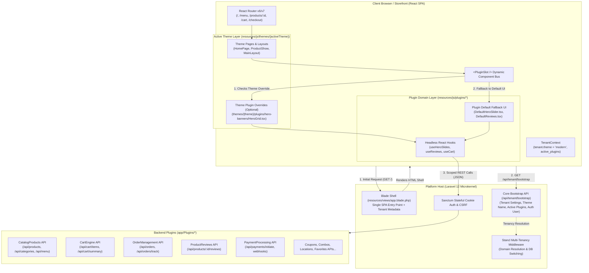

# Master Migration Roadmap: Replacing Inertia.js with Decoupled API & Multi-Theme Plugin Architecture

> **System Target:** Turbo Tenant SaaS (Laravel 12.x / Stancl Tenancy 3.9.x / Filament 4.x / React 18 / Tailwind v4)  
> **Destination Path:** `.plan/replace_inertia_with_api/`  
> **Status:** Architecture Master Plan (Updated for Multi-Theme & Headless Plugin Architecture)  
> **Previous Context:** Microkernel Plugin System (`.plan/migration_to_plugins/`)  

---

## 1. Executive Vision & Architectural Rationale

Turbo Tenant's backend has been successfully structured into an isolated **Microkernel + 15 Standalone Plugins** living in `app/Plugins/{StudlyName}/`. However, the storefront has relied on **Inertia.js**, which inherently creates tight coupling between backend controllers and React views.

Furthermore, a true multi-tenant SaaS storefront must support **Multiple Independent Themes** (e.g., `default`, `modern`, `luxury`, `restaurant`). If a plugin hardcodes its own UI component into a slot, themes lose design freedom and visual consistency breaks.

### Architectural Core Tenets:
1. **Zero Open-Closed Principle Violations:** Core controllers no longer need to know about optional plugins (e.g. `ProductReviews`, `CouponsPromotions`, `ComboPackages`) to construct page props.
2. **Strict Inversion of Control (Headless Plugins vs. Themes):**
   - **Plugins own Domain Data, API Contracts & Business Logic:** Every plugin exposes typed REST APIs and **Headless Hooks** (`useHeroSlides()`, `useReviews()`, `useCart()`, `useApplyCoupon()`).
   - **Themes own Presentation, Layouts & Styling:** Themes determine *how* that data is visually presented.
3. **Graceful Fallback via Slot Hierarchy:**
   - Plugins ship with a neutral **Default/Fallback Component** (`DefaultHeroSlider.tsx`).
   - Active themes can supply a **Theme Override Component** (`themes/{theme}/plugins/hero-banners/HeroSlider.tsx`).
   - The `<PluginSlot />` bus resolves: **Theme Override > Plugin Default > null**.
4. **Omnichannel Capability:** The same REST APIs that power the web storefront instantly become ready for native mobile apps (React Native / Flutter), POS terminals, and third-party webhooks.

---

## 2. Confirmed Core Architectural Decisions

| Decision Area | Selected Standard | Architectural Impact |
| :--- | :--- | :--- |
| **Frontend Shell & Routing** | **Embedded React SPA (React Router v6/v7)** | Served via a single Laravel Blade shell (`resources/views/app.blade.php`). Preserves Stancl Tenancy domain routing and SSR meta tags while providing client-side SPA routing. |
| **Frontend Directory Layout** | **Centralized `resources/js/plugins/` + Theme Overrides** | Keeps all TypeScript/React code cleanly grouped in `resources/js/`, separating backend PHP from frontend UI while maintaining strict plugin boundaries. |
| **Multi-Theme Strategy** | **Headless-First + Theme Override Hierarchy** | Plugins export headless TanStack Query hooks + fallback UI. Themes can override any slot widget inside `resources/js/themes/{themeName}/plugins/{plugin-slug}/`. |
| **State & Data Fetching** | **TanStack Query v5 (React Query) + Axios** | Provides enterprise-grade caching, automatic background revalidation, optimistic mutations, and window focus management without manual state boilerplate. |
| **Authentication & Session** | **Laravel Sanctum Stateful Cookie Auth** | Leverages multi-tenant subdomain session cookies, CSRF protection via `/sanctum/csrf-cookie`, and avoids token storage vulnerabilities in localStorage. |
| **Extensibility Bus** | **Theme-Aware `<PluginSlot />` Engine** | Named extension points (e.g. `<PluginSlot name="home.hero" />`) resolve theme-specific components first, falling back to plugin defaults. |

---

## 3. High-Level Architecture Diagram (Multi-Theme Aware)



---

## 4. Standardized Frontend Directory Structure (Multi-Theme)

```
resources/js/
├── core/                                 # Platform Host Core Infrastructure
│   ├── api/                              # Unified Axios client & config
│   │   ├── client.ts                     # Axios instance with CSRF & 401 interceptors
│   │   ├── endpoints.ts                  # Centralized endpoint dictionary
│   │   └── query-client.ts               # Preconfigured TanStack QueryClient
│   ├── slots/                            # Theme-Aware Plugin Slot Engine
│   │   ├── PluginSlot.tsx                # <PluginSlot name="..." context={...} />
│   │   ├── slot-registry.ts              # registerPluginDefault(), registerThemeOverride(), resolveSlot()
│   │   └── types.ts                      # Slot name and context type definitions
│   ├── router/                           # React Router setup
│   │   ├── AppRouter.tsx                 # Dynamic themed routes loader
│   │   └── guards/                       # AuthGuard.tsx, GuestCheckoutGuard.tsx
│   ├── context/                          # Global React contexts
│   │   ├── TenantContext.tsx             # Tenant config, theme name, & active plugins entitlement
│   │   └── AuthContext.tsx               # Customer user session
│   └── types/                            # Core global DTOs & API response wrappers
│
├── plugins/                              # 🧩 Headless Domain & Fallback UI
│   ├── catalog-products/                 # Catalog & taxonomy
│   │   ├── api/                          # useProducts.ts, useProduct.ts, useCategories.ts
│   │   ├── components/                   # DefaultProductCard, DefaultProductOptions (Fallbacks)
│   │   └── types/                        # Product, Category, Variant interfaces
│   ├── cart-engine/                      # Cart calculations & mutations
│   │   ├── api/                          # useCart.ts, useAddToCart.ts, useUpdateCartItem.ts
│   │   ├── components/                   # DefaultCartDrawer, DefaultCartTotals
│   │   └── types/
│   ├── order-management/                 # Order placement & history
│   │   ├── api/                          # usePlaceOrder.ts, useOrders.ts, useOrder.ts
│   │   ├── components/                   # DefaultOrderTimeline, DefaultOrderReceipt
│   │   └── types/
│   ├── guest-checkout/                   # Guest identification & order lookup
│   │   ├── api/                          # useGuestTracking.ts
│   │   ├── components/                   # DefaultGuestAccordion
│   │   └── types/
│   ├── payment-processing/               # Payment gateways & callback handlers
│   │   ├── api/                          # useInitiatePayment.ts, usePaymentStatus.ts
│   │   ├── components/                   # DefaultPaymentMethodSelector
│   │   └── types/
│   ├── product-reviews/                  # Customer reviews & ratings
│   │   ├── api/                          # useReviews.ts, useSubmitReview.ts (Headless)
│   │   ├── components/                   # DefaultReviewsSection.tsx (Fallback UI)
│   │   └── index.ts                      # Registers DefaultReviewsSection into 'product.tabs'
│   ├── hero-banners/                     # Homepage visual slider
│   │   ├── api/                          # useHeroSlides.ts (Headless)
│   │   ├── components/                   # DefaultHeroSlider.tsx (Fallback UI)
│   │   └── index.ts                      # Registers DefaultHeroSlider into 'home.hero'
│   ├── combo-packages/                   # Group meal packages
│   │   ├── api/                          # useCombos.ts (Headless)
│   │   ├── components/                   # DefaultComboCard.tsx (Fallback UI)
│   │   └── index.ts                      # Registers DefaultComboCard into 'product.upsell'
│   ├── coupons-promotions/               # Promo codes & discount banners
│   │   ├── api/                          # useApplyCoupon.ts, useRemoveCoupon.ts (Headless)
│   │   ├── components/                   # DefaultCouponInputBox.tsx (Fallback UI)
│   │   └── index.ts                      # Registers DefaultCouponInputBox into 'cart.summary.coupon'
│   ├── customer-favorites/               # Wishlist
│   │   ├── api/                          # useFavorites.ts, useToggleFavorite.ts (Headless)
│   │   └── components/                   # DefaultFavoriteButton.tsx (Fallback UI)
│   ├── locations-delivery/               # Branches, governorates, areas & addresses
│   │   ├── api/                          # useBranches.ts, useDeliveryAreas.ts, useAddresses.ts
│   │   └── components/                   # DefaultDeliveryAreaSelector, DefaultAddressForm
│   ├── cms-pages/                        # Static policy/content pages
│   │   ├── api/                          # useCmsPage.ts
│   │   └── components/                   # DefaultCmsPageView.tsx
│   └── push-notifications/               # Expo push token registration
│       ├── api/                          # useRegisterExpoToken.ts
│       └── components/                   # PushTokenInitializer.tsx
│
├── themes/                               # 🎨 Themes (Presentation, Layouts & Custom Overrides)
│   ├── default/                          # Theme 1: Default Storefront
│   │   ├── config.ts                     # Theme colors, fonts, token definitions
│   │   ├── layouts/                      # MainLayout.tsx, AuthLayout.tsx
│   │   ├── pages/                        # HomePage, ProductShowPage, MenuPage, CartPage...
│   │   └── plugins/                      # Optional Theme-Specific Overrides for Plugins
│   │       ├── hero-banners/
│   │       │   └── HeroSlider.tsx        # Default theme's custom Embla carousel
│   │       ├── product-reviews/
│   │       │   └── StarReviewsCard.tsx   # Default theme's custom review card
│   │       └── coupons-promotions/
│   │           └── CouponBanner.tsx      # Default theme's styled coupon box
│   │
│   ├── modern/                           # Theme 2: Minimalist / Boutique Theme
│   │   ├── config.ts
│   │   ├── layouts/
│   │   ├── pages/
│   │   └── plugins/
│   │       └── hero-banners/
│   │           └── HeroSplitGrid.tsx     # Modern theme's 2-column grid instead of slider!
│   │
│   └── restaurant/                       # Theme 3: Fast-Food / Menu-Heavy Theme
│       ├── config.ts
│       ├── layouts/
│       ├── pages/
│       └── plugins/
│
├── components/ui/                        # Base Radix / Shadcn primitives
└── app.tsx                               # Application root mounting React, QueryClient & Theme Engine
```

---

## 5. Master Phase Breakdown & Implementation Index

The migration is divided into **6 logically sequenced, risk-managed phases**:

| Phase File | Phase Title | Scope & Objectives |
| :--- | :--- | :--- |
| [`01_phase1_api_infrastructure_and_frontend_shell.md`](file:///e:/turbo_tenant/.plan/replace_inertia_with_api/01_phase1_api_infrastructure_and_frontend_shell.md) | **API Infrastructure & Shell** | Laravel Sanctum stateful cookies, tenant bootstrap API (`/api/tenant/bootstrap`), Blade SPA shell, Axios client, TanStack Query, and **Theme-Aware `<PluginSlot />` engine**. |
| [`02_phase2_catalog_and_browse_experience.md`](file:///e:/turbo_tenant/.plan/replace_inertia_with_api/02_phase2_catalog_and_browse_experience.md) | **Catalog & Browse Experience** | Migration of `CatalogProducts`, `HeroBanners`, `CmsPages`, and `CustomerFavorites` to Headless REST APIs + fallback UI. Theme-specific Hero Banner overrides. |
| [`03_phase3_cart_checkout_and_orders.md`](file:///e:/turbo_tenant/.plan/replace_inertia_with_api/03_phase3_cart_checkout_and_orders.md) | **Cart, Checkout & Order Flow** | Migration of `CartEngine`, `LocationsDelivery`, `GuestCheckout`, and `OrderManagement` to REST. React pages for Cart, Checkout, Order Tracking, and Order History. |
| [`04_phase4_customer_engagement_and_addons.md`](file:///e:/turbo_tenant/.plan/replace_inertia_with_api/04_phase4_customer_engagement_and_addons.md) | **Customer Engagement & Addons** | Headless migration of `ProductReviews`, `CouponsPromotions`, `ComboPackages`, and `PushNotifications`. Wiring fallback UI and Theme overrides into slots. |
| [`05_phase5_payments_and_webhooks.md`](file:///e:/turbo_tenant/.plan/replace_inertia_with_api/05_phase5_payments_and_webhooks.md) | **Payments & External Integrations** | Migration of `PaymentProcessing` (Paymob, Kashier, COD) and `PosIntegration`. React payment callback views and webhook verification. |
| [`06_phase6_inertia_removal_and_final_verification.md`](file:///e:/turbo_tenant/.plan/replace_inertia_with_api/06_phase6_inertia_removal_and_final_verification.md) | **Inertia Removal & Final Verification** | Complete removal of `@inertiajs/react` and `inertiajs/inertia-laravel`, middleware cleanup, Ziggy cleanup, updating PHPUnit/Pest tests, and E2E validation. |

---

## 6. Migration Guarantees & Non-Negotiables

1. **Zero Tenant Feature Regression:** Tenants with active plugins retain exact functional parity across whatever theme they have selected.
2. **Backward-Compatible Parallel Running:** During phases 1 through 5, Inertia and API routes can coexist safely until Phase 6 cleanly cuts over.
3. **Headless Inversion of Control:** Plugins never force opinionated CSS or layout onto a theme. They supply headless hooks and neutral fallback components.
4. **Theme Resilience:** If a theme does not provide a custom override for an installed plugin, the system cleanly renders the plugin's default fallback component without blank spots or exceptions.
