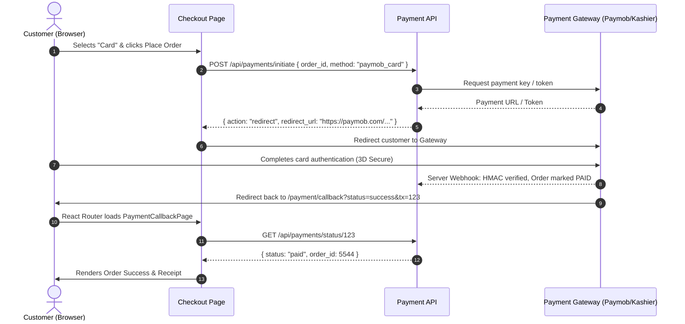

# Phase 5: Payments & External Integrations

> **Focus:** Decoupling payment initiation, gateways (Paymob, Kashier, COD), payment status polling, webhooks, and POS integrations to clean REST contracts.  
> **Target Path:** `.plan/replace_inertia_with_api/05_phase5_payments_and_webhooks.md`  

---

## 1. Objectives & Overview

Payment processing is critical for revenue flow. In the previous Inertia setup, payment callbacks frequently triggered full-page Inertia redirects with flash messages. In this phase:
- Payment initiation is converted to a clean JSON API.
- Payment callbacks (success/failure) are handled gracefully in the React SPA via client routing (`/payment/callback`).
- External webhooks (Paymob HMAC, Kashier signature verification) remain completely stateless and isolated.
- The `PaymentMethodSelector` is registered into the `<PluginSlot name="checkout.payment.methods" />` slot.

Key Plugins Migrated in this Phase:
- `payment-processing` (Paymob, Kashier, Cash on Delivery, Payment Gateways)
- `pos-integration` (POS sync triggers, product & order webhooks)

---

## 2. Backend API Implementation Tasks

### 2.1 PaymentProcessing REST API (`app/Plugins/PaymentProcessing/`)
Create `App\Plugins\PaymentProcessing\src\Http\Controllers\Api\PaymentApiController`:
- `GET /api/payments/methods` → Returns active payment gateways for current tenant (e.g. `["cod", "paymob_card", "paymob_wallet", "kashier"]`).
- `POST /api/payments/initiate` →
  - Validates order ownership and status.
  - Resolves gateway via `PaymentGatewayFactory`.
  - Returns structured response:
    ```json
    {
      "method": "paymob_card",
      "action": "redirect",
      "redirect_url": "https://accept.paymob.com/api/acceptance/iframes/12345?payment_token=xyz",
      "transaction_id": "tx_987654"
    }
    ```
    or for Kashier:
    ```json
    {
      "method": "kashier",
      "action": "modal",
      "kashier_config": {
        "mid": "MID-123",
        "hash": "generated_hash",
        "order_id": "ORD-5544",
        "amount": 250.00
      }
    }
    ```
    or for Cash on Delivery:
    ```json
    {
      "method": "cod",
      "action": "confirmed",
      "order_id": 5544
    }
    ```
- `GET /api/payments/status/{transaction_id}` → Fast poll endpoint to verify payment status during asynchronous callback processing.

### 2.2 Payment Webhook Handlers
- Ensure `POST /api/webhooks/paymob` and `POST /api/webhooks/kashier` bypass CSRF and multi-tenant session middleware, authenticating via HMAC signatures and resolving tenant context via order metadata.

### 2.3 PosIntegration Sync Endpoints (`app/Plugins/PosIntegration/`)
- `POST /api/pos/orders/sync/{order}` → Manually or automatically trigger POS sync.
- `GET /api/pos/status` → Check POS connectivity.

---

## 3. Frontend Plugin Directory Organization

### 3.1 `resources/js/plugins/payment-processing/`
```
resources/js/plugins/payment-processing/
├── api/
│   ├── usePaymentMethods.ts      # Query for /api/payments/methods
│   ├── useInitiatePayment.ts     # Mutation for POST /api/payments/initiate
│   └── usePaymentStatus.ts       # Query for polling transaction state
├── components/
│   ├── PaymentMethodSelector.tsx # Radio buttons with gateway logos
│   ├── KashierModal.tsx          # Embeds Kashier JS SDK modal
│   └── PaymentStatusReceipt.tsx  # Success/failure receipt card
├── pages/
│   └── PaymentCallbackPage.tsx   # Handles return from Paymob / Kashier
└── index.ts                      # Registers PaymentMethodSelector into 'checkout.payment.methods'
```

### 3.2 `resources/js/plugins/pos-integration/`
```
resources/js/plugins/pos-integration/
├── api/
│   └── usePosStatus.ts
└── types/
    └── index.ts
```

---

## 4. Payment Flow in React SPA



---

## 5. Verification & Testing

### 5.1 Automated Backend Tests
- `tests/Feature/Api/PaymentApiTest.php`: Test initiation for COD (marks pending, returns confirmed), test Paymob initiation (returns valid redirect structure).
- `tests/Feature/Api/PaymentWebhookTest.php`: Test valid HMAC webhook payload updates order status to `PAID`, invalid HMAC returns 400.

### 5.2 Manual Browser Verification
- Place order with COD → Verify immediate redirect to Order Receipt with status "Unpaid/Pending Delivery".
- Place order with Online Gateway (Mock/Sandbox) → Complete 3D Secure → Verify redirect to `/payment/callback` displays success and order summary.
