# Master Filament UX Overhaul Plan: Turbo Tenant Admin Panel

> **Target Platform:** Turbo Tenant SaaS (Laravel 12.x / Filament 4.x / Multi-Tenant Microkernel)  
> **Destination Path:** `.plan/ux_updates/`  
> **Status:** Approved for Implementation (Incorporating User Architectural Modifications)  

---

## 1. Executive Summary & User Architectural Directives

Following our systematic UX audit across all 18 resources in [app/Filament](file:///e:/turbo_tenant/app/Filament) and [app/Plugins](file:///e:/turbo_tenant/app/Plugins), this plan outlines the complete UX modernization of the merchant admin panel.

### 📌 User Directives Incorporated:
1. **Order Status Editing Ownership:** Order status transitions and fulfillment are managed primarily by the POS system. We will add a configurable toggle in [Settings.php](file:///e:/turbo_tenant/app/Plugins/StoreSettings/src/Filament/Pages/Settings.php) (`allow_manual_order_status_update`) that defaults to `false` (read-only for POS integrity) but can be toggled on by admins when emergency manual overrides are required.
2. **Thermal Receipts / Invoices:** Printing kitchen tickets and customer invoices is the POS's responsibility; removed from Filament scope.
3. **Extra Option Selection Rules on Products:** `min_selections` (الحد الأدنى) and `max_selections` (الحد الأقصى) must be exposed not only in [ExtraOptionForm.php](file:///e:/turbo_tenant/app/Plugins/CatalogProducts/src/Filament/Resources/ExtraOptions/Schemas/ExtraOptionForm.php), but also directly on [ProductForm.php](file:///e:/turbo_tenant/app/Plugins/CatalogProducts/src/Filament/Resources/Products/Schemas/ProductForm.php) so that products can define or override selection rules for assigned extras.
4. **Inline Governorate Creation:** In [AreaForm.php](file:///e:/turbo_tenant/app/Plugins/LocationsDelivery/src/Filament/Resources/Areas/Schemas/AreaForm.php), the `governorate_id` select must support quick inline creation (`createOptionForm`) so admins can add new Governorates without leaving the Area form.
5. **Hide Address Resource from Navigation:** Addresses are historical delivery snapshots tied to orders. [AddressResource.php](file:///e:/turbo_tenant/app/Plugins/LocationsDelivery/src/Filament/Resources/Addresses/AddressResource.php) is removed from sidebar navigation (`$shouldRegisterNavigation = false`) and accessible only in order/customer context.
6. **Slider Label Simplification:** Rename [HeroSliderResource.php](file:///e:/turbo_tenant/app/Plugins/HeroBanners/src/Filament/Resources/HeroSliderResource.php) navigation and model labels from "سلايدر الترويسة" to simply **"سلايدر"**.

---

## 2. Global Navigation Hierarchy

We reorganize the sidebar from 18 unorganized, flat root items into 7 structured groups aligned with standard e-commerce mental models:

```mermaid
flowchart TD
    Panel["Filament Admin Panel"] --> G1["1. إدارة المبيعات (Sales)"]
    Panel --> G2["2. الكتالوج والمنتجات (Catalog)"]
    Panel --> G3["3. العروض والخصومات (Promotions)"]
    Panel --> G4["4. التوصيل والمناطق (Delivery)"]
    Panel --> G5["5. العملاء والتقييمات (CRM)"]
    Panel --> G6["6. المحتوى والتسويق (Marketing)"]
    Panel --> G7["7. الإعدادات والنظام (Settings)"]

    G1 --> R_Orders["الطلبات (Orders)"]
    
    G2 --> R_Products["المنتجات (Products)"]
    G2 --> R_Categories["الفئات (Categories)"]
    G2 --> R_ExtraOptions["خيارات إضافية (Extra Options)"]
    G2 --> R_WeightOptions["خيارات الوزن (Weight Options)"]
    G2 --> R_Sections["الأقسام (Sections)"]
    G2 --> P_POSImport["استيراد منتجات POS"]
    G2 --> P_POSSync["مزامنة الأسعار"]

    G3 --> R_Coupons["الكوبونات (Coupons)"]
    G3 --> R_Packages["باقات التوفير (Packages)"]

    G4 --> R_Branches["الفروع (Branches)"]
    G4 --> R_Gov["المحافظات (Governorates)"]
    G4 --> R_Areas["المناطق (Areas) [مع إنشاء المحافظة السريع]"]

    G5 --> R_Users["المستخدمين (Users)"]
    G5 --> R_Guests["زوار المتجر (Guest Users)"]
    G5 --> R_Reviews["التقييمات والآراء (Reviews)"]

    G6 --> R_Slider["سلايدر (Sliders)"]
    G6 --> R_Pages["صفحات CMS (Pages)"]
    G6 --> R_Notifications["إشعارات Push (Bulk Notifications)"]

    G7 --> P_Settings["إعدادات المتجر (Settings) [4 Tabs]"]
    G7 --> P_Plugins["سوق الإضافات (Manage Plugins)"]
    G7 --> P_Manifest["إعدادات الـ Manifest"]
```

---

## 3. Implementation Phases Index

| Phase | Specification Document | Key Deliverables |
| :--- | :--- | :--- |
| **Phase 1** | [01_phase1_navigation_and_enums.md](file:///e:/turbo_tenant/.plan/ux_updates/01_phase1_navigation_and_enums.md) | Navigation grouping, hide AddressResource, rename Slider to 'سلايدر', implement Filament Enum contracts (`HasLabel`, `HasColor`, `HasIcon`), unify currency format. |
| **Phase 2** | [02_phase2_catalog_and_products.md](file:///e:/turbo_tenant/.plan/ux_updates/02_phase2_catalog_and_products.md) | Product form redesign with Tabs, product-level & extra-option `min/max_selections`, drag-and-drop table reordering, `ToggleColumn`s. |
| **Phase 3** | [03_phase3_orders_and_operations.md](file:///e:/turbo_tenant/.plan/ux_updates/03_phase3_orders_and_operations.md) | Infolist item extras rendering (add-ons/weight), Settings toggle for manual status overrides vs. POS lock, customer phone visibility, Arabic infolist headers. |
| **Phase 4** | [04_phase4_promotions_and_marketing.md](file:///e:/turbo_tenant/.plan/ux_updates/04_phase4_promotions_and_marketing.md) | Coupon form tabs & Arabic badge fix, Package form tabs & gradient preset picker, Slider Arabic form & presets, Push Notification memory fix. |
| **Phase 5** | [05_phase5_locations_and_crm.md](file:///e:/turbo_tenant/.plan/ux_updates/05_phase5_locations_and_crm.md) | Inline Governorate creation from Area form, Area table shipping cost inline edit, User form phone/orders count, Review 1-click approvals & star badges. |
| **Phase 6** | [06_phase6_settings_and_final_verification.md](file:///e:/turbo_tenant/.plan/ux_updates/06_phase6_settings_and_final_verification.md) | Store settings 4-tab overhaul, POS tools navigation unification, automated test suite & syntax lint validation. |
| **Module 7** | [07_table_filters_sorting_and_columns_matrix.md](file:///e:/turbo_tenant/.plan/ux_updates/07_table_filters_sorting_and_columns_matrix.md) | Master Table Matrix: Exhaustive filter, sorting, defaultSort, drag-and-drop, and hidden column blueprints for all 18 tables. |

---

## 4. UX Psychology & Design Principles Applied

* **Hick's Law (Choice Reduction):** Grouping 18 items into 7 clear categories reduces cognitive load and allows store operators to locate tasks in under 2 seconds.
* **Progressive Disclosure:** Breaking complex monolithic forms (Products, Coupons, Packages, Store Settings) into logical **Tabs** prevents visual fatigue and avoids infinite vertical scrolling.
* **Fitts' Law (Action Accessibility):** Interactive `ToggleColumn` components allow rapid status changes (e.g. out-of-stock items) directly from table lists with zero clicks into edit pages.
* **Zero Context Switching:** Adding `createOptionForm` for Governorates inside the Area form allows rapid branch and delivery setup without navigating back and forth.
* **Defensive System Design:** POS status authority is preserved by default, with an explicit opt-in setting toggle for manual admin overrides.
