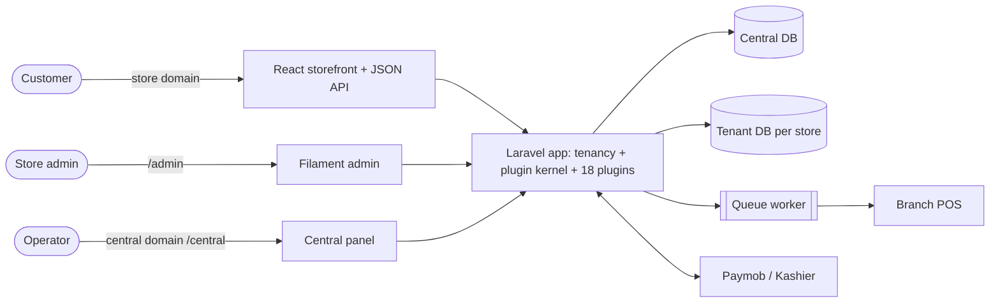

# Turbo Tenant handbook

Turbo Tenant is a multi-tenant online ordering platform for restaurants. One Laravel 12 application serves many stores, each with its own domain and database (stancl/tenancy), a React storefront, an Arabic Filament admin panel, and a plugin marketplace from which the store switches on capabilities such as cart, checkout, online payments, coupons, POS integration and push notifications.

## Start here

| I want to... | Read |
| --- | --- |
| Understand what the product does and its vocabulary | [Overview](overview.md) |
| Run it on my machine | [Getting started](getting-started.md) |
| Understand how it is built | [Architecture](architecture.md), [Data model](data-model.md) |
| Find or change a feature | [Feature catalog](features/README.md) |
| Call or integrate with it | [Interfaces](interfaces.md), [Configuration](configuration.md) |
| Add code, run tests, follow conventions | [Development guide](development.md) |
| Release it | [Deployment](deployment.md) |
| Keep it running / fix incidents | [Operations and troubleshooting](operations.md) |
| See what changed | [Changelog](../CHANGELOG.md) |
| Know what is not yet documented or verified | [Coverage](coverage.md) |

## Reading paths

- **New developer (day 1):** [Overview](overview.md) → [Getting started](getting-started.md) → [Architecture](architecture.md) → [Checkout and orders](features/checkout-and-orders.md) end to end → [Development guide](development.md).
- **Operator / on-call:** [Deployment](deployment.md) → [Operations](operations.md) → [Configuration](configuration.md) → [POS integration](features/pos-integration.md) and [Payments](features/payments.md) troubleshooting.
- **Product / support:** [Overview](overview.md) → [Feature catalog](features/README.md) → the "How to use" section of each feature.

## System at a glance

A request's host selects the store; the store's database, cache tag and files become active; only the plugins active for that store answer. Orders flow from cart through a plugin-extended validation and pricing pipeline, to payment, to the branch POS, and back as status updates.

## More references

- [Generated architecture explorer](engineering-atlas/index.html): offline inventory of classes, routes, schema declarations and SPA routes with diagrams.
- Design notes and plans (may describe earlier or planned states): [SaaS lifecycle engine](architecture/saas-lifecycle-engine.md), [plugin configuration pattern](architecture/plugin-configuration-pattern.md), [guest ordering plan](GUEST_ORDERING_PLAN.md), [Kashier gateway](kashier-payment-gateway.md), [Meta Pixel and CAPI plan](META_PIXEL_AND_CAPI_PLAN.md), [custom pages guide](CUSTOM_PAGES_GUIDE.md), [storefront performance](storefront-performance.md), [theme test ids](THEME_TEST_IDS_SPEC.md), [POS delivery monitor design](order-pos-delivery-monitor.md).
- POS API contract: [CREATE_ORDER_API_DOC.md](../CREATE_ORDER_API_DOC.md).

---
Reviewed against `d064a36` plus uncommitted working-tree changes on 2026-11-06. See [coverage](coverage.md) for what was verified and what was not.
