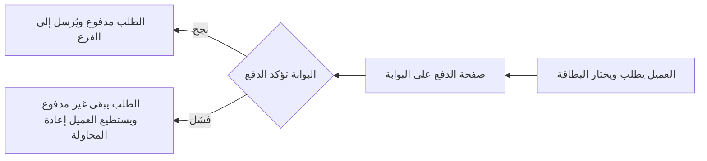

# الدفع الإلكتروني

الشاشة: إعدادات المتجر › المالية وبوابات الدفع (تحتاج إضافة **Payment Processing & Gateways**).

## الدفع عند الاستلام

متاح دائماً. يمكنك إضافة **رسوم الدفع عند الاستلام (COD)** التي تُضاف إلى إجمالي الطلب. يُرسل الطلب إلى الفرع فوراً، وعندما يصبح «مكتمل» يُعلَّم **مدفوعاً** تلقائياً.

## تفعيل الدفع بالبطاقة والمحفظة

1. فعّل **تفعيل الدفع الإلكتروني عبر البطاقات البنكية والمحافظ**.
2. اختر **بوابة الدفع المفعلة**: Paymob أو Kashier.
3. املأ بيانات البوابة (من حسابك على البوابة):
   - **Paymob**: الرابط الأساسي (`https://accept.paymob.com`)، والمفتاح العام، والمفتاح السري، ومعرفات الدمج (مفصولة بفواصل)، ومفتاح HMAC السري، والعملة، ووضع التشغيل (`test` للتجربة، و`live` للتشغيل الفعلي).
   - **Kashier**: معرف التاجر، ومفتاح API العام، والمفتاح السري، ووضع التشغيل، والعملة، و**طرق الدفع المسموحة**.
4. في لوحة البوابة نفسها، ضع رابط الإشعارات (Callback / Webhook):
   - Paymob: `https://<دومين متجرك>/api/webhooks/paymob`
   - Kashier: `https://<دومين متجرك>/api/webhooks/kashier`
5. جرّب بوضع `test` وبطاقة تجريبية، ثم حوّل إلى `live`.

## كيف يسير الطلب المدفوع إلكترونياً

- يُسجَّل الطلب **قبل** الدفع بحالة «قيد الانتظار» ودفع «قيد الانتظار».
- **لا يُرسل الطلب إلى الكاشير إلا بعد تأكيد الدفع** من البوابة.
- إذا أغلق العميل صفحة الدفع يبقى الطلب غير مدفوع.
- بعد الدفع يأخذ زر **عرض الطلب** العميلَ الزائر (بدون حساب) مباشرة إلى صفحة تتبع طلبه، دون أن يُطلب منه تسجيل الدخول.

::: danger لا تغيّر حالة الدفع يدوياً
إذا دفع العميل وبقي الطلب «قيد الانتظار»، فغالباً رابط الإشعارات في لوحة البوابة غير صحيح أو مفتاح HMAC غير مطابق. أصلح الإعداد واطلب من البوابة إعادة إرسال الإشعار. تغيير الحالة يدوياً لا يرسل الطلب إلى الفرع.
:::
