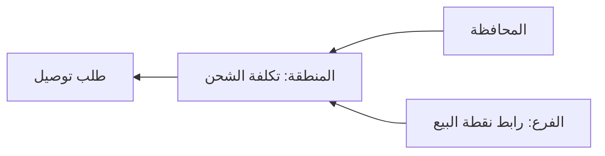

# الفروع والمحافظات والمناطق

الشاشات تحت التوصيل والمناطق. الترتيب: **الفروع** ← **المحافظات** ← **المناطق**.

## الفروع

| الحقل | ملاحظات |
| --- | --- |
| الاسم | اللي العميل بيختاره عند الطلب |
| الرابط | رابط نقطة البيع (الكاشير) في الفرع، مثلاً `https://branch1.example.com`. مطلوب للربط مع نقطة البيع فقط |
| مفتاح API لنقطة البيع | يظهر لو إضافة نقطة البيع مفعلة. [التفاصيل](pos.md) |
| نشط | الفرع المقفول مش بيظهر للعملاء |

## المحافظات

الاسم بالإنجليزي والعربي، ترتيب العرض، و**نشطة للتوصيل**.

## المناطق

| الحقل | ملاحظات |
| --- | --- |
| المحافظة | |
| الفرع | الفرع اللي بيخدم المنطقة |
| الاسم (إنجليزي) / الاسم (عربي) | الاسم العربي هو اللي بيوصل للكاشير في العنوان |
| تكلفة الشحن | رسوم التوصيل اللي بتتضاف على الطلب |
| ترتيب العرض، نشط | |

## قواعد مهمة

- العميل بيشوف بس المناطق النشطة في محافظات نشطة.
- رسوم التوصيل = تكلفة شحن المنطقة. طلبات **الاستلام من الفرع** ملهاش رسوم توصيل. كوبون الشحن المجاني بيلغيها.
- **العناوين** (في نفس المجموعة) بتعرض عناوين العملاء المحفوظة.
