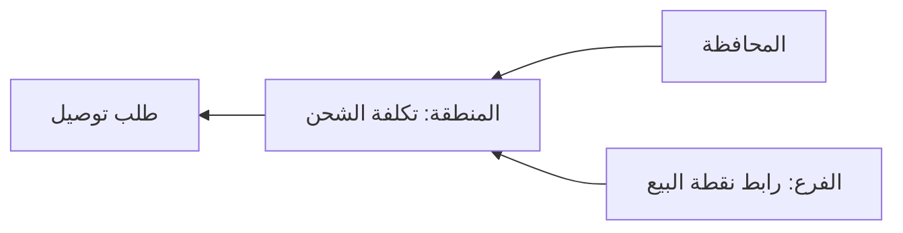

# الفروع والمحافظات والمناطق

الشاشات تحت التوصيل والمناطق. الترتيب: **الفروع** ← **المحافظات** ← **المناطق**.

## الفروع

| الحقل | ملاحظات |
| --- | --- |
| الاسم | ما يختاره العميل عند الطلب |
| الرابط | رابط نقطة البيع (الكاشير) في الفرع، مثل `https://branch1.example.com`. مطلوب للربط مع نقطة البيع فقط |
| مفتاح API لنقطة البيع | يظهر إذا كانت إضافة نقطة البيع مفعلة. [التفاصيل](pos.md) |
| نشط | الفرع المغلق لا يظهر للعملاء |

إذا كان للمتجر فرع نشط واحد، تخفي صفحة إتمام الطلب اختيار الفرع وتختاره تلقائياً. وعند اختيار منطقة التوصيل يُختار الفرع الذي يخدمها تلقائياً.

## المحافظات

الاسم بالإنجليزية والعربية، وترتيب العرض، و**نشطة للتوصيل**.

## المناطق

| الحقل | ملاحظات |
| --- | --- |
| المحافظة | |
| الفرع | الفرع الذي يخدم المنطقة |
| الاسم (إنجليزي) / الاسم (عربي) | الاسم العربي هو الذي يصل إلى الكاشير في العنوان |
| تكلفة الشحن | رسوم التوصيل التي تُضاف إلى الطلب |
| ترتيب العرض، نشط | |

## قواعد مهمة

- يرى العميل المناطق النشطة في المحافظات النشطة فقط، وتظهر بجانب كل منطقة رسوم شحنها.
- رسوم التوصيل = تكلفة شحن المنطقة. طلبات **الاستلام من الفرع** ليس عليها رسوم توصيل.
- يصبح التوصيل مجانياً تلقائياً إذا وصلت قيمة المنتجات بعد الخصم إلى **الحد الأدنى للشحن المجاني** في [إعدادات المتجر › الطلبات](store-settings.md#الطلبات)، أو إذا استخدم العميل كوبون شحن مجاني.
- إذا كان **نموذج العنوان المبسّط** مفعلاً، يكتب العميل عنوانه في حقل واحد بعد اختيار المحافظة أو المنطقة.
- **العناوين** (في المجموعة نفسها) تعرض عناوين العملاء المحفوظة.
