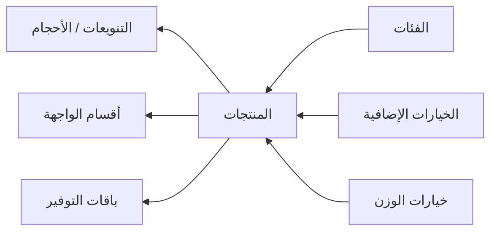

# الفئات والمنتجات

كل شاشات المنيو تحت الكتالوج والمنتجات. الترتيب المقترح: **الفئات** ← **خيارات إضافية** و**خيارات الوزن** ← **المنتجات** ← **أقسام الواجهة**.

## الفئات

الكتالوج والمنتجات › الفئات: الاسم بالإنجليزي والعربي، الوصف، الصورة، **ترتيب العرض** (الأقل يظهر الأول)، و**نشط**.

## إضافة منتج

الكتالوج والمنتجات › المنتجات › إنشاء. النموذج فيه 3 تبويبات:

### البيانات الأساسية

| الحقل | ملاحظات |
| --- | --- |
| الاسم (إنجليزي) / الاسم بالعربية | الاسم العربي هو اللي بيوصل للكاشير في ملاحظات الطلب |
| الفئة | |
| متاح للطلب (نشط) | لو مقفول المنتج بيختفي من الموقع |
| الوصف | |
| صورة المنتج | يفضّل صورة مربعة 800×800 بكسل على الأقل. الصورة بتتضغط تلقائياً |

### التسعير والتنويعات

- **السعر الأساسي**.
- **السعر بعد الخصم**: سيبه فاضي لو مفيش خصم. لو مكتوب، العميل بيشوف السعر القديم مشطوب، والمنتج بيظهر في "العروض".
- **بيع المنتج بالوزن**: شغّله لو المنتج بيتباع بالكيلو، والسعر هنا يبقى سعر الكيلو. [البيع بالوزن](weight-options.md).
- **التنويعات** (الأحجام) بتضيفها بعد حفظ المنتج من جدول التنويعات أسفل الصفحة. [التنويعات](variants.md).

### الخيارات الإضافية والأوزان

- **مجموعة الإضافات**: اختار مجموعة (مثلاً "الصوصات").
- **الحد الأدنى للاختيارات / الحد الأقصى للاختيارات / السماح باختيار أكثر من خيار**: سيبهم فاضيين عشان تستخدم قواعد المجموعة نفسها، أو اكتب قيم خاصة بالمنتج ده.
- **قالب أوزان المنتج**: للمنتجات اللي بتتباع بالوزن.

لو إضافة نقطة البيع مفعلة، هيظهر قسم **ربط نقطة البيع (POS)** لربط المنتج بصنف الكاشير. [الربط مع نقطة البيع](pos.md#ربط-المنتجات-بأصناف-الكاشير).

## إجراءات جماعية على المنتجات

حدد كذا منتج من الجدول، واختار:

- **تفعيل المحدد / إلغاء تفعيل المحدد**
- **تفعيل البيع بالوزن / إلغاء البيع بالوزن**
- **تغيير الفئة**
- **تطبيق خيار إضافي** (مجموعة إضافات لكل المحدد)
- **تطبيق خيار الوزن**
- **إضافة متغيرات سريعة** (نفس الأحجام لكل المحدد)

::: tip
المنتج اللي داخل في باقة توفير مينفعش يتحذف. اللوحة هتوريك الباقات اللي فيها المنتج عشان تشيله منها الأول، أو أوقف المنتج بدل ما تحذفه.
:::

## إزاي العميل بيشوف المنيو

- الصفحة الرئيسية: السلايدر، أقسام الواجهة، والفئات.
- صفحة **المنيو**: كل المنتجات النشطة مع بحث (اقتراحات بعد حرفين)، فلتر بالفئة، نطاق السعر، والترتيب.
- صفحة المنتج: الأحجام المتاحة، الإضافات بحدودها، الأوزان، منتجات من نفس الفئة، وباقات فيها المنتج ("اجعلها وجبة").
- السعر الظاهر = السعر بعد الخصم لو موجود وإلا السعر الأساسي، ولو اختار حجم بياخد سعر الحجم.
