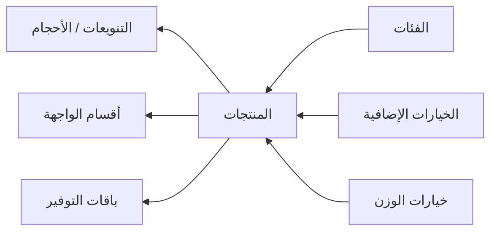

# الفئات والمنتجات

كل شاشات المنيو تحت الكتالوج والمنتجات. الترتيب المقترح: **الفئات** ← **خيارات إضافية** و**خيارات الوزن** ← **المنتجات** ← **أقسام الواجهة**.

## الفئات

الكتالوج والمنتجات › الفئات: الاسم بالإنجليزية والعربية، والوصف، والصورة، و**ترتيب العرض** (الأقل يظهر أولاً)، و**نشط**.

## إضافة منتج

الكتالوج والمنتجات › المنتجات › إنشاء. في النموذج 3 تبويبات:

### البيانات الأساسية

| الحقل | ملاحظات |
| --- | --- |
| الاسم (إنجليزي) / الاسم بالعربية | الاسم العربي هو الذي يصل إلى الكاشير في ملاحظات الطلب |
| الفئة | |
| متاح للطلب (نشط) | إذا أُغلق يختفي المنتج من الموقع |
| الوصف | |
| صورة المنتج | يُفضَّل أن تكون مربعة بمقاس 800×800 بكسل على الأقل. تُضغط الصورة تلقائياً |

### التسعير والتنويعات

- **السعر الأساسي**.
- **السعر بعد الخصم**: اتركه فارغاً إذا لم يكن هناك خصم. إذا كُتب، يرى العميل السعر القديم مشطوباً، ويظهر المنتج في «العروض».
- **بيع المنتج بالوزن**: شغّله إذا كان المنتج يُباع بالكيلو، ويكون السعر هنا سعر الكيلو. [البيع بالوزن](weight-options.md).
- **التنويعات** (الأحجام) تضيفها بعد حفظ المنتج من جدول التنويعات أسفل الصفحة. [التنويعات](variants.md).

### الخيارات الإضافية والأوزان

- **مجموعة الإضافات**: اختر مجموعة (مثل «الصوصات»).
- **الحد الأدنى للاختيارات / الحد الأقصى للاختيارات / السماح باختيار أكثر من خيار**: اتركها فارغة لاستخدام قواعد المجموعة نفسها، أو اكتب قيماً خاصة بهذا المنتج.
- **قالب أوزان المنتج**: للمنتجات التي تُباع بالوزن.

إذا كانت إضافة نقطة البيع مفعلة، يظهر قسم **ربط نقطة البيع (POS)** لربط المنتج بصنف الكاشير. [الربط مع نقطة البيع](pos.md#ربط-المنتجات-بأصناف-الكاشير).

## إجراءات جماعية على المنتجات

حدد عدة منتجات من الجدول، ثم اختر:

- **تفعيل المحدد / إلغاء تفعيل المحدد**
- **تفعيل البيع بالوزن / إلغاء البيع بالوزن**
- **تغيير الفئة**
- **تطبيق خيار إضافي** (مجموعة إضافات لكل المحدد)
- **تطبيق خيار الوزن**
- **إضافة متغيرات سريعة** (الأحجام نفسها لكل المحدد)

::: tip
لا يمكن حذف منتج داخل في باقة توفير. تعرض لك اللوحة الباقات التي تحتوي المنتج لتزيله منها أولاً، أو أوقف المنتج بدلاً من حذفه.
:::

## كيف يرى العميل المنيو

- الصفحة الرئيسية: السلايدر، وأقسام الواجهة، والفئات.
- صفحة **المنيو**: كل المنتجات النشطة مع بحث (اقتراحات بعد حرفين)، وتصفية بالفئة، ونطاق السعر، والترتيب.
- صفحة المنتج: الأحجام المتاحة، والإضافات بحدودها، والأوزان، ومنتجات من الفئة نفسها، والباقات التي تحتوي المنتج («اجعلها وجبة»). على الهاتف يبقى زر الإضافة إلى السلة ثابتاً أسفل الشاشة.
- السعر الظاهر = السعر بعد الخصم إن وُجد وإلا السعر الأساسي، وإذا اختار العميل حجماً يأخذ سعر الحجم.
