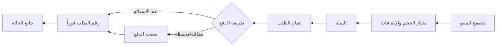

# تجربة العميل على الموقع

عشان تعرف تساعد عملاءك، دي الخطوات اللي العميل بيمشيها من أول ما يفتح الموقع لحد ما الطلب يوصله.

## 1. التصفح والسلة

- يشوف الرئيسية والمنيو، يبحث، ويفلتر بالفئة والسعر.
- في صفحة المنتج يختار الحجم، الإضافات (بالحد الأدنى والأقصى)، الوزن، والكمية، ثم **Add to Cart**.
- السلة محفوظة حتى لو مش مسجل دخول.

## 2. إتمام الطلب

1. يضغط **Proceed to Checkout**. لو الطلب بدون حساب مقفول، هيطلب منه يسجل دخول.
2. يختار **Delivery** (توصيل) أو **Takeaway** (استلام من الفرع).
3. يختار **الفرع**، ولو توصيل يختار عنوان محفوظ أو يضيف عنوان (المنطقة، الموبايل، الشارع، العمارة، الدور، الشقة). رسوم المنطقة بتتضاف.
4. يكتب كوبون (اختياري) وملاحظة.
5. يختار الدفع: **Cash on Delivery** أو بطاقة/محفظة لو مفعلة.
6. **Place Order**: بيظهر رقم الطلب `ORD-XXXXXXXX`.

## رسائل ممكن تظهر للعميل

| الرسالة | السبب | الحل |
| --- | --- | --- |
| Cart is empty | السلة فاضية | |
| The selected branch is inactive or unavailable. | الفرع اتقفل | يختار فرع تاني |
| Some products are unavailable | منتج اتوقف بعد ما اتحط في السلة | يشيله من السلة |
| The minimum order amount is X. | أقل من الحد الأدنى للطلب | يزود الطلب |
| We are currently closed. | خارج ساعات العمل | راجع ساعات العمل (بتوقيت UTC) |
| Guest checkout is not permitted | الطلب بدون حساب مقفول | يسجل دخول |

## 3. متابعة الطلب

- العميل المسجل: صفحة **My Orders** بتعرض كل طلباته وحالتها وحالة الدفع.
- الزائر: صفحة **Track Order** برقم الطلب والموبايل.
- الحالة بتتحدث لوحدها لما الفرع يحرّك الطلب على الكاشير، ولو عنده التطبيق بيوصله إشعار.
