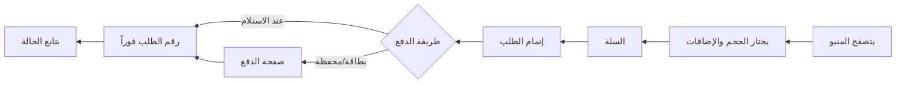

# تجربة العميل على الموقع

لتتمكن من مساعدة عملائك، هذه هي الخطوات التي يمر بها العميل من فتح الموقع حتى وصول الطلب إليه.

## 1. التصفح والسلة

- يتصفح الصفحة الرئيسية والمنيو، ويبحث، ويصفّي بالفئة والسعر.
- في صفحة المنتج يختار الحجم، والإضافات (بالحد الأدنى والأقصى)، والوزن، والكمية، ثم **Add to Cart**. على الهاتف يبقى زر الإضافة ثابتاً أسفل الشاشة.
- تبقى السلة محفوظة حتى لو لم يسجّل الدخول.
- إذا كان الشحن المجاني التلقائي مفعلاً، يرى العميل في السلة شريطاً يوضح المبلغ الباقي للحصول على التوصيل المجاني.
- إذا كان رقم واتساب مضبوطاً في إعدادات المتجر، يظهر زر واتساب عائم للتواصل السريع.

## 2. إتمام الطلب

1. يضغط **Proceed to Checkout**. إذا كان الطلب بدون حساب مغلقاً، يُطلب منه تسجيل الدخول.
2. يختار **Delivery** (توصيل) أو **Takeaway** (استلام من الفرع).
3. يختار **الفرع** (يُختار تلقائياً إذا كان للمتجر فرع نشط واحد)، وفي التوصيل يختار عنواناً محفوظاً أو يضيف عنواناً (المنطقة، والهاتف، والشارع، والعمارة، والدور، والشقة، أو حقلاً واحداً للعنوان بالتفصيل إذا كان النموذج المبسّط مفعلاً). تُضاف رسوم المنطقة، إلا إذا تحقق الشحن المجاني.
4. يكتب كوبوناً (اختياري) وملاحظة.
5. يختار الدفع: **Cash on Delivery** أو بطاقة / محفظة إن كانت مفعلة.
6. **Place Order**: يظهر رقم الطلب `ORD-XXXXXXXX`.

## رسائل قد تظهر للعميل

| الرسالة | السبب | الحل |
| --- | --- | --- |
| Cart is empty | السلة فارغة | |
| The selected branch is inactive or unavailable. | أُغلق الفرع | يختار فرعاً آخر |
| Some products are unavailable | أُوقف منتج بعد وضعه في السلة | يزيله من السلة |
| The minimum order amount is X. | الطلب أقل من الحد الأدنى | يزيد الطلب |
| We are currently closed. | خارج ساعات العمل | راجع ساعات العمل (بتوقيت UTC) |
| Guest checkout is not permitted | الطلب بدون حساب مغلق | يسجّل الدخول |

## 3. متابعة الطلب

- العميل المسجّل: صفحة **My Orders** تعرض كل طلباته وحالتها وحالة الدفع.
- الزائر: صفحة **Track Order** برقم الطلب والهاتف. وبعد الدفع الإلكتروني يأخذه زر **عرض الطلب** إلى صفحة التتبع مباشرة.
- تُحدَّث الحالة تلقائياً عندما يحرّك الفرع الطلب على الكاشير، وإذا كان لدى العميل التطبيق يصله إشعار.
