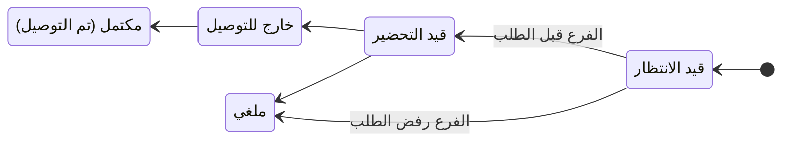

# إدارة الطلبات

الشاشة: إدارة المبيعات › الطلبات.

## قائمة الطلبات

- تبويبات حسب الحالة: **الكل**، **قيد الانتظار**، **قيد التحضير**، **خارج للتوصيل**، **مكتمل**، **ملغي**، و**فشل الإرسال لنقطة البيع** (لو الربط مفعل).
- الجدول بيعرض رقم الطلب (`ORD-XXXXXXXX`)، العميل، الإجمالي، الحالة، حالة الدفع، وحالة الإرسال لنقطة البيع، مع فلاتر (منها فلتر الطلبات المتأخرة في الإرسال).

## تفاصيل الطلب

افتح الطلب تشوف: بيانات العميل، العنوان كما كان وقت الطلب، الفرع، الكوبون، المنتجات بأحجامها وإضافاتها ومكونات الباقات، الإجماليات، وسجل تغيير الحالة (مين غيّرها: نقطة البيع أو مدير).

**الإجمالي** = المنتجات − خصم الكوبون + الضريبة + رسوم الدفع عند الاستلام + رسوم التوصيل.

## دورة حياة الطلب

- الطبيعي إن **الكاشير في الفرع** هو اللي بيحرك الحالة، والموقع بيتحدث تلقائياً والعميل بيشوفها في صفحة طلباته.
- الحالة بتمشي للأمام بس وبالترتيب. مثلاً مينفعش طلب يروح من «قيد التحضير» لـ «مكتمل» مباشرة، لازم يعدي على «خارج للتوصيل».
- **طلبات الدفع عند الاستلام**: لما الطلب يبقى «مكتمل»، حالة الدفع بتتحول تلقائياً لـ «مكتمل (مدفوع)». (الميزة دي في تحديث قيد المراجعة؛ قبل دمجه حالة الدفع بتفضل «قيد الانتظار».)
- **الطلبات أونلاين** (بطاقة/محفظة): حالة الدفع بتتحدث من بوابة الدفع. [الدفع الإلكتروني](payments.md).

## تغيير الحالة من اللوحة

لو مفيش نقطة بيع في الفرع، أو محتاج تصلّح حالة: فعّل **السماح بالتعديل اليدوي لحالة الطلبات من لوحة الإدارة** في إعدادات المتجر › الطلبات. بعدها هيظهر في الطلب زر **تحديث حالة الطلب (يدوي)**: اختار **الحالة الجديدة** واكتب **سبب التعديل اليدوي**. التعديل بيتسجل في سجل الطلب باسمك.

## متابعة الإرسال لنقطة البيع

لو الربط مع نقطة البيع مفعل، كل طلب ليه **حالة إرسال**:

| الحالة | معناها | تعمل إيه |
| --- | --- | --- |
| غير جاهز | الطلب لسه متبعتش للفرع، غالباً طلب أونلاين مستني تأكيد الدفع | استنى تأكيد الدفع، أو اضغط **إرسال لنقطة البيع** لو الطلب كاش |
| في قائمة الإرسال / جارِ الإرسال | الطلب في الطريق للفرع | لو فضل أكتر من 5 دقايق، كلّم الدعم الفني (غالباً الـ worker واقف) |
| بانتظار إعادة المحاولة | الفرع مش متاح دلوقتي | الموقع بيعيد المحاولة تلقائياً (لحد 5 مرات) |
| تم الإرسال | الطلب وصل للكاشير | — |
| فشل الإرسال | الفرع رفض أو المحاولات خلصت | شوف **سبب الفشل**، صلّح السبب، واضغط **إعادة الإرسال لنقطة البيع** |
| تحتاج مراجعة مع الفرع | مش متأكدين الطلب وصل ولا لأ | **كلّم الفرع الأول**، ثم **تسجيل نتيجة التحقق مع الفرع** |

التفاصيل الكاملة في [الربط مع نقطة البيع](pos.md#متابعة-الطلبات-المرسلة).

## رمز التكامل

زر **رمز التكامل** أعلى قائمة الطلبات بيولّد كلمة السر اللي الكاشير بيستخدمها لتحديث حالات الطلبات. [إزاي تستخدمه](pos.md#الخطوة-3-رمز-التكامل).
