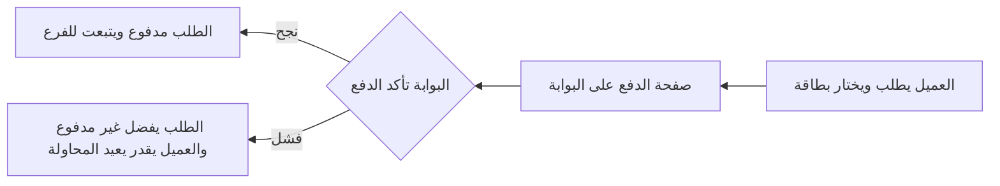

# الدفع الإلكتروني

الشاشة: إعدادات المتجر › المالية وبوابات الدفع (تحتاج إضافة **Payment Processing & Gateways**).

## الدفع عند الاستلام

متاح دايماً. ممكن تضيف **رسوم الدفع عند الاستلام (COD)** بتتضاف على إجمالي الطلب. الطلب بيتبعت للفرع فوراً، ولما يبقى «مكتمل» بيتعلّم **مدفوع** تلقائياً.

## تفعيل الدفع بالبطاقة والمحفظة

1. فعّل **تفعيل الدفع الإلكتروني عبر البطاقات البنكية والمحافظ**.
2. اختار **بوابة الدفع المفعلة**: Paymob أو Kashier.
3. املأ بيانات البوابة (من حسابك على البوابة):
   - **Paymob**: الرابط الأساسي (`https://accept.paymob.com`)، المفتاح العام، المفتاح السري، معرفات الدمج (مفصولة بفواصل)، مفتاح HMAC السري، العملة، ووضع التشغيل (`test` للتجربة، `live` للحقيقي).
   - **Kashier**: معرف التاجر، مفتاح API العام، المفتاح السري، وضع التشغيل، العملة، و**طرق الدفع المسموحة**.
4. في لوحة البوابة نفسها، حط رابط الإشعارات (Callback / Webhook):
   - Paymob: `https://<دومين متجرك>/api/webhooks/paymob`
   - Kashier: `https://<دومين متجرك>/api/webhooks/kashier`
5. جرّب بوضع `test` وبطاقة تجريبية، وبعدين حوّل لـ `live`.

## الطلب الأونلاين بيمشي إزاي

- الطلب بيتسجل **قبل** الدفع بحالة «قيد الانتظار» ودفع «قيد الانتظار».
- **الطلب مش بيتبعت للكاشير غير بعد تأكيد الدفع** من البوابة.
- لو العميل قفل صفحة الدفع، الطلب بيفضل غير مدفوع.

::: danger متغيرش حالة الدفع بإيدك
لو العميل دفع والطلب لسه «قيد الانتظار»، غالباً رابط الإشعارات في لوحة البوابة غلط أو مفتاح HMAC مش مطابق. صلّح الإعداد واطلب من البوابة تعيد إرسال الإشعار. تغيير الحالة يدوياً مش بيبعت الطلب للفرع.
:::
