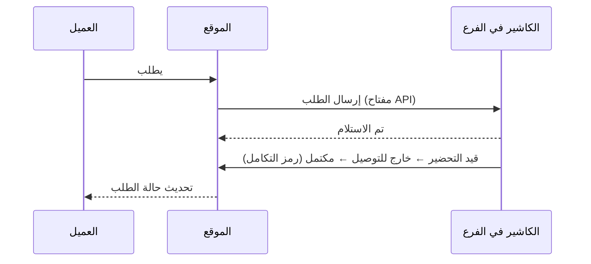

# الربط مع نقطة البيع (POS)

عندما يعمل الربط، فإن الطلب الذي ينشئه العميل على الموقع يصل **تلقائياً إلى الكاشير في الفرع**، وعندما يقبل الفرع الطلب أو يخرجه للتوصيل أو ينهيه **تُحدَّث الحالة على الموقع** ويراها العميل.

::: info المتطلبات
- إضافة **Point of Sale (POS) Integration** مفعلة من [سوق الإضافات](plugins.md).
- نقطة بيع في كل فرع لها رابط على الإنترنت (https).
- صلاحية مدير على نقطة البيع (لفتح الإعدادات).
:::

## مفتاحان، واحد لكل اتجاه

| | من الموقع إلى الكاشير | من الكاشير إلى الموقع |
| --- | --- | --- |
| الاسم | **مفتاح API** | **رمز التكامل** |
| أين يُولَّد | على نقطة البيع | على الموقع |
| أين يُوضع | على الموقع (في كل فرع) | على نقطة البيع |
| يُستخدم في | إرسال الطلبات واستيراد المنتجات | تحديث حالة الطلب |

## الخطوة 1: مفتاح API

يُولَّد على نقطة البيع ويوضع على الموقع.

1. على **نقطة البيع الرئيسية**: الإعدادات › إدارة الفروع › مفتاح الربط (API)، اضغط **توليد مفتاح** في خانة «مفتاح API للموقع والفروع»، وانسخه. (إذا كانت لديك فروع تابعة، فيجب أن تستخدم كلها المفتاح نفسه.)
2. على **الموقع**: التوصيل والمناطق › الفروع ← افتح الفرع.
3. اكتب **الرابط**: رابط نقطة البيع في الفرع، مثل `https://branch1.example.com`.
4. الصق المفتاح في **مفتاح API لنقطة البيع**، واحفظ. كرر ذلك لكل فرع.
5. على **الموقع**: إعدادات المتجر › نظام نقاط البيع (POS) ← **رابط مستودع المنتجات الرئيسي** (رابط نقطة البيع الرئيسية) و**مفتاح API لمستودع المنتجات الرئيسي** (المفتاح نفسه).

## الخطوة 2: المنتجات

يجب أن يكون كل منتج على الموقع مربوطاً بصنف على الكاشير، وإلا **فلن يُرسل** الطلب، وستظهر حالة «فشل الإرسال» بسبب منتج غير مربوط.

### استيراد المنتجات من نقطة البيع

الكتالوج والمنتجات › استيراد منتجات POS:

1. **تحديث القائمة**: يجلب أصناف نقطة البيع (الفئة، والاسم، ورقم المرجع، والنوع).
2. حدد الأصناف ← **استيراد المحدد** (أو **استيراد الكل**). تكون المنتجات المستوردة مربوطة تلقائياً.
3. بعد الاستيراد أكمل بيانات المنتج على الموقع: الصورة، والوصف، والأحجام، والإضافات.

### مزامنة الأسعار

الكتالوج والمنتجات › مزامنة الأسعار: تقارن **السعر الحالي** على الموقع بـ **السعر الجديد** على الكاشير (والسعر بعد الخصم). حدد ← **مزامنة المحدد** أو **مزامنة الكل**.

### ربط المنتجات بأصناف الكاشير

إذا كان المنتج موجوداً على الموقع من قبل: افتح المنتج ← قسم **ربط نقطة البيع (POS)** ← واختر لكل ربط:

- **الفرع (اختياري)**: اتركه فارغاً ليشمل كل الفروع.
- **التنويع (اختياري)**: إذا كان لكل حجم صنف مختلف على الكاشير.
- **عنصر الإضافة (اختياري)**: إذا كان للإضافة صنف على الكاشير (ستصل سطراً مستقلاً).
- **POS Item ID**: رقم الصنف على الكاشير.

للباقات ربط مشابه في تبويب **تكاملات** داخل الباقة.

## الخطوة 3: رمز التكامل

يُولَّد على الموقع ويوضع على نقطة البيع.

1. على **الموقع**: إدارة المبيعات › الطلبات ← زر **رمز التكامل** أعلى الصفحة ← توليد. **انسخه فوراً**، لأنه يظهر مرة واحدة فقط.
2. على **نقطة البيع**: الإعدادات › إدارة الفروع › مفتاح الربط (API) ← الصقه في «رمز التكامل من الموقع».
3. على **نقطة البيع**: الإعدادات › الإعدادات العامة ← «رابط الموقع» = رابط متجرك، مثل `https://shop.example.com`.

::: warning توليد رمز جديد
توليد رمز جديد يلغي القديم فوراً. يجب وضع الرمز الجديد على نقطة البيع، وإلا فلن تُحدَّث الحالات على الموقع.
:::

## الخطوة 4: التجربة

1. أنشئ طلب «دفع عند الاستلام» من الموقع.
2. يظهر الطلب على الكاشير في الفرع خلال ثوانٍ.
3. اقبل الطلب على الكاشير ← يصبح على الموقع «قيد التحضير».
4. أكمل حتى «مكتمل» ← يصبح الطلب مكتملاً على الموقع.

## كيف يظهر الطلب على الكاشير

- كل منتج سطر بالاسم المربوط. في المنتجات بالوزن تكون الكمية هي الوزن بالكيلو.
- الإضافة المربوطة بصنف تصل سطراً مستقلاً بملاحظة «إضافة على: اسم المنتج». أما الإضافة غير المربوطة، والحجم والوزن، فتُكتب في ملاحظات المنتج بالعربية.
- العنوان بالعربية: المنطقة، والمحافظة، والشارع، والعمارة، والدور، والشقة.
- تصل رسوم التوصيل في خانة الخدمة.
- إذا أرسل الموقع الطلب نفسه مرتين (مثلاً عند انقطاع الإنترنت)، فإن الكاشير **لا يكرره**: يرد بأنه استلمه من قبل، ويعلّم الموقع الطلب «تم الإرسال».
- يطبّق الكاشير على الطلب صلاحياته المعتادة؛ فمثلاً لا يستطيع الكاشير إضافة خصم على طلب الموقع إلا بصلاحية الخصم.

## متابعة الطلبات المرسلة

افتح الطلب ← لوحة **متابعة الإرسال لنقطة البيع**: حالة الإرسال، وعدد المحاولات والفاشل منها، ووقت آخر محاولة والمحاولة التالية، و**آخر سبب فشل مسجل**، وجدول **سجل محاولات الإرسال والمراجعات**.

| الحالة | ماذا تفعل |
| --- | --- |
| فشل الإرسال: منتج غير مربوط | اربط المنتج أو الحجم أو الإضافة بهذا الفرع، ثم **إعادة الإرسال لنقطة البيع** |
| فشل الإرسال: 401 | مفتاح API في الفرع غير صحيح. انسخه من نقطة البيع مرة أخرى |
| فشل الإرسال: «رقم الطلب مستخدم في الفرع لطلب مختلف» | يوجد على الكاشير طلب آخر بالرقم نفسه. راجع الكاشير، ولا تعِد الإرسال إلا إذا تأكدت أن الطلب غير موجود |
| بانتظار إعادة المحاولة | الفرع غير متاح (الإنترنت أو الوردية مغلقة). سيعيد الموقع المحاولة تلقائياً |
| تحتاج مراجعة مع الفرع | **تواصل مع الفرع واسأل**: هل وصل الطلب؟ ثم **تسجيل نتيجة التحقق مع الفرع**: إذا وصل يُعلَّم «تم الإرسال»، وإذا لم يصل يُرسل مرة أخرى. اكتب في **تفاصيل التحقق مع الفرع** من أكّد ذلك |

::: danger لا تُعِد الإرسال قبل التأكد
في حالة «تحتاج مراجعة مع الفرع» قد يكون الطلب وصل فعلاً. إعادة الإرسال دون سؤال الفرع قد تنشئ طلباً مكرراً.
:::

لا يمكن الإرسال يدوياً في هذه الحالات: طلب ملغي أو مكتمل، أو طلب إلكتروني لم يُدفع بعد («بانتظار تأكيد سداد الطلب»)، أو طلب مسترد، أو طلب بدون فرع صحيح.

يعرض عنصر **الطلبات الفاشلة** في الصفحة الرئيسية للوحة الطلبات التي فشل إرسالها.

## مشكلات شائعة

| المشكلة | السبب | الحل |
| --- | --- | --- |
| الطلبات باقية «في قائمة الإرسال» | خدمة الطلبات في الخلفية (worker) متوقفة على الخادم | تواصل مع الدعم الفني |
| قبل الكاشير الطلب والموقع ما زال «قيد الانتظار» | رمز التكامل أو «رابط الموقع» غير صحيح على نقطة البيع | ولّد رمزاً جديداً وضعه على نقطة البيع |
| صفحة الاستيراد فارغة | رابط المستودع الرئيسي أو مفتاحه غير صحيح | إعدادات المتجر › نظام نقاط البيع (POS) |
| تغيرت الحالة على الكاشير ثم عادت | رفض الموقع التحديث (مثلاً طلب توصيل انتقل من «قيد التحضير» إلى «مكتمل» مباشرة) | انقل الطلب عبر الحالات بالترتيب |

للفنيين: [Connecting a POS to the website](../pos-website-link.md).
