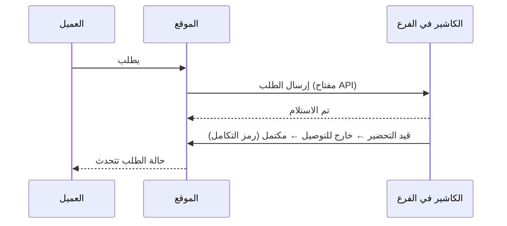

# الربط مع نقطة البيع (POS)

لما الربط يكون شغال: الطلب اللي العميل بيعمله على الموقع بينزل **تلقائياً على الكاشير في الفرع**، ولما الفرع يقبل الطلب أو يخرّجه للتوصيل أو يقفله، **الحالة بتتحدث على الموقع** والعميل بيشوفها.

::: info محتاج إيه
- إضافة **Point of Sale (POS) Integration** مفعلة من [سوق الإضافات](plugins.md).
- كل فرع عليه نقطة بيع ليها رابط على الإنترنت (https).
- صلاحية مدير على نقطة البيع (عشان تفتح الإعدادات).
:::

## مفتاحين، واحد لكل اتجاه

| | من الموقع للكاشير | من الكاشير للموقع |
| --- | --- | --- |
| الاسم | **مفتاح API** | **رمز التكامل** |
| بيتولّد فين | على نقطة البيع | على الموقع |
| بيتحط فين | على الموقع (في كل فرع) | على نقطة البيع |
| بيستخدم في | إرسال الطلبات واستيراد المنتجات | تحديث حالة الطلب |

## الخطوة 1: مفتاح API

بتولّده على نقطة البيع وتحطه على الموقع.

1. على **نقطة البيع الرئيسية**: الإعدادات › إدارة الفروع › مفتاح الربط (API)، اضغط **توليد مفتاح** في خانة «مفتاح API للموقع والفروع»، وانسخه. (لو عندك فروع تابعة، كلها لازم تستخدم نفس المفتاح.)
2. على **الموقع**: التوصيل والمناطق › الفروع ← افتح الفرع.
3. اكتب **الرابط**: رابط نقطة البيع في الفرع، مثلاً `https://branch1.example.com`.
4. الصق المفتاح في **مفتاح API لنقطة البيع**، واحفظ. كرر لكل فرع.
5. على **الموقع**: إعدادات المتجر › نظام نقاط البيع (POS) ← **رابط مستودع المنتجات الرئيسي** (رابط نقطة البيع الرئيسية) و**مفتاح API لمستودع المنتجات الرئيسي** (نفس المفتاح).

## الخطوة 2: المنتجات

كل منتج على الموقع لازم يكون مربوط بصنف على الكاشير، وإلا الطلب **مش هيتبعت** وهيظهر «فشل الإرسال» بسبب منتج غير مربوط.

### استيراد المنتجات من نقطة البيع

الكتالوج والمنتجات › استيراد منتجات POS:

1. **تحديث القائمة**: بيجيب أصناف نقطة البيع (الفئة، الاسم، رقم المرجع، النوع).
2. حدد الأصناف ← **استيراد المحدد** (أو **استيراد الكل**). المنتجات المستوردة بتكون مربوطة تلقائياً.
3. بعد الاستيراد كمّل بيانات المنتج على الموقع: الصورة، الوصف، الأحجام، الإضافات.

### مزامنة الأسعار

الكتالوج والمنتجات › مزامنة الأسعار: بتقارن **السعر الحالي** على الموقع بـ **السعر الجديد** على الكاشير (والسعر بعد الخصم). حدد ← **مزامنة المحدد** أو **مزامنة الكل**.

### ربط المنتجات بأصناف الكاشير

لو المنتج موجود على الموقع من قبل: افتح المنتج ← قسم **ربط نقطة البيع (POS)** ← لكل ربط اختار:

- **الفرع (اختياري)**: سيبه فاضي = كل الفروع.
- **التنويع (اختياري)**: لو كل حجم ليه صنف مختلف على الكاشير.
- **عنصر الإضافة (اختياري)**: لو الإضافة ليها صنف على الكاشير (هتنزل سطر مستقل).
- **POS Item ID**: رقم الصنف على الكاشير.

الباقات ليها ربط مشابه في تبويب **تكاملات** في الباقة.

## الخطوة 3: رمز التكامل

بتولّده على الموقع وتحطه على نقطة البيع.

1. على **الموقع**: إدارة المبيعات › الطلبات ← زر **رمز التكامل** أعلى الصفحة ← توليد. **انسخه فوراً**، لأنه بيظهر مرة واحدة بس.
2. على **نقطة البيع**: الإعدادات › إدارة الفروع › مفتاح الربط (API) ← الصقه في «رمز التكامل من الموقع».
3. على **نقطة البيع**: الإعدادات › الإعدادات العامة ← «رابط الموقع» = رابط متجرك، مثلاً `https://shop.example.com`.

::: warning توليد رمز جديد
توليد رمز جديد بيلغي القديم فوراً. لازم تحط الجديد على نقطة البيع، وإلا الحالات مش هتتحدث على الموقع.
:::

## الخطوة 4: جرّب

1. اعمل طلب "دفع عند الاستلام" من الموقع.
2. الطلب يظهر على الكاشير في الفرع خلال ثواني.
3. اقبل الطلب على الكاشير ← على الموقع يبقى «قيد التحضير».
4. كمّل لحد «مكتمل» ← الطلب يبقى مكتمل على الموقع.

## إزاي الطلب بيظهر على الكاشير

- كل منتج سطر، بالاسم المربوط. المنتجات بالوزن الكمية = الوزن بالكيلو.
- الإضافة المربوطة بصنف = سطر مستقل بملاحظة «إضافة على: اسم المنتج». الإضافة غير المربوطة، والحجم والوزن، بيتكتبوا في ملاحظات المنتج بالعربي.
- العنوان بالعربي: المنطقة، المحافظة، الشارع، عمارة، الدور، شقة.
- رسوم التوصيل بتنزل في خانة الخدمة.
- لو الموقع بعت نفس الطلب مرتين (مثلاً النت فصل)، الكاشير **مش بيكرره**: بيرد إنه استلمه قبل كده، والموقع بيعلّم الطلب «تم الإرسال».

## متابعة الطلبات المرسلة

افتح الطلب ← لوحة **متابعة الإرسال لنقطة البيع**: حالة الإرسال، عدد المحاولات والفاشلة، وقت آخر محاولة والتالية، **آخر سبب فشل مسجل**، وجدول **سجل محاولات الإرسال والمراجعات**.

| الحالة | تعمل إيه |
| --- | --- |
| فشل الإرسال: منتج غير مربوط | اربط المنتج/الحجم/الإضافة بالفرع ده، ثم **إعادة الإرسال لنقطة البيع** |
| فشل الإرسال: 401 | مفتاح API في الفرع غلط. انسخه من نقطة البيع تاني |
| فشل الإرسال: «رقم الطلب مستخدم في الفرع لطلب مختلف» | فيه طلب تاني على الكاشير بنفس الرقم. راجع الكاشير، وأعد الإرسال بس لو الطلب فعلاً مش موجود |
| بانتظار إعادة المحاولة | الفرع مش متاح (النت أو الوردية مقفولة). الموقع هيعيد لوحده |
| تحتاج مراجعة مع الفرع | **كلّم الفرع واسأل**: الطلب وصل؟ ثم **تسجيل نتيجة التحقق مع الفرع**: وصل ← يتعلّم «تم الإرسال»، موصلش ← يتبعت تاني. اكتب في **تفاصيل التحقق مع الفرع** مين أكد |

::: danger متعملش إعادة إرسال قبل ما تتأكد
في حالة «تحتاج مراجعة مع الفرع» الطلب ممكن يكون وصل فعلاً. إعادة الإرسال من غير ما تسأل الفرع ممكن تعمل طلب مكرر.
:::

مينفعش ترسل يدوياً: طلب ملغي أو مكتمل، طلب أونلاين لسه مدفعش («بانتظار تأكيد سداد الطلب»)، طلب مسترد، أو طلب من غير فرع صحيح.

الودجت **الطلبات الفاشلة** في الصفحة الرئيسية للوحة بتعرض الطلبات اللي فشل إرسالها.

## مشاكل شائعة

| المشكلة | السبب | الحل |
| --- | --- | --- |
| الطلبات فاضلة «في قائمة الإرسال» | خدمة الطلبات في الخلفية (الـ worker) واقفة على السيرفر | كلّم الدعم الفني |
| الكاشير قبل الطلب والموقع لسه «قيد الانتظار» | رمز التكامل أو «رابط الموقع» غلط على نقطة البيع | ولّد رمز جديد وحطه على نقطة البيع |
| صفحة الاستيراد فاضية | رابط أو مفتاح المستودع الرئيسي غلط | إعدادات المتجر › نظام نقاط البيع (POS) |
| الحالة اتغيرت على الكاشير ورجعت | الموقع رفض التحديث (مثلاً طلب توصيل قفز من «قيد التحضير» لـ «مكتمل») | مشّي الطلب على الحالات بالترتيب |

للفنيين: [Connecting a POS to the website](../pos-website-link.md).
