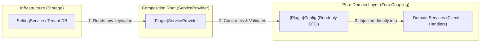

# Architecture Specification: Plugin Configuration Pattern

> **Document Version:** 1.0.0  
> **Status:** Accepted (Standard for all plugins)  
> **Pattern:** Pattern 1 (Typed Config DTO + Composition Root)

---

## 1. Context & Problem Statement

In a modular microkernel architecture, plugins require configuration values (API keys, endpoints, feature toggles, timeout limits).

### The Anti-Pattern (What is FORBIDDEN ❌)
Injecting a general `SettingService` directly into domain services:

```php
// ❌ WRONG: Couples domain logic to settings storage and magic strings
final class POSApiClient
{
    public function __construct(private SettingService $settings) {}

    public function sendOrder() {
        $url = $this->settings->get('pos-integration.api_base_url'); // Magic string!
    }
}
```

### Architectural Flaws of the Anti-Pattern:
1. **Tight Coupling:** The domain logic cannot run in tests or isolated workers without booting the database settings engine.
2. **Magic String Bugs:** Misspelling `'pos-integration.api_base_url'` causes silent runtime failures that PHPStan and static analysis cannot catch.
3. **Violation of Dependency Inversion Principle (DIP):** Low-level storage mechanisms pollute high-level domain business logic.

---

## 2. The Solution: Pattern 1 (Typed Config DTO + Composition Root)

All plugins in Turbo Tenant decouple their configuration using **Composition Root Hydration**:



---

## 3. Implementation Blueprint

### Step 1: The Plugin's Local Config DTO
Location: `app/Plugins/{PluginName}/src/DTOs/{PluginName}Config.php`

An immutable, strongly-typed value object representing only the options required by this plugin:

```php
namespace App\Plugins\PosIntegration\src\DTOs;

final readonly class PosConfig
{
    public function __construct(
        public string $baseUrl,
        public ?string $token = null,
        public bool $autoAcceptOrders = false,
        public int $timeoutSeconds = 30
    ) {}
}
```

### Step 2: Composition Root (`{PluginName}ServiceProvider.php`)
The ServiceProvider is the **only class in the entire plugin** permitted to import `SettingService`. It bridges the storage engine to the clean DTO:

```php
namespace App\Plugins\PosIntegration;

use App\Plugins\PosIntegration\src\DTOs\PosConfig;
use App\Plugins\PosIntegration\src\Services\POSApiClient;
use App\Plugins\StoreSettings\src\Services\SettingService;
use Illuminate\Support\ServiceProvider;

final class PosIntegrationServiceProvider extends ServiceProvider
{
    public function register(): void
    {
        // 1. Build typed DTO from SettingService
        $this->app->singleton(PosConfig::class, function ($app) {
            $settings = $app->make(SettingService::class);

            return new PosConfig(
                baseUrl: (string) $settings->get('pos-integration.api_base_url', 'https://api.pos.com/v1'),
                token: $settings->get('pos-integration.api_token'),
                autoAcceptOrders: (bool) $settings->get('pos-integration.auto_accept_orders', false)
            );
        });

        // 2. Inject pure DTO into domain service
        $this->app->singleton(POSApiClient::class, function ($app) {
            return new POSApiClient($app->make(PosConfig::class));
        });
    }
}
```

### Step 3: Domain Service Execution (0% Coupling)
Domain services depend strictly on the typed DTO:

```php
namespace App\Plugins\PosIntegration\src\Services;

use App\Plugins\PosIntegration\src\DTOs\PosConfig;

final class POSApiClient
{
    public function __construct(
        private readonly PosConfig $config
    ) {}

    public function sendOrder(Branch $branch, array $payload): array
    {
        $url = $this->config->baseUrl;   // 100% type-safe, autocompleted
        $token = $this->config->token;

        if (empty($token)) {
            throw new PosConfigurationException('POS API token is missing.');
        }

        // Execute API request...
    }
}
```

---

## 4. Testing Benefits

By adopting Pattern 1, unit testing domain logic requires **zero mocks of the database or settings engine**:

```php
it('sends order to POS endpoint correctly', function () {
    // Pure instantiation: zero mocks, zero databases
    $config = new PosConfig(
        baseUrl: 'https://mock-pos.test',
        token: 'test_secret_token',
        autoAcceptOrders: true
    );

    $client = new POSApiClient($config);

    $response = $client->sendOrder($branch, $payload);
    expect($response['success'])->toBeTrue();
});
```

---

## 5. Strict Rules for All Plugins

1. **NO Direct Settings Injection:** Domain services must **never** inject `SettingService`.
2. **Mandatory DTO:** Every plugin must maintain its `{StudlyName}Config` class in `src/DTOs/`.
3. **Single Responsibility:** The ServiceProvider handles 100% of the extraction and casting from storage to DTO.
