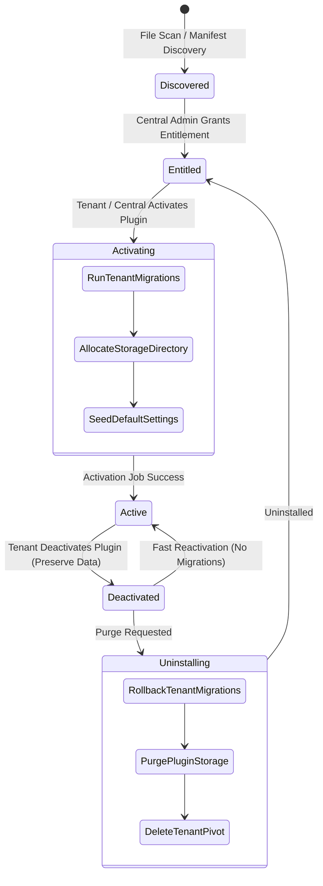

# Architecture Specification: SaaS Lifecycle Engine

> **Document Version:** 1.0.0  
> **Target Framework:** Laravel 12.x / Stancl Tenancy 3.x / Filament 4.x / Inertia React  
> **Status:** Accepted (Architectural Baseline)

---

## 1. Executive Summary

The **SaaS Lifecycle Engine** manages plugins not as static code toggles or global configuration flags, but as **stateful, entitlement-based extensions** that can be activated, migrated, executed, and uninstalled on a per-tenant basis. 

In a multi-tenant food & e-commerce platform, different tenants subscribe to distinct operational modules (e.g., POS Integration, Online Gateways, Push Notifications, Combo Packages, Loyalty). The SaaS Lifecycle Engine guarantees:
- **Zero Schema Bloat:** Inactive plugins never run migrations or create unused tables in tenant databases.
- **Tenant Isolation:** Plugin configuration, database tables, and storage buckets are strictly scoped per tenant.
- **Dynamic Booting:** If a tenant does not have a plugin active, its classes, routes, service providers, and Filament panels have **zero memory and runtime footprint**.
- **Clean Blast Radius:** Plugin activation/deactivation failures remain isolated without compromising core checkout.

---

## 2. Core Lifecycle State Machine

A plugin transitions through five explicit states across system and tenant lifecycles:



### State Definitions

| State | Scope | Behavior |
| :--- | :--- | :--- |
| **Discovered** | Central / System | Code resides on disk in `app/Plugins/{PluginName}` with a valid `plugin.json` manifest registered in the central `plugins` table. |
| **Entitled** | Central $\to$ Tenant | Super Admin permits Tenant $X$ to use the plugin (based on plan tier or add-on subscription). |
| **Active** | Tenant Runtime | Migrations applied to the tenant DB, storage provisioned, Filament resources loaded in admin navigation, and event listeners booted. |
| **Deactivated** | Tenant Runtime | Code execution stopped; Filament resources hidden from admin; **all tenant DB tables and uploaded files remain intact**. |
| **Uninstalled** | Tenant DB & Storage | Tenant-level migrations rolled back, tenant plugin storage purged, and tenant pivot record deleted. |

---

## 3. Database Schema Architecture

### 3.1 Central Database Schema

The Central Database maintains the global catalog of discovered plugins and the per-tenant entitlement/state pivot.

```sql
-- Global registry of all discovered plugins
CREATE TABLE plugins (
    id VARCHAR(50) PRIMARY KEY,                  -- e.g. 'pos-integration', 'payment-gateways'
    name VARCHAR(100) NOT NULL,
    version VARCHAR(20) NOT NULL,
    category ENUM('core', 'extra') DEFAULT 'extra',
    description TEXT NULL,
    is_core BOOLEAN DEFAULT FALSE,
    created_at TIMESTAMP NULL,
    updated_at TIMESTAMP NULL
);

-- Per-tenant plugin activation state and encrypted credentials
CREATE TABLE tenant_plugins (
    tenant_id VARCHAR(50) NOT NULL,
    plugin_id VARCHAR(50) NOT NULL,
    status ENUM('entitled', 'active', 'deactivated') DEFAULT 'entitled',
    settings JSON NULL,                          -- Tenant-specific configuration (API keys, webhooks)
    activated_at TIMESTAMP NULL,
    installed_at TIMESTAMP NULL,
    PRIMARY KEY (tenant_id, plugin_id),
    FOREIGN KEY (tenant_id) REFERENCES tenants(id) ON DELETE CASCADE,
    FOREIGN KEY (plugin_id) REFERENCES plugins(id) ON DELETE CASCADE
);
```

### 3.2 Tenant Database Schema
Each plugin maintains its own independent migrations inside:
`app/Plugins/{PluginName}/database/migrations/tenant/`

When a tenant activates a plugin, the engine executes `Artisan::call('migrate')` targeted **strictly at that tenant's database connection**. Uninvolved tenant databases remain pristine.

---

## 4. Plugin Manifest Specification (`plugin.json`)

Every plugin must define a `plugin.json` in its root folder:

```json
{
  "id": "loyalty-rewards",
  "name": "Customer Loyalty & Rewards",
  "version": "1.0.0",
  "category": "extra",
  "description": "Earn points on orders and redeem them for checkout discounts.",
  "author": "Turbo Tenant",
  "providers": [
    "App\\Plugins\\Loyalty\\LoyaltyServiceProvider"
  ],
  "filament": {
    "plugin_class": "App\\Plugins\\Loyalty\\Filament\\LoyaltyFilamentPlugin"
  },
  "requires": {
    "core": ">=1.0.0",
    "php": ">=8.3"
  }
}
```

---

## 5. The 6-Dimension Execution Architecture

| Dimension | Execution Mechanism |
| :--- | :--- |
| **1. Internal Logic** | Service Providers registered dynamically in `TenancyInitialized` event listener. Pipeline pipes attached to `OrderValidationPipeline` and `PricingCalculationPipeline`. |
| **2. External Integration** | Tenant-scoped API clients resolve credentials from `tenant_plugins.settings`. Webhooks route to `/api/plugins/{plugin}/{tenant}/webhook`. |
| **3. Database Tables** | `PluginMigrationService::migrateForTenant($tenant, $path)` executes migrations only in the active tenant's context. |
| **4. Storage Data** | Scoped disk directory: `storage/tenant{id}/plugins/{plugin-id}/`. Scaffolds on activate; purges on uninstall. |
| **5. Filament Panels** | `AdminPanelProvider` queries `PluginManager::getActiveFilamentPluginsForTenant(tenant())` to dynamically inject `Filament\Contracts\Plugin` instances. |
| **6. Frontend (Inertia)** | Core React templates render `<PluginSlot name="..." props={...} />`. Active plugin metadata is shared via `$page.props.plugins`. |

---

## 6. End-to-End Walkthrough: Loyalty & Rewards Example

```
app/Plugins/Loyalty/
├── plugin.json
├── LoyaltyServiceProvider.php
├── database/
│   └── migrations/
│       └── tenant/
│           └── 2026_10_10_000001_create_loyalty_points_table.php
├── src/
│   ├── Services/LoyaltyPointCalculator.php
│   ├── Listeners/AwardPointsOnOrderPaid.php
│   └── Filament/
│       ├── LoyaltyFilamentPlugin.php
│       └── Resources/LoyaltyRewardResource.php
└── resources/
    └── js/LoyaltyCheckoutWidget.tsx
```

1. **Central Admin Grants Entitlement:** Super Admin assigns `loyalty-rewards` to Tenant `pizzaslice`.
2. **Tenant Activates Plugin:** Tenant Admin turns toggle `ON`. An asynchronous `ActivateTenantPluginJob`:
   - Runs `2026_10_10_000001_create_loyalty_points_table.php` inside `tenant_pizzaslice` DB.
   - Creates `storage/tenant_pizzaslice/plugins/loyalty/`.
   - Sets status to `active`.
3. **Runtime Execution:**
   - Order placed $\to$ `OrderPaid` event fires $\to$ `AwardPointsOnOrderPaid` awards $+50$ points.
   - Tenant admin sidebar dynamically renders `Loyalty Rewards` navigation group.
   - Frontend checkout slot mounts `<LoyaltyCheckoutWidget />` to allow point redemptions.
4. **Uninstall / Purge:**
   - Tenant clicks "Uninstall" $\to$ Tenant migrations rolled back $\to$ `storage/.../loyalty` deleted $\to$ Pivot removed.

---

## 7. Related Specifications

- **[Plugin Configuration Standard (Pattern 1)](file:///d:/turbo_tenant/docs/architecture/plugin-configuration-pattern.md):** Rules for typed DTO configuration and zero-coupling domain design.

