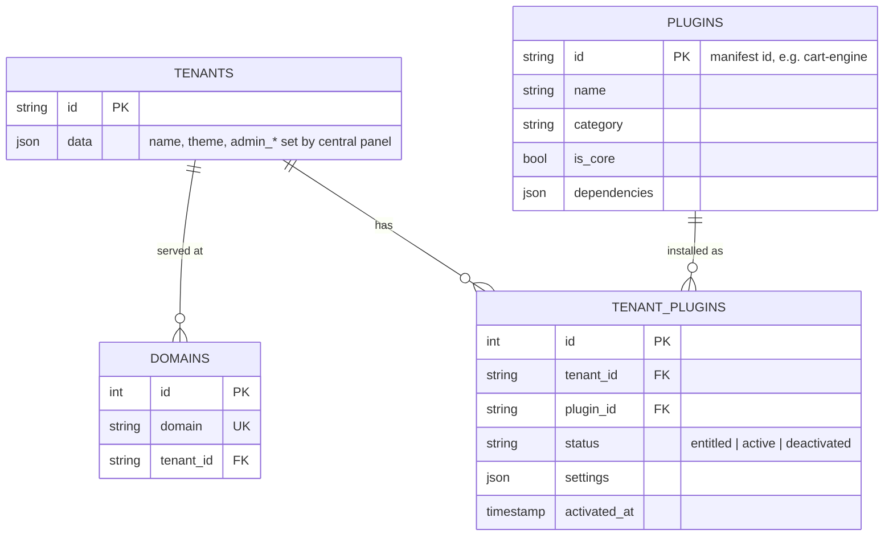
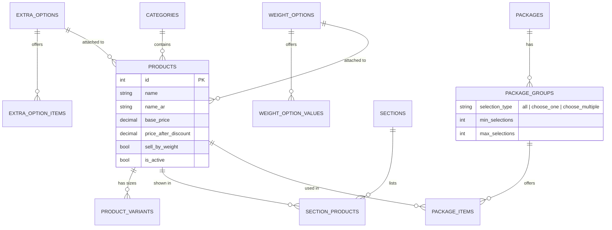
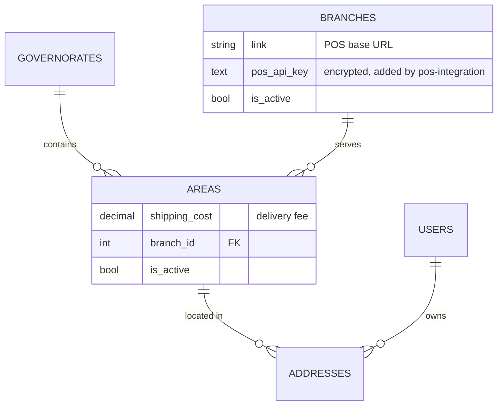
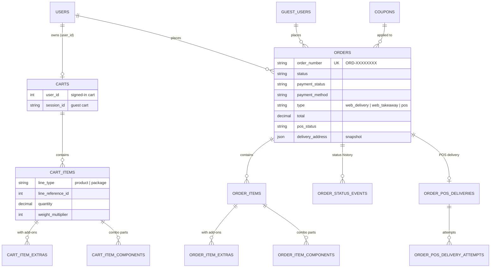
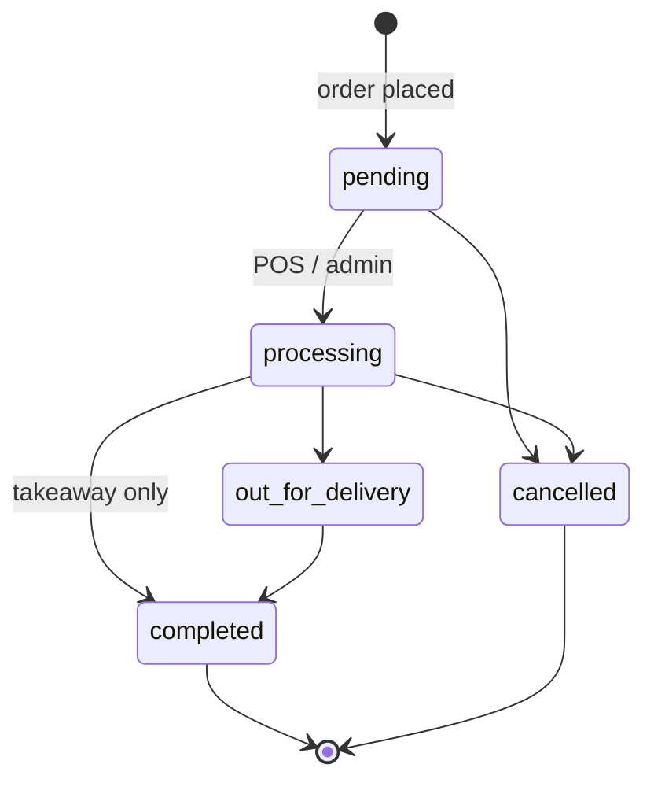
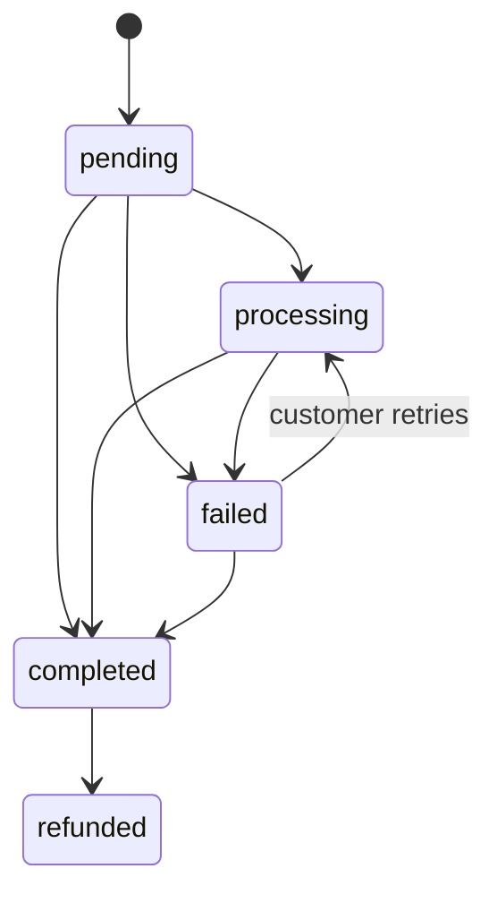

# Data model

Schema is declared in Laravel migrations. Migration files describe intended schema; the state of a particular database depends on which migrations ran there (check `migrations` table per database).

## Stores

| Store | Kind | Holds | Schema source |
| --- | --- | --- | --- |
| Central DB | MySQL (connection from `DB_CONNECTION`) | Tenants, domains, plugin catalog, per-tenant plugin state, central operator users, queue tables | [database/migrations](../database/migrations) |
| Tenant DB `tenant<id>` | MySQL, one per store (prefix `tenant` from [config/tenancy.php](../config/tenancy.php)) | Everything about one store | [database/migrations/tenant](../database/migrations/tenant) (run when the tenant is created) + `app/Plugins/*/database/migrations/tenant` (run when a plugin is activated) |
| Tenant files | `storage/tenant<id>/app[/public]` | Uploaded images and their WebP variants, PWA `manifest.json`, `plugins/<id>/` folders | [`TenantService`](../app/Services/TenantService.php) |

Twenty-nine tenant migrations exist both in `database/migrations/tenant` and in a plugin folder under the same file name (catalog, cart, locations and settings tables). Laravel records migrations by file name, so whichever runs first wins and the other is skipped. Edit both copies when changing one of them, or remove the host copy.

## Central database

`plugins` is synchronized from `plugin.json` files by `php artisan plugin:discover` ([`PluginRegistry::syncDatabase`](../app/Core/Plugins/Services/PluginRegistry.php)). `tenant_plugins` is written by [`PluginLifecycleService`](../app/Core/Plugins/Services/PluginLifecycleService.php). Central also has `users` (operators for `/central`), `jobs`, `failed_jobs`, `cache`, `personal_access_tokens`, and a `bulk_notifications` table that is a leftover duplicate of the tenant table (see [Push notifications](features/push-notifications.md#troubleshooting)).

The central panel's tenant form stores `admin_name`, `admin_email` and a bcrypt hash of `admin_password` in the tenant's `data` JSON ([CreateTenant page](../app/Filament/Central/Resources/TenantResource/Pages/CreateTenant.php)).

## Tenant database by area

### Customers and settings

| Table | Purpose | Owner |
| --- | --- | --- |
| `users` | Customers and store admins (`is_admin`), Google id, `expo_token` | host, [`User`](../app/Models/User.php) |
| `addresses` | Customer address book linked to an area | [locations-delivery](features/locations-delivery.md) |
| `guest_users` | Guest checkout identities keyed by phone + country code | [guest-checkout](features/guest-checkout.md) |
| `settings` | Key/value store settings (`key`, `value`, `type`) incl. gateway and SMTP credentials | [store-settings](features/store-settings.md) |
| `notifications`, `user_notifications`, `bulk_notifications` | In-app notification inbox, push campaign records | [push-notifications](features/push-notifications.md) |
| `sessions`, `password_reset_tokens`, `cache`, `jobs`, `failed_jobs` | Framework tables inside the tenant DB | host |

### Catalog

Tables: `categories`, `products`, `product_variants` (`price`, `is_available`), `extra_options` (selection rules), `extra_option_items` (`price`), `weight_options`, `weight_option_values` (`value`), `sections`, `section_products` ([catalog](features/catalog.md)); `packages`, `package_groups`, `package_items`, `package_availabilities`, `package_branch` ([combo packages](features/combo-packages.md); the legacy `package_product` pivot is dropped by a 2025-11 migration); `reviews` ([reviews](features/product-reviews.md)); `product_pos_mappings`, `pos_line_mappings` ([POS](features/pos-integration.md)).

### Locations

### Cart and orders

Orders snapshot customer name/phone/email, the delivery address, product names (EN/AR) and unit prices, so later catalog edits do not change past orders. `payment_events` records each gateway webhook (`gateway`, `transaction_id`) for idempotency; `meta_order_tracking` and `meta_capi_events` support [Meta marketing](features/meta-marketing.md).

### Content

`hero_sliders` ([hero banners](features/hero-banners.md)), `pages` ([CMS pages](features/cms-pages.md)), `sample_greetings` (demo plugin).

## Lifecycles

### Order status

Enum values and Arabic labels: [`OrderStatus`](../app/Plugins/OrderManagement/src/Enums/OrderStatus.php) (`processing` is labelled "قيد التحضير", `completed` "مكتمل (تم التوصيل)"). Allowed transitions: [`OrderStatusTransitions`](../app/Plugins/OrderManagement/src/Services/OrderStatusTransitions.php). Every status change fires `OrderStatusUpdated` from the model ([Order.php](../app/Plugins/OrderManagement/src/Models/Order.php#L183)).

### Payment status

Source: [`PaymentStateMachine`](../app/Plugins/PaymentProcessing/src/Services/PaymentStateMachine.php). Entering `completed` fires `OrderPaymentCompleted`.

### POS delivery status (`orders.pos_status`)

`not_ready → pending/ready → queued → sending → sent`, with `retry_wait`, `needs_verification` and `failed` branches. See [POS integration](features/pos-integration.md#states).

### Plugin state per tenant

`entitled → active ⇄ deactivated`; uninstall deletes the `tenant_plugins` row and calls the plugin's `onUninstall` hook ([`PluginLifecycleService`](../app/Core/Plugins/Services/PluginLifecycleService.php)). Deactivation keeps tables and files.

## Data rules

- Money is stored as decimals in the store currency (setting `currency`, default `EGP`). Gateways receive amounts in cents (`total × 100`) and webhooks must match exactly.
- Times use the application timezone, which is UTC (no `timezone` override in [config/app.php](../config/app.php)).
- Customer accounts are per tenant: the same email can exist in several stores independently.
- Guest identity is the pair (`phone`, `phone_country_code`), default country code `+20`.

## Changing the schema

- Host table used by every tenant: add a migration under `database/migrations/tenant/` and run `php artisan tenants:migrate`.
- Plugin table: add a migration under `app/Plugins/<Name>/database/migrations/tenant/`. New activations run it automatically; for tenants that already have the plugin active run `php artisan tenants:plugin:migrate --plugin=<id>` (optionally `--tenant=<id>`) ([command](../app/Console/Commands/TenantsPluginMigrateCommand.php)).
- Central table: `database/migrations/` and `php artisan migrate`.
- The project's migration stubs omit `down()` methods, so plan forward-only fixes rather than rollbacks ([Deployment](deployment.md#rollback)).
