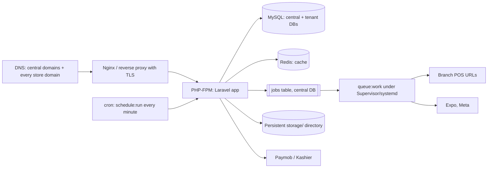

# Deployment

**Procedure status:** Recommended, derived from repository requirements. The repository has no Dockerfile, IaC, deploy script or deploy workflow, so the hosting choices below are the minimum the code needs. Confirm the items under [Open decisions](#open-decisions).

## Environments

| Environment | URL | Source | How deployed | Data |
| --- | --- | --- | --- | --- |
| Local | `http://<tenant>.localhost:8000`, central `http://localhost:8000` | working tree | [Getting started](getting-started.md) | disposable |
| CI | — | every push | GitHub Actions tests only ([Development](development.md#continuous-integration)) | in-memory SQLite |
| Production | Central domains listed in [config/tenancy.php](../config/tenancy.php) (`turbospace.click`, `central.turbosoftspace.com`, `moda-1.turbospace.click`) plus each store's own domain | `master` | manual (see below) | persistent |

## Runtime topology



Every store domain must point at the same application. TLS certificates are needed for each store domain (wildcard for subdomains, or per-domain certificates for custom domains).

### Required processes

| Process | Command | Count / supervision | Notes |
| --- | --- | --- | --- |
| Web | PHP-FPM behind Nginx, document root `public/` | per load | Serves storefront, APIs, `/admin`, `/central`, webhooks |
| Queue worker | `php artisan queue:work database --queue=default --tries=1 --timeout=90` | ≥ 1, Supervisor or systemd, restart always | Jobs define their own `$tries` (POS 5, Meta 5/3, images 3). The `pos-database` connection uses the same `jobs` table and queue, so one worker on `database` covers it when both point at the central DB |
| Scheduler | `* * * * * php /path/artisan schedule:run` | 1 cron entry | Runs `notifications:send-scheduled` |

Without a worker: images stay unoptimized, POS orders stay `queued`, push notifications and Meta events are never sent. Supervisor/systemd files, the `DB_QUEUE_CONNECTION` pitfall and health checks: [Queue, workers and scheduler](queue-and-workers.md).

### Server requirements

- PHP 8.3 with `pdo_mysql`, `mbstring`, `intl`, `bcmath`, `gd` or `imagick` (WebP encoding), `pcntl` (worker timeouts), `redis` extension if `REDIS_CLIENT=phpredis`.
- Node.js LTS on the build machine (not needed at runtime).
- MySQL 8 with a user that can create and drop `tenant*` databases.
- Redis for cache (tag support).
- Writable, persistent `storage/` (tenant uploads live in `storage/tenant<id>/`) and `bootstrap/cache/`.
- `php artisan storage:link` so `public/storage` serves uploads. Tenant asset URLs come from `Storage::url()` on tenant-suffixed disks; verify that uploaded images load on a store domain after the first deploy.
- Outbound HTTPS to Paymob/Kashier, Expo, Meta Graph, Google, and to every branch POS `link` (public addresses only unless `NETWORK_ALLOW_PRIVATE_HOSTS=true`).
- Inbound HTTPS from Paymob/Kashier (webhooks) and branch POS systems (status callback).

## First-time setup

```bash
# on the server, in the release directory
composer install --no-dev --optimize-autoloader
npm ci && npm run build
cp .env.example .env    # then set production values, see configuration.md
php artisan key:generate
php artisan migrate --force
php artisan plugin:discover
php artisan storage:link
php artisan optimize          # config, routes, views, events, and plugin manifest cache
```

Create the first operator account for `/central` (for example with `php artisan tinker` creating an `App\Models\User` in the central DB; do not use the `DEFAULT_USER_*` defaults in production). Then create stores from the central panel ([Store provisioning](features/tenant-provisioning.md)), point their domains at the server, and activate plugins from each store's marketplace.

## Release procedure

1. **Preflight**
   - CI green on the commit (tests, PHPStan, Pint, atlas).
   - `CHANGELOG.md` has the release's entries and upgrade notes.
   - Review new migrations: central (`database/migrations`), host tenant (`database/migrations/tenant`), plugin tenant (`app/Plugins/*/database/migrations/tenant`). Note any that lock large tables or drop data.
   - Back up the central DB and every `tenant*` DB (`mysqldump --databases ...`), and the `storage/` directory.
2. **Build** (in a new release directory or CI artifact)
   ```bash
   composer install --no-dev --optimize-autoloader
   npm ci && npm run build
   ```
3. **Release**
   ```bash
   php artisan down --render="errors::503"     # optional; webhooks are also blocked while down
   # switch the current release (symlink) to the new directory, sharing storage/ and .env
   php artisan migrate --force                     # central
   php artisan tenants:migrate --force             # host tenant migrations for every tenant
   php artisan tenants:plugin:migrate --force      # pending plugin migrations for active plugins
   php artisan plugin:discover                     # new/changed plugin.json
   php artisan optimize
   php artisan queue:restart                       # workers pick up new code after current job
   php artisan up
   ```
   Order matters: migrate before workers process new jobs, and restart workers after code and schema are both in place. Keep maintenance windows short: payment webhooks received while the app is down get a 503, and gateways retry on their own schedule.
4. **Verify**
   - `GET https://<central>/up` returns 200.
   - On one store: storefront loads, `/api/tenant/bootstrap` returns `active_plugins`, an admin can sign in at `/admin`.
   - Place a cash-on-delivery order on a test store; check it in the orders list and, if POS is active, its POS delivery state moves past `queued`.
   - `php artisan queue:failed` shows no new failures; `storage/logs/laravel.log` has no new errors.
5. **Finish:** tag the release (`git tag vX.Y.Z`), move `Unreleased` entries under the version in `CHANGELOG.md`.

## Rollback

1. Switch the release symlink back to the previous directory, run `php artisan optimize` and `php artisan queue:restart`.
2. Migrations: the project's stubs have no `down()` methods, so schema changes are not reversed by `migrate:rollback`. Write migrations to be additive (new nullable columns, new tables) so the previous code keeps working against the new schema. If a release dropped or rewrote data, restore the affected databases from the preflight backup, after checking which orders and payments arrived since (they would be lost).
3. Recheck the verification steps above.

## Database migrations in production

- Three scopes, three commands: `migrate` (central), `tenants:migrate` (host tenant folder, every tenant), `tenants:plugin:migrate` (each tenant's active plugins; `--tenant`/`--plugin` to narrow).
- Activating a plugin for a store runs that plugin's migrations immediately ([`PluginLifecycleService::activate`](../app/Core/Plugins/Services/PluginLifecycleService.php)); failures leave earlier migrations applied.
- With many tenants, migrations run tenant by tenant; a failure stops at that tenant. Re-run after fixing; completed tenants are skipped by migration name.
- Release-specific steps belong in the changelog's upgrade notes (for example the POS delivery tracking migration described in [POS integration](features/pos-integration.md#configuration)).

## Adding a store domain

1. Add the domain on the tenant in `/central` (or `$tenant->domains()->create(['domain' => 'shop.example.com'])`).
2. Point DNS at the server and issue a certificate.
3. In the gateway dashboards, the webhook and redirect URLs are built from the request host (`https://<store domain>/api/webhooks/<gateway>`), so use the store's primary domain consistently.

## CI/CD

GitHub Actions runs tests, static analysis, style and atlas checks on push. Nothing deploys automatically.

## Open decisions

- Hosting provider, server layout and who has access.
- Process supervisor and number of queue workers.
- Backup schedule, retention and restore drills for central + tenant databases and `storage/`.
- TLS strategy for custom store domains.
- Whether to replace the database queue with Redis.
- Error tracking / uptime monitoring service.
