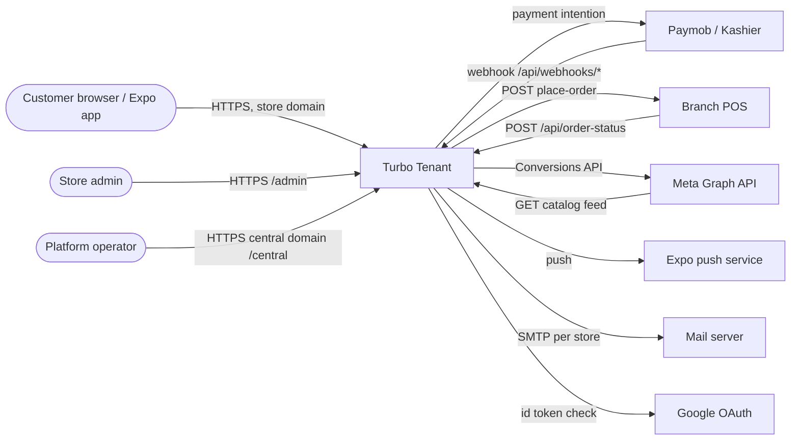
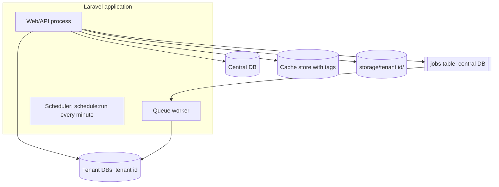
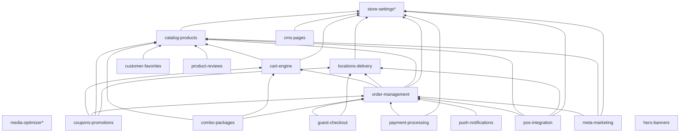
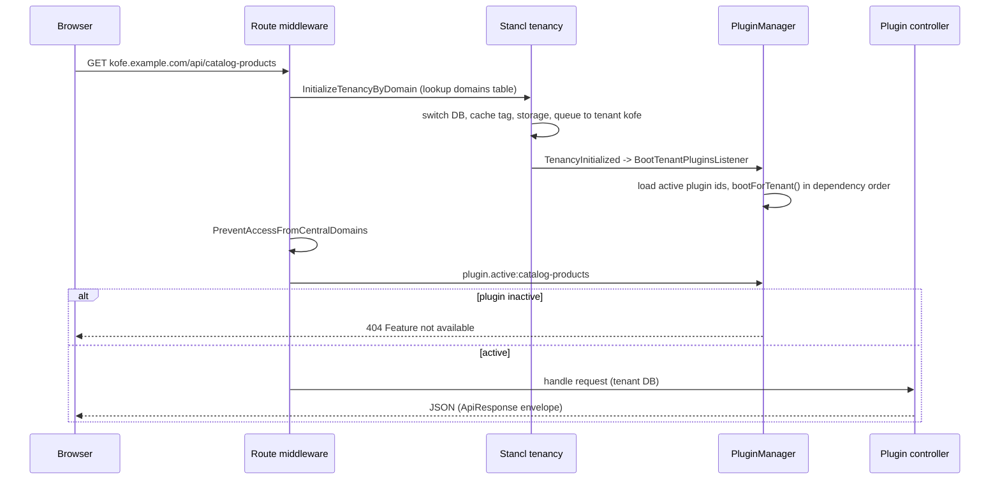

# Architecture

Turbo Tenant is one Laravel 12 application that serves many stores. It combines three ideas:

1. **Database-per-tenant multi-tenancy** ([stancl/tenancy](https://tenancyforlaravel.com/docs/v3) v3): the request's host decides which store is active, and the default DB connection, cache, filesystem and queue context switch to that store.
2. **A plugin microkernel**: every business capability lives in `app/Plugins/<Name>` with a `plugin.json` manifest. A small host kernel (`app/Core/Plugins`) discovers plugins, activates them per tenant, and lets them contribute to shared extension points.
3. **A headless storefront**: a React 18 + TypeScript SPA (`resources/js`) served by one Blade shell and talking to JSON endpoints, plus a Filament 4 admin panel per store.

## System context

## Runtime building blocks

| Unit | Responsibility | Entry point |
| --- | --- | --- |
| Web/API | Storefront shell, JSON APIs, Filament panels, webhooks | [bootstrap/app.php](../../bootstrap/app.php), [routes/tenant.php](../../routes/tenant.php), plugin `routes/tenant.php` files |
| Queue worker | POS delivery, image variants, push notifications, Meta events, bulk notifications | `php artisan queue:work`; jobs carry `tenant_id` via `QueueTenancyBootstrapper` |
| Scheduler | Runs `notifications:send-scheduled` every minute ([routes/console.php](../../routes/console.php)) | `php artisan schedule:run` |
| Central DB | `tenants`, `domains`, `plugins`, `tenant_plugins`, central `users`, `jobs`, `failed_jobs`, `personal_access_tokens` | [database/migrations](../../database/migrations) |
| Tenant DBs | All store data: users, catalog, carts, orders, settings... | [database/migrations/tenant](../../database/migrations/tenant) + each plugin's `database/migrations/tenant` |
| Tenant storage | Uploads under `storage/tenant<id>/app/public`, PWA manifest | [`TenantService`](../../app/Services/TenantService.php), `filesystem` in [config/tenancy.php](../../config/tenancy.php) |

## Code organization

| Path | Owns |
| --- | --- |
| [`app/Core/Plugins`](../../app/Core/Plugins) | Plugin kernel: manifest loading, registry and cache, dependency sort, per-tenant lifecycle, `plugin.active` middleware, route helpers, contribution resolver, shared contracts |
| [`app/Plugins/*`](../../app/Plugins) | 18 feature plugins. Each has `plugin.json`, a ServiceProvider, `routes/tenant.php`, `src/` (models, services, controllers, Filament resources, settings sections), `database/migrations/tenant`, and optionally a `*Plugin` class with tenant hooks |
| [`app/Providers`](../../app/Providers) | Host boot: tenancy events, plugin registration, the two Filament panels |
| [`app/Http`](../../app/Http) | Host-owned endpoints: storefront bootstrap, auth, profile, API error envelope (`ApiResponse`) |
| [`app/Filament`](../../app/Filament) | Central `TenantResource`, tenant `ManagePlugins` marketplace, `UserResource`, setup checklist widget |
| [`app/Models`](../../app/Models) | `Tenant`, `User` (used in both central and tenant DBs), `Plugin`, `TenantPlugin` |
| [`resources/js/core`](../../resources/js/core) | SPA kernel: router, API client, tenant/auth contexts, plugin slots, analytics |
| [`resources/js/plugins/*`](../../resources/js/plugins) | Frontend half of each plugin: API hooks, default components, slot registration |
| [`resources/js/themes/*`](../../resources/js/themes) | Theme registry and the `default` theme (layouts, pages, component overrides) |

Plugins depend on each other only through declared `dependencies` in `plugin.json` and through contracts. The dependency graph:

`*` = core plugin (auto-activated, cannot be deactivated). Arrows point to the dependency.

## Request lifecycle

### Tenant identification and plugin boot

1. Plugin service providers are registered at application boot for **all** discovered plugins ([`PluginServiceProvider::register`](../../app/Providers/PluginServiceProvider.php)). Their routes therefore always exist; activation is enforced per request.
2. Plugin routes are declared with [`PluginRoutes::tenant('<id>')`](../../app/Core/Plugins/Routing/PluginRoutes.php), which applies `web`, `InitializeTenancyByDomain`, `PreventAccessFromCentralDomains` and `plugin.active:<id>`. Webhooks and the POS callback use `PluginRoutes::tenantUngated()` so in-flight payments settle even if the plugin was just deactivated.
3. `TenancyInitialized` runs three listeners ([`TenancyServiceProvider`](../../app/Providers/TenancyServiceProvider.php)): Stancl's bootstrappers, [`ConfigureTenantMail`](../../app/Listeners/ConfigureTenantMail.php) (applies the store's SMTP settings), and [`BootTenantPluginsListener`](../../app/Core/Plugins/Listeners/BootTenantPluginsListener.php). Plugins register order pipes and similar per-tenant state in `bootForTenant()`; services listed under `tenant_scoped` in a manifest are forgotten from the container on every tenant switch.
4. API errors for `api/*` are rendered as `{"status":"error","message":...,"errors":...}` by the exception handlers in [bootstrap/app.php](../../bootstrap/app.php); model class names are not leaked on 404.

### Storefront boot

The Blade shell [`resources/views/app.blade.php`](../../resources/views/app.blade.php) loads [`resources/js/app.tsx`](../../resources/js/app.tsx), which registers frontend plugins and the theme, then calls `GET /api/tenant/bootstrap` once ([`BootstrapController`](../../app/Http/Controllers/Api/BootstrapController.php)). The response holds the tenant, current user, merged store settings, `active_plugins`, cart count and pre-fetched React Query data contributed by active plugins. [`RequirePlugin`](../../resources/js/core/router/RequirePlugin.tsx) hides routes for inactive plugins; the server-side middleware is the actual enforcement.

The API client ([client.ts](../../resources/js/core/api/client.ts)) uses same-origin cookies, fetches `/sanctum/csrf-cookie` before the first mutating request, and sends `X-Requested-With`.

## Cross-cutting concerns

| Concern | How it works here | Where |
| --- | --- | --- |
| Authentication | Session cookies on the store domain (Sanctum stateful SPA). Login/register/reset under `/api/tenant/auth/*`; Google via web OAuth redirect or native ID-token verification | [routes/tenant.php](../../routes/tenant.php), [AuthController](../../app/Http/Controllers/Api/AuthController.php), [GoogleNativeAuthController](../../app/Http/Controllers/Api/GoogleNativeAuthController.php) |
| Authorization | `auth` middleware on customer-only routes, ownership checks in controllers/policies (e.g. [`AddressPolicy`](../../app/Plugins/LocationsDelivery/src/Policies/AddressPolicy.php)), `is_admin` for `/admin`, Filament MFA for panel users | [User.php](../../app/Models/User.php) |
| Feature gating | `plugin.active:<id>` middleware; contributions filtered to active plugins; listeners wrapped in [`ActivationGatedListener`](../../app/Core/Plugins/Listeners/ActivationGatedListener.php) | `app/Core/Plugins` |
| Validation and errors | FormRequests per endpoint; order rules extended by plugins via the `order.placement.rules` tag; uniform API error envelope | [bootstrap/app.php](../../bootstrap/app.php) |
| Transactions | Order + items created in one DB transaction; POS delivery state changes under row locks | [OrderRepository](../../app/Plugins/OrderManagement/src/Services/Repositories/OrderRepository.php), [OrderDeliveryDispatcher](../../app/Plugins/PosIntegration/src/Services/OrderDeliveryDispatcher.php) |
| Background jobs | Database queue; Stancl stores `tenant_id` in each payload and re-initializes tenancy in the worker. The POS queue (`pos-database`) is pinned to the central DB; the default `database` queue is central only when `DB_QUEUE_CONNECTION` names the central connection | [config/queue.php](../../config/queue.php) |
| Caching | Tag-based per-tenant cache (requires a tag-capable store). Settings are memoized per request in [`SettingService`](../../app/Plugins/StoreSettings/src/Services/SettingService.php) | [config/tenancy.php](../../config/tenancy.php) |
| Files and media | Tenant-suffixed `local`/`public` disks; uploads converted to WebP variants by [Media optimizer](features/media-optimizer.md) | [config/tenancy.php](../../config/tenancy.php) |
| Settings | Key/value `settings` table per tenant, edited in the Store Settings page whose tabs are contributed by plugins (`store-settings.sections`) | [Store settings](features/store-settings.md) |
| Notifications / email | Expo push channel; Laravel mail with per-store SMTP | [Push notifications](features/push-notifications.md) |
| Outbound HTTP safety | POS URLs pass [`PublicEndpointGuard`](../../app/Support/Network) which blocks private/loopback hosts unless `NETWORK_ALLOW_PRIVATE_HOSTS=true` | [config/network.php](../../config/network.php) |
| Localization | Admin panel in Arabic; storefront i18next with `en`/`ar` and RTL switching | [resources/js/locales](../../resources/js/locales), [Development guide › i18n](development.md#storefront-localization-i18n) |
| Logging | Laravel log stack; `pail` in development | [config/logging.php](../../config/logging.php) |

## Extension points

**Backend.** A plugin contributes by implementing a contract and tagging it in its ServiceProvider; [`PluginContributions::active($tag)`](../../app/Core/Plugins/Services/PluginContributions.php) returns only contributions from plugins active for the current tenant.

| Tag | Contract purpose | Contributed by |
| --- | --- | --- |
| `tenant.bootstrap.contributors` | Add settings / prefetched data to `/api/tenant/bootstrap` | store-settings, catalog-products, cart-engine, combo-packages, hero-banners, payment-processing, meta-marketing |
| `store-settings.sections` | Add a tab to the Store Settings page | store-settings, order-management, payment-processing, pos-integration, meta-marketing |
| `order.placement.rules` | Extra validation rules for `POST /api/orders/place` | coupons-promotions, guest-checkout, payment-processing |
| `order.customer.resolvers` | Resolve a non-user customer at checkout | guest-checkout |
| `order.placement.response` | Add fields to the place-order response | guest-checkout, meta-marketing |
| `order.payment-status.response` | Add fields to the payment-status response | guest-checkout |
| `cart-engine.line-types` | New kinds of cart lines | combo-packages |
| `catalog.line-references`, `catalog-products.product-deletion-guards` | Reference/protect products from other plugins | combo-packages |
| `catalog.product.form`, `catalog.extra-option.form`, `admin.form.combo-packages.package`, `admin.form.locations-delivery.branch` | Add fields to admin forms | pos-integration |
| `catalog.product.details` | Add data to product detail responses | product-reviews |
| `admin.setup-checklist`, `admin.users.table.columns` | Dashboard checklist items, user table columns | store-settings, catalog-products, order-management |

Order validation and pricing are pipelines that plugins extend in `bootForTenant()` via [`OrderPipelineRegistrar`](../../app/Plugins/OrderManagement/src/Contracts/OrderPipelineRegistrar.php) (see [Checkout and orders](features/checkout-and-orders.md#how-it-works)). Cross-plugin reactions use domain events (`OrderCreated`, `OrderFinalized`, `OrderPaymentCompleted`, `OrderPaymentFailed`, `OrderStatusUpdated`) with listeners declared in each `plugin.json`.

**Frontend.** Plugins register default components for named slots ([slot-registry.ts](../../resources/js/core/slots/slot-registry.ts) `registerPluginDefault`), themes override them (`registerThemeOverride`), and pages render [`PluginSlot`](../../resources/js/core/slots/PluginSlot.tsx). Themes are registered in [themes/registry.ts](../../resources/js/themes/registry.ts); the active theme name comes from the tenant's `theme` attribute in the bootstrap payload.

See [Development guide](development.md#adding-a-feature) for a walkthrough, [Themes](themes.md) for storefront themes and `data-testid` contracts, and [docs/architecture/plugin-configuration-pattern.md](architecture/plugin-configuration-pattern.md) for the plugin settings pattern.

## Architectural decisions

No decision records exist yet in `docs/decisions/`. Background design notes: [SaaS lifecycle engine](architecture/saas-lifecycle-engine.md), [plugin configuration pattern](architecture/plugin-configuration-pattern.md).
