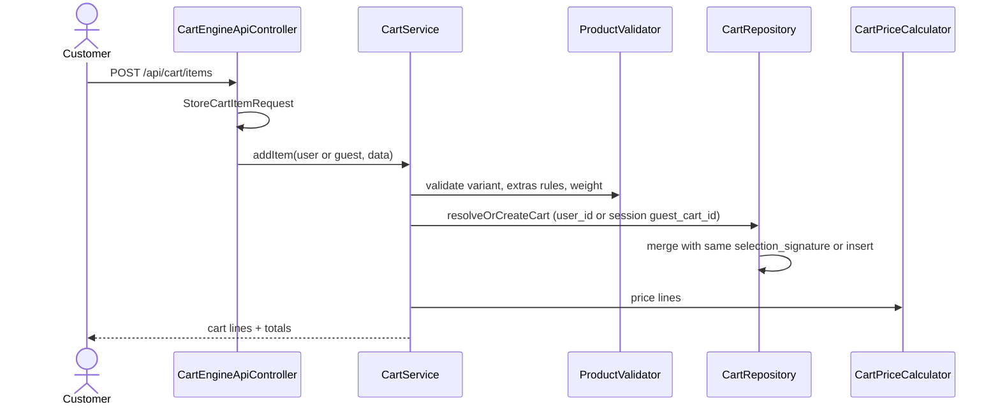

# Cart

## Overview

Holds what a customer intends to buy, for signed-in customers and anonymous visitors alike, and computes line and cart totals on the server. Supports product sizes (variants), add-ons (extras), products sold by weight, and composite lines such as combo packages.

**Status:** live · **Plugin:** `cart-engine` ([plugin.json](../../../app/Plugins/CartEngine/plugin.json)) · **Depends on:** catalog-products, store-settings · **Related:** [Catalog](catalog.md), [Combo packages](combo-packages.md), [Checkout](checkout-and-orders.md)

## How to use

### Customer

1. On a product page (`/products/:id`) or the quick-add dialog, choose a size, add-ons and quantity (or a weight and how many of it), then **Add to Cart**. The header cart count updates.
2. Open the cart (`/cart`, **View Cart**). Change quantities, remove lines, or clear the cart.
3. **Proceed to Checkout** when ready. The delivery fee is shown at checkout ("Delivery fee will be calculated at checkout").

Visitors can fill a cart without an account. When they sign in, their visitor cart moves into their account cart.

**If something goes wrong:** "Selected product is unavailable." means the product was deactivated; "Failed to add to cart" accompanies field errors such as a missing required add-on selection or an invalid weight.

### Rules customers notice

- Quantity 1–99 for normal and package lines; weight-sold lines use a weight value × multiplier (1–99).
- Adding the same product with the same selections and no note increases that line's quantity instead of adding a new line.
- Add-on groups enforce their minimum/maximum selections.
- Prices shown in the cart are recomputed from current catalog prices on every read.

## How it works

### Flow

1. **Entry:** [`CartEngineApiController`](../../../app/Plugins/CartEngine/src/Http/Controllers/Api/CartEngineApiController.php) handles `GET /api/cart`, `POST /api/cart/items`, `PATCH|DELETE /api/cart/items/{itemId}`, `DELETE /api/cart`, `POST /api/cart/sync`.
2. **Checks:** [`StoreCartItemRequest`](../../../app/Plugins/CartEngine/src/Http/Requests/StoreCartItemRequest.php) (product must exist and be active; variant, weight value and extra item ids must exist; quantity 0.001–9999.999 for products). Typed lines (`type` other than `product`) are validated by the handler registered for that type. [`ProductValidator`](../../../app/Plugins/CartEngine/src/Services/Validators/ProductValidator.php) applies [`VariantRule`](../../../app/Plugins/CartEngine/src/Services/Validators/Rules/VariantRule.php), [`ExtrasRule`](../../../app/Plugins/CartEngine/src/Services/Validators/Rules/ExtrasRule.php) and [`WeightRule`](../../../app/Plugins/CartEngine/src/Services/Validators/Rules/WeightRule.php).
3. **Cart identity:** [`CartContextResolver`](../../../app/Plugins/CartEngine/src/Services/Resolvers/CartContextResolver.php) uses `carts.user_id` for signed-in users and a session key `guest_cart_id` (`guest_<uniqid>`) otherwise. Every item operation checks the item belongs to the resolved cart.
4. **Pricing** ([`CartPriceCalculator`](../../../app/Plugins/CartEngine/src/Services/Calculators/CartPriceCalculator.php)):
   - effective price = variant price if set, else `price_after_discount`, else `base_price`;
   - normal line subtotal = (price + Σ extra price × extra qty) × quantity;
   - weight line: final quantity = `weight_multiplier` × weight value; subtotal = price × final quantity + extras × multiplier;
   - non-product lines are priced by their [`CartLineTypeHandler`](../../../app/Plugins/CartEngine/src/Contracts/CartLineTypeHandler.php) (registered with the `cart-engine.line-types` tag, see [Combo packages](combo-packages.md)).
5. **Login merge:** the `Login` event listener [`SyncGuestCartOnLogin`](../../../app/Plugins/CartEngine/src/Listeners/SyncGuestCartOnLogin.php) calls `CartService::syncGuestCartToUser`, which moves visitor lines into the user's cart (merging lines with the same `selection_signature`) and forgets the session key.
6. **Bootstrap:** [`CartEngineBootstrapContributor`](../../../app/Plugins/CartEngine/src/Bootstrap/CartEngineBootstrapContributor.php) puts `cart_count` in `/api/tenant/bootstrap`.
7. **After ordering:** checkout clears the cart (cash on delivery) or removes just the purchased lines once a payment URL exists (online).

### Asynchronous and failure paths

None asynchronous. Deleted products: lines referencing a product deleted later are handled by catalog deletion guards; a deactivated product blocks checkout ("Some products are unavailable").

### Data

| Entity | Read or written | Notes |
| --- | --- | --- |
| [`Cart`](../../../app/Plugins/CartEngine/src/Models/Cart.php) | written | `user_id` or `session_id`, `last_activity_at` |
| [`CartItem`](../../../app/Plugins/CartEngine/src/Models/CartItem.php) | written | `line_type`, `line_reference_id`, `selection_signature`, quantity, weight fields, notes |
| `CartItemExtra`, `CartItemComponent` | written | add-ons, package components |

### Interfaces

See [Interfaces › Cart, checkout, orders](../interfaces.md#cart-checkout-orders). Frontend: [resources/js/plugins/cart-engine](../../../resources/js/plugins/cart-engine).

## Configuration

No settings. Activate after `catalog-products`. Visitor carts rely on the session cookie; `SESSION_LIFETIME` (default 120 minutes) bounds how long an anonymous cart survives.

## Testing

- Automated: [CartEngineApiTest](../../../tests/Feature/CartEngineApiTest.php), [CartSecurityAndValidationTest](../../../tests/Feature/CartSecurityAndValidationTest.php), [CartTest](../../../tests/Feature/CartTest.php), [CompositeCartLineFeatureTest](../../../tests/Feature/CartEngine/CompositeCartLineFeatureTest.php), [CartPriceCalculatorTest](../../../tests/Unit/Services/Cart/Calculators/CartPriceCalculatorTest.php), [SyncGuestCartOnLoginTest](../../../tests/Unit/Services/Cart/Listeners/SyncGuestCartOnLoginTest.php), rule tests in [tests/Unit/Services/Cart](../../../tests/Unit/Services/Cart).
- Browser: [tests/e2e/plugins/cart-engine](../../../tests/e2e/plugins/cart-engine) (add, variants, weighted items, extras, quantity, removal, clear, persistence, checkout).
- Manual smoke test: add a weight-sold product with two add-ons, change the multiplier, confirm the subtotal follows the formula above.

## Troubleshooting

| Symptom | Likely cause | Check | Fix |
| --- | --- | --- | --- |
| Visitor cart empties | Session expired or cookie blocked | Session cookie on the store domain | Increase `SESSION_LIFETIME`; keep `SESSION_DOMAIN=null` |
| Same product appears as two lines | Different selections or a note on one line | Line notes/extras | Expected behavior |
| Cart total differs from product page | Variant price overrides the product discount price | Variant `price` | Adjust variant prices |
| 404 Feature not available on `/api/cart` | Plugin inactive | `tenant:plugin:list` | Activate `cart-engine` |
| Cart lost after login | Login did not fire Laravel's `Login` event (custom auth path) | Listener runs on `Illuminate\Auth\Events\Login` | Use the standard login flows |

## History

- Unreleased (working tree): composite cart lines (packages) via line-type handlers.
- 2026-10: cart moved into the cart-engine plugin.
- 2026-03: availability checks.
- 2025-11: weight-sold products and cart API.
