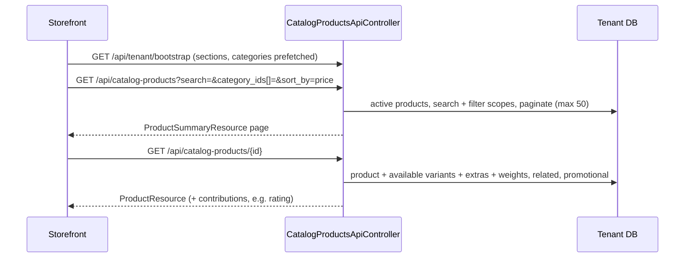

# Catalog and products

## Overview

The store's menu: categories, products with sizes (variants), add-on groups (extras), weight options for products sold by weight, and curated home-page shelves (sections). Admins manage it in Arabic; customers browse it on the storefront in English or Arabic.

**Status:** live · **Plugin:** `catalog-products` ([plugin.json](../../../app/Plugins/CatalogProducts/plugin.json)) · **Depends on:** store-settings · **Related:** [Cart](cart.md), [Combo packages](combo-packages.md), [Media optimizer](media-optimizer.md), [POS integration](pos-integration.md) (product import/price sync), [Product reviews](product-reviews.md)

## How to use

### Store admin: build the menu

All screens are under **الكتالوج والمنتجات** (Catalog & products):

1. **الفئات** (Categories): create categories with English and Arabic names and an image.
2. **خيارات إضافية** (Extra options): create add-on groups (e.g. "Sauces") with items and prices, and set selection rules (minimum, maximum, allow multiple of the same item).
3. **خيارات الوزن** (Weight options): create weight sets (e.g. 250 g, 500 g, 1 kg) for products sold by weight.
4. **المنتجات** (Products): create a product with name/name_ar, description, image, category, base price and optional discounted price, active flag, optional extra option group and weight option. Add sizes in the variants tab, each with its own price and availability.
   - Bulk actions on the table: **تفعيل المحدد / إلغاء تفعيل المحدد** (activate/deactivate), **تفعيل البيع بالوزن / إلغاء البيع بالوزن** (sell by weight on/off), **تغيير الفئة** (change category), **تطبيق خيار إضافي** (apply extra option), **تطبيق خيار الوزن** (apply weight option), **إضافة متغيرات سريعة** (quick-add variants).
5. **أقسام الواجهة** (Storefront sections): create home-page shelves and pick their products and order.

With POS integration active, two more pages appear here: **استيراد منتجات POS** (import POS products) and **مزامنة الأسعار** (sync prices); see [POS integration](pos-integration.md).

The dashboard setup checklist marks "add a category" and "add a product" as done once they exist.

### Customer: browse

1. The home page shows sections and categories. **Menu** (`/menu`) lists all active products with search, category filter, price range and sorting.
2. Typing in search shows suggestions after two characters.
3. A product page (`/products/:id`) shows sizes, add-ons with their limits, weight choices, related products (same category) and promotional products (those with a discount price). Choose options and **Add to Cart**.

### Rules customers notice

- Only active products appear; only available variants are offered.
- Displayed price = discounted price if set, else base price; a selected size's price replaces it.
- Add-on groups enforce their min/max selections.

## How it works

### Flow

1. **Entry:** [`CatalogProductsApiController`](../../../app/Plugins/CatalogProducts/src/Http/Controllers/Api/CatalogProductsApiController.php): `index` ([`ProductIndexRequest`](../../../app/Plugins/CatalogProducts/src/Http/Requests/ProductIndexRequest.php)), `show`, `sections`, `categories`, `suggestions` (q ≥ 2 chars, default 5 results), `byIds`.
2. **Queries:** [`Product`](../../../app/Plugins/CatalogProducts/src/Models/Product.php) scopes `search` and `filter`; sorting by `price` uses `COALESCE(price_after_discount, base_price)`.
3. **Detail enrichment:** [`ProductResource`](../../../app/Plugins/CatalogProducts/src/Http/Resources/ProductResource.php) merges contributions tagged `catalog.product.details` (ratings from [Product reviews](product-reviews.md)).
4. **Bootstrap:** [`StorefrontBootstrapContributor`](../../../app/Plugins/CatalogProducts/src/Bootstrap/StorefrontBootstrapContributor.php) prefetches storefront data from [`StorefrontData`](../../../app/Plugins/CatalogProducts/src/Services/StorefrontData.php) into the bootstrap response.
5. **Admin:** Filament resources in [src/Filament/Resources](../../../app/Plugins/CatalogProducts/src/Filament/Resources). Product and category images use `->optimizeForWeb()` ([Media optimizer](media-optimizer.md)). Other plugins add form fields through `catalog.product.form` and `catalog.extra-option.form` (POS ids), and can block deletion through `catalog-products.product-deletion-guards` (a product used in a package cannot be deleted).
6. **Import/price contracts:** [`ProductImporter`](../../../app/Plugins/CatalogProducts/src/Contracts/ProductImporter.php) and [`ProductPriceUpdater`](../../../app/Plugins/CatalogProducts/src/Contracts/ProductPriceUpdater.php) are implemented by [`ProductImporterService`](../../../app/Plugins/CatalogProducts/src/Services/ProductImporterService.php) / [`ProductPriceUpdaterService`](../../../app/Plugins/CatalogProducts/src/Services/ProductPriceUpdaterService.php) and used by the POS plugin.

### Data

See [Data model › Catalog](../data-model.md#catalog). Selection rules: [`SelectionRules`](../../../app/Plugins/CatalogProducts/src/DTOs/SelectionRules.php).

### Interfaces

See [Interfaces › Catalog and content](../interfaces.md#catalog-and-content). Frontend: [resources/js/plugins/catalog-products](../../../resources/js/plugins/catalog-products).

## Configuration

| Setting | Effect |
| --- | --- |
| `product_show_cards` (Store settings › بطاقات الواجهة) | Product card presentation on the storefront |
| `image_placeholder` (Store settings › identity) | Image shown when a product has none |
| `currency` | Currency shown with prices |

Activate first among commerce plugins; most others depend on it.

## Testing

- Automated: [CatalogProductsApiTest](../../../tests/Feature/CatalogProductsApiTest.php), [ProductShowTest](../../../tests/Feature/ProductShowTest.php), [CatalogContractTest](../../../tests/Feature/Contracts/CatalogContractTest.php), [CatalogProductsUxTest](../../../tests/Feature/Filament/Resources/CatalogProductsUxTest.php), [WeightOptionResourceTest](../../../tests/Feature/Filament/Resources/WeightOptionResourceTest.php), [ProductSelectionRulesTest](../../../tests/Unit/Services/Catalog/ProductSelectionRulesTest.php), [StorefrontHydrationTest](../../../tests/Feature/StorefrontHydrationTest.php).
- Browser: [tests/e2e/plugins/catalog-products](../../../tests/e2e/plugins/catalog-products) (12 specs).
- Manual smoke test: create a category, a product with two variants and an extra group (min 1), check the product page enforces the add-on and shows variant prices.

## Troubleshooting

| Symptom | Likely cause | Check | Fix |
| --- | --- | --- | --- |
| Product missing on storefront | `is_active` off, or its category filter excludes it | Products table | Activate |
| Size not offered | Variant `is_available` off | Variants tab | Enable |
| Product cannot be deleted | Used by a combo package (deletion guard) | Packages using it | Remove it from packages or deactivate instead |
| Image shows full size / slow | Variants not generated | Queue worker, [Media optimizer](media-optimizer.md) | Run worker / `media:migrate-variants` |
| Search returns nothing for one letter | Suggestions need ≥ 2 characters | — | Expected |

## History

- 2026-10: catalog moved into the `catalog-products` plugin with contribution points.
- 2026-02: Arabic names for categories, sections, products, variants, extras; quick-add variants bulk action.
- 2025-11: initial catalog with variants, extras and weight options.
