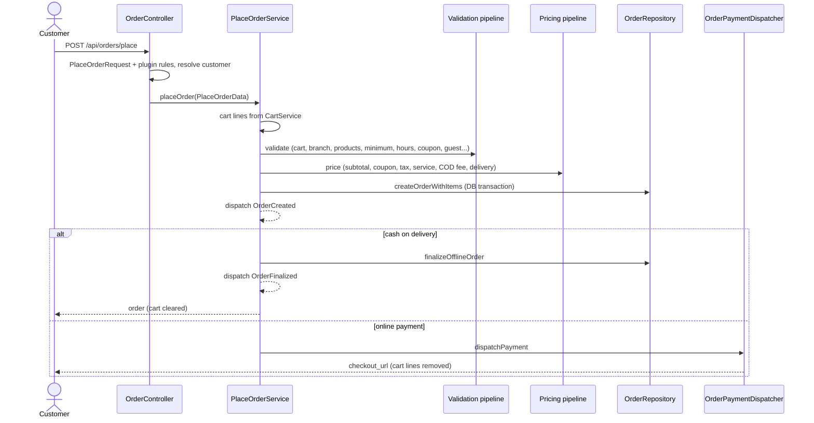

# Checkout and orders

## Overview

Turns the customer's cart into an order, prices it on the server, sends it to payment when needed, and lets customers and admins follow it through its status lifecycle. Every other commerce plugin (coupons, guest checkout, payments, combo packages, POS, Meta, push) plugs into this flow.

**Status:** live · **Plugin:** `order-management` ([plugin.json](../../../app/Plugins/OrderManagement/plugin.json)) · **Depends on:** cart-engine, locations-delivery, catalog-products, store-settings · **Related:** [Cart](cart.md), [Payments](payments.md), [Coupons](coupons.md), [Guest checkout](guest-checkout.md), [POS integration](pos-integration.md)

## How to use

### Customer: place an order

1. From the cart, choose **Proceed to Checkout** (`/checkout`). If you are not signed in and guest checkout is off, you are sent to `/login?redirect=/checkout` with the message "Please sign in or create an account to proceed".
2. Choose **Delivery** or **Takeaway**.
3. If the store has more than one active branch, choose a **Branch** (with one active branch, checkout hides the selector and preselects it automatically; selecting a delivery area also syncs its serving branch). For delivery, pick a saved **Delivery Address** or add one (guests fill name, phone and address fields instead; stores with simplified address mode enabled show a single **Detailed Address** field instead of building/floor/apartment).
4. Optionally enter a coupon code and an order note. On mobile, the bottom navigation bar is hidden on `/checkout` so the sticky total and **Place Order** bar anchor cleanly at the bottom.
5. Choose a payment method: **Cash on Delivery**, or card/wallet when online payments are enabled for the store.
6. Choose **Place Order**.
   - Cash on delivery: you see the order confirmation with its number (`ORD-XXXXXXXX`). The cart is emptied.
   - Online: you are redirected to the payment page; see [Payments](payments.md).

**If something goes wrong:** the message comes from the server and tells you what to fix:

| Message | Meaning | What to do |
| --- | --- | --- |
| Cart is empty | Nothing to order | Add items |
| The selected branch is inactive or unavailable. | Branch was disabled | Pick another branch |
| Some products are unavailable: … | A product was deactivated after you added it | Remove it from the cart |
| The minimum order amount is X. | Subtotal below the store minimum | Add items |
| We are currently closed. Please try again during our work hours. | Outside store hours | Order later |
| Guest checkout is not permitted for this store. Please log in. | Guest ordering is off | Sign in |
| Validation errors on fields | Missing branch/address/payment method | Fill the highlighted fields |

### Customer: follow orders

- **My Orders** (`/orders`) lists your orders with filters; select one for details (`/orders/:id`): items, totals, status and payment status.
- Guests use **Track Order** (`/track-order`), see [Guest checkout](guest-checkout.md).

### Store admin: manage orders

1. Open **إدارة المبيعات › الطلبات** (Sales › Orders). The list shows order number, customer, totals, status, payment status and POS delivery state, with filters.
2. Open an order to see customer, delivery address snapshot, branch, coupon, items with extras/components, and status history.
3. To change status by hand, use **تحديث حالة الطلب (يدوي)** (Update order status, manual): choose **الحالة الجديدة** (new status) and enter **سبب التعديل اليدوي** (reason). The action is visible only when the store setting "allow manual order status update" is on. Normally the branch POS updates status.
4. **رمز التكامل** (Integration token) on the list page generates the bearer token the POS uses to update statuses. Generating a new one revokes the old one immediately.

### Rules customers notice

- Order types: delivery and takeaway. Takeaway has no delivery fee.
- Totals = items subtotal − coupon discount + tax + cash-on-delivery fee + delivery fee.
- Status names: pending (قيد الانتظار), processing (قيد التحضير), out for delivery (خارج للتوصيل), completed (مكتمل), cancelled (ملغي).

## How it works

### Flow

1. **Entry:** `POST /api/orders/place` → [`OrderController::placeOrder`](../../../app/Plugins/OrderManagement/src/Http/Controllers/Api/OrderController.php). [`PlaceOrderRequest`](../../../app/Plugins/OrderManagement/src/Http/Requests/PlaceOrderRequest.php) validates `branch_id` (active branch), `payment_method` (enum), `type` (`web_delivery`/`web_takeaway`), `address_id` (must belong to the user and be in an active area), `coupon_id`, `note` ≤ 1000, and merges rules from plugins tagged `order.placement.rules` (coupon, guest data, billing data). The customer is resolved as the signed-in user or, through `order.customer.resolvers`, a guest ([`CheckoutCustomerResolver`](../../../app/Plugins/OrderManagement/src/Http/CheckoutCustomerResolver.php)).
2. **Validation pipeline** ([`OrderValidationPipeline`](../../../app/Plugins/OrderManagement/src/Pipelines/OrderValidationPipeline.php)), pipes run by priority:

   | Priority | Pipe | Plugin |
   | --- | --- | --- |
   | 100 | [`ValidateCartNotEmptyPipe`](../../../app/Plugins/OrderManagement/src/Pipelines/Pipes/Validation/ValidateCartNotEmptyPipe.php) | order-management |
   | 150 | [`ValidateBranchActivePipe`](../../../app/Plugins/OrderManagement/src/Pipelines/Pipes/Validation/ValidateBranchActivePipe.php) | order-management |
   | 200 | [`ValidateProductsActivePipe`](../../../app/Plugins/OrderManagement/src/Pipelines/Pipes/Validation/ValidateProductsActivePipe.php) | order-management |
   | 210 | [`ValidatePackageLinesPipe`](../../../app/Plugins/ComboPackages/src/Pipelines/ValidatePackageLinesPipe.php) | combo-packages |
   | 250 | [`ValidateMinimumOrderPipe`](../../../app/Plugins/OrderManagement/src/Pipelines/Pipes/Validation/ValidateMinimumOrderPipe.php) | order-management |
   | 300 | [`ValidateStoreOpenPipe`](../../../app/Plugins/OrderManagement/src/Pipelines/Pipes/Validation/ValidateStoreOpenPipe.php) | order-management |
   | 325 | [`GuestCheckoutPermissionPipe`](../../../app/Plugins/GuestCheckout/src/Pipelines/Pipes/GuestCheckoutPermissionPipe.php) | guest-checkout |
   | 350 | [`ValidateCouponPipe`](../../../app/Plugins/CouponsPromotions/src/Pipelines/Pipes/ValidateCouponPipe.php) | coupons-promotions |
   | 400 | [`ValidateUserAuthenticatedPipe`](../../../app/Plugins/OrderManagement/src/Pipelines/Pipes/Validation/ValidateUserAuthenticatedPipe.php) (rejects guests unless a previous pipe authorized them) | order-management |

3. **Pricing pipeline** ([`PricingCalculationPipeline`](../../../app/Plugins/OrderManagement/src/Pipelines/PricingCalculationPipeline.php)):

   | Priority | Pipe | Effect |
   | --- | --- | --- |
   | 100 | [`CalculateSubtotalPipe`](../../../app/Plugins/OrderManagement/src/Pipelines/Pipes/Pricing/CalculateSubtotalPipe.php) | Sum of cart line subtotals |
   | 200 | [`ApplyCouponDiscountPipe`](../../../app/Plugins/CouponsPromotions/src/Pipelines/Pipes/ApplyCouponDiscountPipe.php) | Discount; may zero the delivery fee (free shipping) |
   | 300 | [`CalculateTaxPipe`](../../../app/Plugins/OrderManagement/src/Pipelines/Pipes/Pricing/CalculateTaxPipe.php) | `tax_rate`% of (subtotal − discount), rounded to 2 dp |
   | 400 | [`CalculateServiceFeePipe`](../../../app/Plugins/OrderManagement/src/Pipelines/Pipes/Pricing/CalculateServiceFeePipe.php) | `config('app.service_rate')` × (subtotal − discount). The key is not defined, so this is 0 |
   | 450 | [`ApplyCodFeePipe`](../../../app/Plugins/PaymentProcessing/src/Pipelines/Pipes/ApplyCodFeePipe.php) | Store `cod_fee` for cash on delivery |
   | 500 | [`CalculateDeliveryFeePipe`](../../../app/Plugins/OrderManagement/src/Pipelines/Pipes/Pricing/CalculateDeliveryFeePipe.php) | Area `shipping_cost` for delivery orders (guest area or saved address); waived (`0`) when `free_shipping_threshold > 0` and discounted subtotal meets or exceeds the threshold |

4. **Persistence:** [`OrderRepository::createOrderWithItems`](../../../app/Plugins/OrderManagement/src/Services/Repositories/OrderRepository.php) runs in one transaction: generates `ORD-` + 8 random uppercase characters, snapshots the address (or guest address with area/governorate names), customer name/phone/email and coupon code, creates items with extras and package components, and clears the cart for offline payments.
5. **Side effects:** `OrderCreated` (listeners: admin notification, coupon usage, guest session, Meta tracking context, POS, push). COD orders also fire `OrderFinalized` (POS delivery, Meta purchase). Online orders go to [`OrderPaymentDispatcher`](../../../app/Plugins/OrderManagement/src/Services/Payments/OrderPaymentDispatcher.php); on gateway failure the order's payment is marked failed (`OrderPaymentFailed` releases coupon usage) and the cart is kept.
6. **Response:** [`OrderPlacementResponder`](../../../app/Plugins/OrderManagement/src/Http/Responders/OrderPlacementResponder.php) returns the order plus contributions tagged `order.placement.response` (guest tracking token, Meta purchase event data) and `checkout_url` for online payments.

7. **Cash on delivery paid on completion:** when a COD order's status becomes `completed` (POS callback, admin, or the POS delivery catch-up), a `saving` hook on [`Order`](../../../app/Plugins/OrderManagement/src/Models/Order.php) sets `payment_status` to `completed` («مكتمل (مدفوع)»). Online-paid orders are untouched.

### Asynchronous and failure paths

- Any `OrderValidationException` returns a failure with its message; other exceptions are logged ("Failed to place order") and return a generic failure. Nothing is persisted when validation fails because validation runs before the transaction.
- Online payment completion arrives later by webhook ([Payments](payments.md)); `OrderPaymentCompleted` then triggers POS delivery and the Meta purchase event.
- Status updates come from the POS callback or the admin action. Both go through [`OrderStatusTransitions`](../../../app/Plugins/OrderManagement/src/Services/OrderStatusTransitions.php) (the callback returns 409 on a disallowed transition) and are written to `order_status_events`. The `Order` model fires `OrderStatusUpdated` on every status change ([Order.php](../../../app/Plugins/OrderManagement/src/Models/Order.php#L183)), which sends a push notification.
- Placing an order twice in two tabs is covered by [13-two-tab-checkout](../../../tests/e2e/plugins/order-management/13-two-tab-checkout.live.spec.ts); the second attempt finds an empty cart.

### States

See [Data model › Order status](../data-model.md#order-status) and [Payment status](../data-model.md#payment-status).

### Data

| Entity | Read or written | Notes |
| --- | --- | --- |
| [`Order`](../../../app/Plugins/OrderManagement/src/Models/Order.php) | written | totals, status, payment fields, `pos_status`, snapshots |
| [`OrderItem`](../../../app/Plugins/OrderManagement/src/Models/OrderItem.php), `OrderItemExtra`, `OrderItemComponent` | written | name/price snapshots |
| [`OrderStatusEvent`](../../../app/Plugins/OrderManagement/src/Models/OrderStatusEvent.php) | written | status history with source (`integration`, admin) |
| Cart lines | read, then cleared | [Cart](cart.md) |

### Interfaces

| Interface | Details |
| --- | --- |
| `POST /api/orders/place` | See [Interfaces](../interfaces.md#cart-checkout-orders) |
| `GET /api/orders`, `GET /api/orders/{id}` | Signed-in customer's orders only ([`EloquentCustomerOrderHistory`](../../../app/Plugins/OrderManagement/src/Services/EloquentCustomerOrderHistory.php)) |
| `POST /api/order-status` | POS callback, bearer integration token, 60/min |

## Configuration

| Setting | Where | Effect | Default |
| --- | --- | --- | --- |
| `tax_rate` | Store settings › orders: نسبة الضريبة المضافة (%) | Tax percent on discounted subtotal | 0 |
| `min_order_amount` | Store settings › orders: الحد الأدنى لقيمة الطلب | Minimum items subtotal | 0 |
| `free_shipping_threshold` | Store settings › orders: الحد الأدنى للشحن المجاني | Waives delivery fee when `(subtotal - discount) >= threshold` (`0` disables) | 0 |
| `simplified_address_enabled` | Store settings › orders: تفعيل نموذج العنوان المبسّط | Hides building/floor/apartment/city fields and uses one detailed address field | off |
| `allow_manual_order_status_update` | Store settings › orders | Shows the manual status action | off |
| `work_times`, `accept_orders_after_work_times` | Store settings › النظام وساعات العمل | Store open check; overnight ranges supported | open always / accept |
| `cod_fee` | Store settings › payments | Added to COD orders | 0 |
| Integration token | Orders list › رمز التكامل | POS callback auth | none |

**Enabling:** activate `catalog-products`, `locations-delivery`, `cart-engine`, then `order-management`. Create at least one active branch and, for delivery, governorates and areas. Activate `guest-checkout` for account-free ordering and `payment-processing` for online payment.

## Testing

- Automated: [OrderPlacementHttpTest](../../../tests/Feature/OrderPlacementHttpTest.php), [OrderCheckoutRegressionTest](../../../tests/Feature/OrderCheckoutRegressionTest.php), [OrderPlacementBugsTest](../../../tests/Feature/OrderPlacementBugsTest.php), [StorefrontCheckoutAndShippingSettingsTest](../../../tests/Feature/StorefrontCheckoutAndShippingSettingsTest.php), [MoneyPrecisionAndOrderSnapshotsTest](../../../tests/Feature/MoneyPrecisionAndOrderSnapshotsTest.php), [PlaceOrderServiceTest](../../../tests/Unit/Services/PlaceOrderServiceTest.php), [OrderPipelineRegistryTest](../../../tests/Unit/Services/Order/OrderPipelineRegistryTest.php), [StoreHoursTest](../../../tests/Unit/Services/Order/StoreHoursTest.php), [OrderResourceTest](../../../tests/Feature/Filament/Resources/OrderResourceTest.php), [OrderStatusIntegrationSecurityTest](../../../tests/Feature/Security/OrderStatusIntegrationSecurityTest.php). Run `php artisan test --filter=Order`.
- Browser: [tests/e2e/plugins/order-management](../../../tests/e2e/plugins/order-management) (23 live specs covering guest/auth checkout, calculations, guards, history, status lifecycle, payment callback).
- Manual smoke test: add a product, check out with COD and takeaway → order appears in admin with status pending and the cart is empty.
- Not covered: real POS and real gateway behavior (faked in tests).

## Troubleshooting

| Symptom | Likely cause | Check | Fix |
| --- | --- | --- | --- |
| "We are currently closed" during opening hours | Work hours compared in UTC ([`OrderManagementConfig::isStoreOpen`](../../../app/Plugins/OrderManagement/src/DTOs/OrderManagementConfig.php)) | Server time `date -u` vs. configured hours | Enter hours in UTC or enable accepting orders after work times |
| Service fee never applied | `app.service_rate` is not defined in config | [config/app.php](../../../config/app.php) | Add the key if a service fee is wanted |
| "Failed to place order" with no detail | Unexpected exception | `laravel.log` → "Failed to place order" | Fix the logged error |
| Online order created but cart still full | Gateway intention failed | Order payment status `failed`, log "Creating payment intention" | Fix gateway settings; customer retries |
| Manual status button missing | Setting off | Store settings › orders | Enable it |
| POS status update rejected with 409 | Transition not allowed (e.g. completed → processing) | Response body `from_status`/`to_status` | Send statuses in order |
| POS update 401 | Missing/rotated token | Response message | Regenerate and share the integration token |

## History

- 2026-10: order placement split into validation and pricing pipelines that plugins extend; manual status setting key added; POS responses handled per the POS contract.
- 2026-03: product availability checks in cart and order placement.
- 2026-02: checkout UI components (order type, payment method, notes, summary); guest order tracking and emails.
- 2025-11: first checkout and order management.
