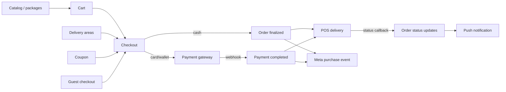

# Feature catalog

Every capability in Turbo Tenant. Plugin features are available to a store only when the plugin is active in its [marketplace](plugin-marketplace.md). Each page has a **How to use** part (customers, admins, operators) and a **How it works** part (code, data, failure paths), plus configuration, tests and troubleshooting.

| Feature | Who uses it | Entry points | Plugin | Status |
| --- | --- | --- | --- | --- |
| [Store provisioning](tenant-provisioning.md) | Platform operator | `/central` Tenants, `app:create-tenant` | host | live |
| [Plugin marketplace](plugin-marketplace.md) | Store admin, operator | `/admin/plugins`, `tenant:plugin:*` | host | live |
| [Store settings and branding](store-settings.md) | Store admin | Admin › إعدادات المتجر, PWA page | `store-settings` (core) | live |
| [Customer accounts](customer-accounts.md) | Customers, store admins | `/login`, `/register`, `/profile`, `/api/tenant/auth/*` | host | live |
| [Catalog and products](catalog.md) | Store admin, customers | Admin › الكتالوج والمنتجات, `/menu`, `/products/:id` | `catalog-products` | live |
| [Combo packages](combo-packages.md) | Store admin, customers | Admin › باقات التوفير, `/packages/:id` | `combo-packages` | live |
| [Media optimizer](media-optimizer.md) | Store admin (automatic), operator | Image uploads, `media:migrate-variants` | `media-optimizer` (core) | live |
| [Cart](cart.md) | Customers | `/cart`, `/api/cart` | `cart-engine` | live |
| [Checkout and orders](checkout-and-orders.md) | Customers, store admin, POS | `/checkout`, `/orders`, Admin › الطلبات, `/api/order-status` | `order-management` | live |
| [Delivery areas, branches and addresses](locations-delivery.md) | Store admin, customers | Admin › التوصيل والمناطق, checkout, profile | `locations-delivery` | live |
| [Guest checkout and tracking](guest-checkout.md) | Customers without accounts | `/checkout`, `/track-order` | `guest-checkout` | live |
| [Online payments](payments.md) | Customers, store admin, gateways | Checkout, `/api/webhooks/*` | `payment-processing` | live |
| [Coupons and promotions](coupons.md) | Store admin, customers | Admin › الكوبونات, checkout | `coupons-promotions` | live |
| [POS integration](pos-integration.md) | Store admin, branch POS | Branch links, order delivery panel, import/price pages | `pos-integration` | live (add-on) |
| [Favorites](favorites.md) | Customers | Heart buttons, `/favorites` | `customer-favorites` | live (browser storage only) |
| [Product reviews](product-reviews.md) | Customers, store admin | Product page, Admin › التقييمات والآراء | `product-reviews` | live |
| [Hero banners](hero-banners.md) | Store admin, customers | Admin › سلايدر, home page | `hero-banners` | live |
| [CMS pages](cms-pages.md) | Store admin, customers | Admin › صفحات CMS, `/pages/:slug` | `cms-pages` | live |
| [Push notifications](push-notifications.md) | Customers (app), store admin | Admin › إشعارات Push, order events | `push-notifications` | live |
| [Meta marketing](meta-marketing.md) | Store admin, Meta | Store settings › Meta, diagnostics page, catalog feed | `meta-marketing` | live |
| [Sample greeting](sample-greeting.md) | Developers | — | `sample-greeting` | demo |

## By area

### Platform
- [Store provisioning](tenant-provisioning.md): create a store with its database, domain and first admin.
- [Plugin marketplace](plugin-marketplace.md): turn capabilities on and off per store.
- [Store settings and branding](store-settings.md): identity, theme, hours, Google, SMTP, PWA.
- [Customer accounts](customer-accounts.md): register, sign in (password/Google), reset, profile.

### Menu
- [Catalog and products](catalog.md): categories, products, sizes, add-ons, weights, home sections.
- [Combo packages](combo-packages.md): bundles with choose-one/choose-many groups, add-ons, sales rules (hours, branches, order types, limits), coupons and POS mapping.
- [Media optimizer](media-optimizer.md): WebP image variants.

### Ordering
- [Cart](cart.md), [Checkout and orders](checkout-and-orders.md), [Delivery areas](locations-delivery.md), [Guest checkout](guest-checkout.md), [Online payments](payments.md), [Coupons](coupons.md), [POS integration](pos-integration.md).

### Engagement
- [Favorites](favorites.md), [Product reviews](product-reviews.md), [Hero banners](hero-banners.md), [CMS pages](cms-pages.md), [Push notifications](push-notifications.md), [Meta marketing](meta-marketing.md).

## Cross-feature journey: from menu to kitchen

