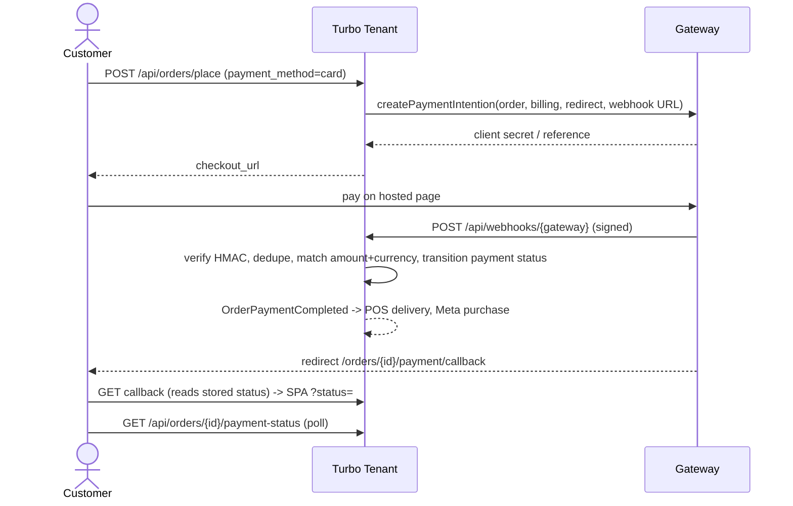

# Online payments

## Overview

Lets customers pay by card or mobile wallet through **Paymob** or **Kashier**, and adds a cash-on-delivery fee option. Payment is confirmed only by the gateway's server-to-server webhook; the browser return page just reads the stored result.

**Status:** live · **Plugin:** `payment-processing` ([plugin.json](../../../app/Plugins/PaymentProcessing/plugin.json)) · **Depends on:** order-management, store-settings · **Related:** [Checkout](checkout-and-orders.md), [POS integration](pos-integration.md), [Meta marketing](meta-marketing.md), [Paymob integration](../integrations/paymob.md), [Kashier integration](../integrations/kashier.md)

## How to use

### Store admin: set up a gateway

1. Open **إعدادات المتجر** (Store settings) and the payments tab.
2. Turn on **تفعيل الدفع الإلكتروني عبر البطاقات البنكية والمحافظ** (enable online payments) and pick **بوابة الدفع المفعلة** (active gateway): Paymob or Kashier.
3. Paymob: fill **الرابط الأساسي** (base URL, `https://accept.paymob.com`), **المفتاح العام** (public key), **المفتاح السري** (secret key), **معرفات الدمج** (integration ids, comma-separated), **مفتاح HMAC السري** (HMAC secret), currency and mode (`test`/`live`).
   Kashier: **معرف التاجر** (merchant id), **مفتاح API العام** (API key), **المفتاح السري** (secret key), mode, currency, allowed methods.
4. In the gateway dashboard set the transaction callback to `https://<store domain>/api/webhooks/paymob` (or `/api/webhooks/kashier`). The redirect URL is sent per payment by the app.
5. Optionally set **رسوم الدفع عند الاستلام (COD)** (cash-on-delivery fee).

### Customer: pay online

1. At checkout choose a card/wallet method and **Place Order**.
2. You are redirected to the gateway's page (Paymob hosted checkout, or the store's `/payments/:id/kashier` page for Kashier) and pay there.
3. You return to `/orders/:id/payment/callback`, which shows success, failure, or "pending" while the gateway confirmation has not arrived yet; the page polls the payment status. **View Order** (`عرض الطلب`) opens `/orders/:id` for signed-in customers, or `/orders/track?order_number=...&token=...` for guests (`guest-checkout` active).
4. After a failed payment you can retry from the order; the cart lines were already removed once the payment page was created.

### Rules customers notice

- Card/wallet options appear only when the store has online payments enabled.
- The order exists (status pending, payment pending) before you pay; a closed payment page leaves it unpaid.

## How it works

### Flow

1. **Gateway selection:** [`GatewayRegistry`](../../../app/Plugins/PaymentProcessing/src/Services/GatewayRegistry.php) resolves the active gateway from the `active_payment_gateway` setting; implementations [`PaymobService`](../../../app/Plugins/PaymentProcessing/src/Services/PaymobService.php) and [`KashierService`](../../../app/Plugins/PaymentProcessing/src/Services/KashierService.php) implement [`PaymentGatewayInterface`](../../../app/Plugins/PaymentProcessing/src/Contracts/PaymentGatewayInterface.php). Credentials come from tenant settings ([`PaymentProcessingConfig`](../../../app/Plugins/PaymentProcessing/src/DTOs/PaymentProcessingConfig.php)), not from `PAYMOB_*` env vars.
2. **Intention:** [`OrderPaymentDispatcher::dispatchPayment`](../../../app/Plugins/OrderManagement/src/Services/Payments/OrderPaymentDispatcher.php) builds billing data (billing fields are required by [`BillingDataRulesContributor`](../../../app/Plugins/PaymentProcessing/src/Http/Rules/BillingDataRulesContributor.php)), the redirect URL `url('/orders/{id}/payment/callback')` and webhook URL `url('/api/webhooks/{gateway}')`, both on the current store domain. Failure marks the order's payment failed and returns the gateway error.
3. **Webhook:** [`PaymobWebhookController`](../../../app/Plugins/PaymentProcessing/src/Http/Controllers/PaymobWebhookController.php) / [`KashierWebhookController`](../../../app/Plugins/PaymentProcessing/src/Http/Controllers/KashierWebhookController.php) → [`PaymentWebhookService::handleWebhook`](../../../app/Plugins/PaymentProcessing/src/Services/PaymentWebhookService.php):
   1. `validateHmac` with the store's secret, else `Invalid webhook signature`;
   2. duplicate check on `payment_events (gateway, transaction_id)`;
   3. find the order by `merchant_order_id`;
   4. amount in cents must equal `round(total × 100)`; currency must equal the gateway's currency;
   5. [`PaymentStateMachine::transition`](../../../app/Plugins/PaymentProcessing/src/Services/PaymentStateMachine.php) applies only allowed transitions (others are logged as `ignored_transition`); entering `completed` dispatches `OrderPaymentCompleted`;
   6. a `payment_events` row is recorded.
   Webhook routes are `tenantUngated` (work even if the plugin was deactivated mid-payment) and CSRF-exempt.
4. **Return page:** [`PaymentController::paymentCallback`](../../../app/Plugins/PaymentProcessing/src/Http/Controllers/PaymentController.php) only reads `payment_status` through [`PaymentCallbackService`](../../../app/Plugins/PaymentProcessing/src/Services/PaymentCallbackService.php) and redirects to the SPA with `status=success|failed|pending`. It never changes state.
5. **Status/config endpoints:** `payment-status` and `kashier-config` require the caller to own the order: the signed-in user for account orders, or the order id stored in the session's `guest_order_ids` for guest orders ([`AuthorizesOrderPayment`](../../../app/Plugins/PaymentProcessing/src/Http/Requests/Concerns/AuthorizesOrderPayment.php)). For guest orders when `guest-checkout` is active, `payment-status` runs [`OrderPaymentStatusResponseContributor`](../../../app/Plugins/OrderManagement/src/Contracts/OrderPaymentStatusResponseContributor.php) contributions (`order.payment-status.response`) so [`GuestPaymentStatusResponseContributor`](../../../app/Plugins/GuestCheckout/src/Http/Response/GuestPaymentStatusResponseContributor.php) attaches `tracking_token`, and [`resolvePaymentCallbackOrderLink`](../../../resources/js/plugins/payment-processing/api/usePaymentStatus.ts#L88) routes callback order actions to `/orders/track?order_number=...&token=...`.
6. **COD fee:** [`ApplyCodFeePipe`](../../../app/Plugins/PaymentProcessing/src/Pipelines/Pipes/ApplyCodFeePipe.php) adds `cod_fee` to cash orders. [`PaymentProcessingBootstrapContributor`](../../../app/Plugins/PaymentProcessing/src/Bootstrap/PaymentProcessingBootstrapContributor.php) exposes `cod_fee` and `online_payments_enabled` to the storefront.

### Asynchronous and failure paths

- Webhooks may arrive before or after the browser returns; the return page shows "pending" until the webhook lands.
- Repeated webhooks are acknowledged as duplicates and change nothing.
- `failed → processing/completed` is allowed so a declined card can be retried.
- Payment failure (`OrderPaymentFailed`) releases the coupon usage counted at order creation.
- Refunds: the `refunded` state exists, and [`RefundResult`](../../../app/Plugins/PaymentProcessing/src/DTOs/RefundResult.php) is defined, but refunds are performed in the gateway dashboard.

### States

See [Data model › Payment status](../data-model.md#payment-status).

### Data

| Entity / field | Read or written | Notes |
| --- | --- | --- |
| `orders.payment_status`, `payment_method`, `transaction_id`, `merchant_order_id`, `paymob_order_id`, `payment_data` | written | |
| [`PaymentEvent`](../../../app/Plugins/PaymentProcessing/src/Models/PaymentEvent.php) | written | idempotency and audit |

## Configuration

| Setting | Effect | Default |
| --- | --- | --- |
| `online_payments_enabled` | Show card/wallet options | true |
| `active_payment_gateway` | `paymob` or `kashier` | `paymob` |
| `paymob_base_url`, `paymob_secret_key`, `paymob_public_key`, `paymob_integration_ids`, `paymob_hmac_secret`, `paymob_currency`, `paymob_mode` | Paymob credentials | base URL, `EGP`, `test` |
| `kashier_merchant_id`, `kashier_api_key`, `kashier_secret_key`, `kashier_mode`, `kashier_currency`, `kashier_allowed_methods` | Kashier credentials | `test`, `EGP`, `card` |
| `cod_fee` | Cash-on-delivery fee | 0 |

**Rollout:** configure credentials and the webhook URL in the gateway before enabling online payments. Use sandbox/test mode first; the opt-in sandbox E2E needs a public HTTPS callback ([instructions](../development.md#paymob-sandbox-e2e)). These settings are stored unencrypted in the tenant `settings` table.

## Testing

- Automated: [PaymentWebhookSecurityTest](../../../tests/Feature/Security/PaymentWebhookSecurityTest.php), [PaymentCallbackSecurityTest](../../../tests/Feature/Security/PaymentCallbackSecurityTest.php), [PaymentProcessingApiTest](../../../tests/Feature/PaymentProcessingApiTest.php), unit tests in [tests/Unit/Services/Payment](../../../tests/Unit/Services/Payment) (state machine, webhook service, Paymob, Kashier, dispatcher, callback).
- Browser: [17-payment-visibility](../../../tests/e2e/plugins/order-management/17-payment-visibility.live.spec.ts), [18-payment-callback](../../../tests/e2e/plugins/order-management/18-payment-callback.live.spec.ts), opt-in [19-paymob-sandbox](../../../tests/e2e/plugins/order-management/19-paymob-sandbox.live.spec.ts), [payment-processing.live.spec.ts](../../../tests/e2e/plugins/payment-processing.live.spec.ts).
- Manual smoke test (sandbox): pay with a gateway test card, confirm `payment_status=completed`, a `payment_events` row, and the return page shows success.
- Not covered: live gateways in CI.

## Troubleshooting

| Symptom | Likely cause | Check | Fix |
| --- | --- | --- | --- |
| Paid but order stays pending | Webhook not received or rejected | Log lines with `gateway`, `merchant_order_id`, `result` (`invalid_signature`, `amount_mismatch`, `currency_mismatch`, `order_not_found`) | Fix HMAC secret/currency/callback URL; ask gateway to resend |
| `order_not_found` | Webhook sent to another store's domain | Gateway dashboard callback URL | Use this store's domain |
| "Failed to create payment" at checkout | Bad credentials or integration ids | Log "Creating payment intention" and gateway response | Correct settings, test mode first |
| Return page stuck on pending | Webhook delayed or blocked; app in maintenance mode | Web server access log for `/api/webhooks/` | Restore webhook delivery |
| 403/404 on payment-status for a guest | Different browser/session than the one that placed the order | `guest_order_ids` in session | Use the guest tracking page instead |
| Card options missing | `online_payments_enabled` off or plugin inactive | Bootstrap `settings` | Enable |

## History

- 2026-10: read-only callback, fail-closed webhooks, explicit payment state machine, idempotent webhook events.
- 2026-03: guest billing defaults.
- 2026-01: Kashier gateway.
- 2025-11: Paymob integration.
