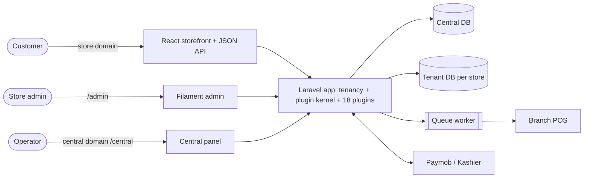

# Turbo Tenant handbook

Turbo Tenant is a multi-tenant online ordering platform for restaurants. One Laravel 12 application serves many stores, each with its own domain and database (stancl/tenancy), a React storefront, an Arabic Filament admin panel, and a plugin marketplace from which the store switches on capabilities such as cart, checkout, online payments, coupons, POS integration and push notifications.

## Start here

| I want to... | Read |
| --- | --- |
| Understand what the product does and its vocabulary | [Overview](overview.md) |
| Run it on my machine | [Getting started](setup.md) |
| Understand how it is built | [Architecture](architecture.md), [Data model](data-model.md) |
| Find or change a feature | [Feature catalog](features/index.md) |
| Connect a store to its restaurant POS | [Connecting a POS to the website](pos-website-link.md) |
| Call or integrate with it | [Interfaces](interfaces.md), [Configuration](configuration.md), [Security](security.md) |
| Integrate Google login, Paymob, Kashier, or Meta | [Google login](integrations/google-login.md), [Paymob](integrations/paymob.md), [Kashier](integrations/kashier.md), [Meta Pixel & CAPI](integrations/meta-pixel.md) |
| Add code, run tests, build themes, follow conventions | [Development guide](development.md), [Themes & test IDs](themes.md) |
| Release it | [Deployment](ops/deployment.md), [Production web server and post-pull checklist](ops/production-server.md), [Queue, workers and scheduler](ops/queue-and-workers.md) |
| Keep it running / fix incidents | [Operations and troubleshooting](ops/operations.md) |
| See what changed | [Changelog](../changelog.md) |
| Teach a store admin to run their store (Arabic) | [دليل المستخدم](../start/index.md) |

## Reading paths

- **New developer (day 1):** [Overview](overview.md) → [Getting started](setup.md) → [Architecture](architecture.md) → [Checkout and orders](features/checkout-and-orders.md) end to end → [Development guide](development.md).
- **Operator / on-call:** [Deployment](ops/deployment.md) → [Queue and workers](ops/queue-and-workers.md) → [Operations](ops/operations.md) → [Configuration](configuration.md) → [POS integration](features/pos-integration.md) and [Payments](features/payments.md) troubleshooting.
- **Product / support:** [Overview](overview.md) → [Feature catalog](features/index.md) → the "How to use" section of each feature.
- **Store admin (Arabic):** [دليل المستخدم](../start/index.md): أول خطوات التشغيل، المنيو، الفروع والتوصيل، الطلبات، الربط مع نقطة البيع، الدفع، الكوبونات والتسويق.
- **POS installer:** [Connecting a POS to the website](pos-website-link.md) → [POS integration](features/pos-integration.md).

## System at a glance

A request's host selects the store; the store's database, cache tag and files become active; only the plugins active for that store answer. Orders flow from cart through a plugin-extended validation and pricing pipeline, to payment, to the branch POS, and back as status updates.

## More references

- Browse all of this as a website ([site home](../index.md)): `cd docs && npm install && npm run dev` ([Development guide › Documentation](development.md#documentation)).
- Design notes: [SaaS lifecycle engine](architecture/saas-lifecycle-engine.md), [plugin configuration pattern](architecture/plugin-configuration-pattern.md), [storefront performance](storefront-performance.md), [POS delivery monitor design](order-pos-delivery-monitor.md).
- POS API contract (owned by POS repo): [POS website integration](https://github.com/habibGamal/ai_rewrite_turbo_restaurant/blob/master/docs/dev/website-integration.md).
