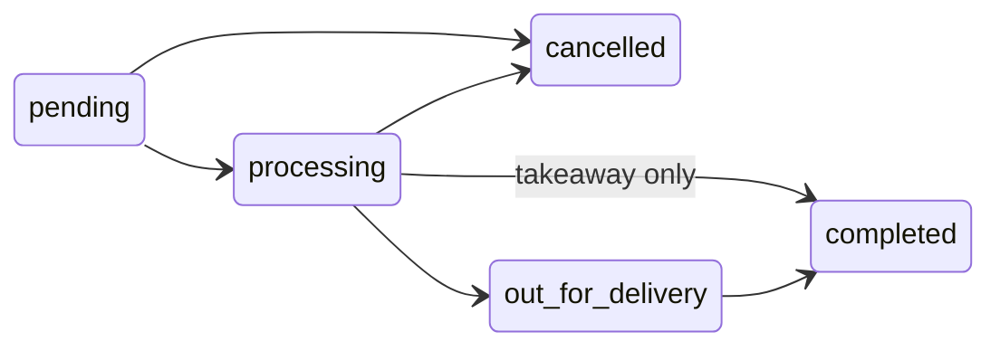

# Connecting a POS to the website

This page is the end-to-end setup and contract between a store on this website and its restaurant POS branches. The plugin internals (delivery tracking, retries, verification) are in [POS integration](features/pos-integration.md); the POS side is documented in the POS project's own handbook, and the names below match it.

## The two secrets

There are two different credentials, one per direction. Mixing them up is the most common setup mistake.

| Direction | Credential | Created where | Pasted where | Sent as |
| --- | --- | --- | --- | --- |
| Website → POS (place order, shift id, can accept, product import) | **POS web API key** | POS: الإعدادات › إدارة الفروع › مفتاح الربط (API) › «مفتاح API للموقع والفروع» (button «توليد مفتاح») | Website: each branch's **مفتاح API لنقطة البيع**, and for the master POS **مفتاح API لمستودع المنتجات الرئيسي** in Store settings › نظام نقاط البيع (POS) | `X-Api-Key: <key>` |
| POS → website (order status) | **Integration token** | Website: الطلبات › **رمز التكامل** (shown once; generating a new one revokes the old) | POS: الإعدادات › إدارة الفروع › مفتاح الربط (API) › «رمز التكامل من الموقع» | `Authorization: Bearer <token>` |

The POS also needs the website address: POS setting **رابط الموقع** (الإعدادات العامة), for example `https://shop.example.com`. Every slave POS and the website must hold the same web API key as the master POS. On the POS, `WEB_API_KEY` in `.env` is only a fallback when the setting is empty.

## Setup checklist

1. **POS:** generate the web API key («توليد مفتاح») and copy it.
2. **Website:** activate the **POS integration** plugin in سوق الإضافات (it depends on order management, catalog, locations and store settings).
3. **Website:** in التوصيل والمناطق › الفروع, set each branch's **الرابط** to that branch POS's public base URL (`https://pos-branch.example.com`) and paste the key into **مفتاح API لنقطة البيع**.
4. **Website:** in إعدادات المتجر › نظام نقاط البيع (POS), set **رابط مستودع المنتجات الرئيسي** (master POS URL) and **مفتاح API لمستودع المنتجات الرئيسي**.
5. **Website:** import products (الكتالوج والمنتجات › استيراد منتجات POS) or map existing products to POS items per branch. Unmapped items make deliveries fail.
6. **Website:** الطلبات › **رمز التكامل** → generate, copy (shown once).
7. **POS:** paste it into «رمز التكامل من الموقع» and set «رابط الموقع».
8. **Server:** make sure a queue worker runs on the central database ([Queue, workers & scheduler](ops/queue-and-workers.md)).
9. **Test:** place a cash order on the website; it should appear in the branch POS, and accepting it on the POS should move the website order to «قيد التحضير».

## Contract

The POS repository owns the canonical POS API request/response contract: [POS website integration contract](https://github.com/habibGamal/ai_rewrite_turbo_restaurant/blob/master/docs/dev/website-integration.md).

### Website → POS (outbound)

[`POSApiClient`](../../app/Plugins/PosIntegration/src/Services/POS/POSApiClient.php) calls `branch.link` + path with `X-Api-Key` (`branch.pos_api_key`), `Accept: application/json`, a 3 s connect timeout, and a 30 s request timeout, with `allow_redirects => false` and `verify => false` (self-signed branch certs). [`PublicEndpointGuard`](../../app/Support/Network/PublicEndpointGuard.php) rejects private/loopback/reserved hosts unless `NETWORK_ALLOW_PRIVATE_HOSTS=true`.

| Call | Website behavior |
| --- | --- |
| `GET /api/can-accept-order` | `false` defers the delivery (counted as an attempt, not a failure) |
| `GET /api/get-shift-id` | Stores `shift_id` on the order when not already set |
| `POST /api/web-orders/place-order` | Retries via `SendOrderToPosJob` (`pos-database` queue, 5 tries, 3 s backoff, 60 s timeout); see responses below |
| Master POS (`products_repo_link` + `products_repo_api_key`) | [`HttpPosMasterClient`](../../app/Plugins/PosIntegration/src/Services/POS/HttpPosMasterClient.php) fetches products and prices (5 s timeout) |

[`OrderPOSPayloadBuilder`](../../app/Plugins/PosIntegration/src/Services/POS/OrderPOSPayloadBuilder.php) sends `order.idempotencyKey` (SHA-256 of tenant ID, order ID, and order number), Arabic customer address and item notes (`PosNoteLabel`, including variant names as «النوع»), weighted items in kg, and mapped add-ons/combo components. Delivery fees go in `order.service`.

| POS answer | Website does |
| --- | --- |
| 200 created | `pos_status = sent` |
| 200 `already_received: true` | Marks sent and advances the website order status to match the POS status (never backwards) |
| 409 `conflict: true` | Marks delivery `failed` without retry and records `mismatches` |
| 400 / 422 | Marks delivery `failed` with the error message |
| timeout / 5xx after POST | Sets `needs_verification`; an admin checks with the branch before retrying (never auto-replayed) |

### POS → website (inbound)

`POST https://<store domain>/api/order-status` with `Authorization: Bearer <integration token>` (`VerifyIntegrationToken`, `throttle:60,1`, CSRF-exempt) updates order status and writes `order_status_events` with `source=integration`.

Allowed transitions ([`OrderStatusTransitions`](../../app/Plugins/OrderManagement/src/Services/OrderStatusTransitions.php)):

Any other transition returns `409` with `from_status` / `to_status` (`401` on missing/invalid token, `404` if order not found, `422` on invalid body). `processing → completed` is allowed only for `web_takeaway` orders.

**Cash orders become paid on completion.** When a cash-on-delivery order reaches `completed` by any path (POS callback, admin action, or the already-received catch-up), its payment status becomes «مكتمل (مدفوع)». Online payments are untouched.

## Troubleshooting

| Symptom | Cause | Fix |
| --- | --- | --- |
| Every delivery fails with 401 | Branch **مفتاح API لنقطة البيع** differs from the POS key | Copy the key again from the POS «مفتاح API للموقع والفروع» |
| Import page is empty / 401 | Master key or URL wrong | Store settings › POS |
| Orders stay «في قائمة الإرسال» (`queued`) | No worker, or jobs written to a tenant DB | [Queue, workers & scheduler](ops/queue-and-workers.md) |
| POS accepted the order but the website still shows «قيد الانتظار» | POS has no token, wrong token, or wrong «رابط الموقع» | Generate a new token on the website and paste it in the POS |
| «رقم الطلب مستخدم في الفرع لطلب مختلف» | 409 conflict | Check the order on the POS; resend only if it is really missing |
| Status update 409 | POS skipped a step (e.g. a delivery order completed from processing) | Move the order through the statuses in order |

More: [POS integration › Troubleshooting](features/pos-integration.md#troubleshooting).
