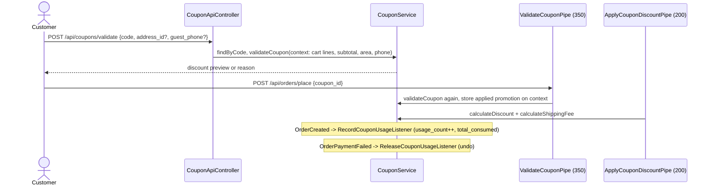

# Coupons and promotions

## Overview

Promo codes that give a percentage or fixed discount, optionally free delivery, under conditions: order total range, specific products/categories/line types, delivery governorates/areas, first order only, specific customers, valid days and hours, expiry and usage limits.

**Status:** live · **Plugin:** `coupons-promotions` ([plugin.json](../../app/Plugins/CouponsPromotions/plugin.json)) · **Depends on:** cart-engine, order-management, catalog-products, locations-delivery · **Related:** [Checkout](checkout-and-orders.md), [Combo packages](combo-packages.md) (per-package coupon eligibility)

## How to use

### Store admin: create a coupon

**العروض والخصومات › الكوبونات** (Offers & discounts › Coupons) → create:

| Field (Arabic label) | Meaning |
| --- | --- |
| رمز الكوبون (البروموكود) | Code customers type |
| اسم الحملة الترويجية, وصف الكوبون وشروطه للعملاء | Name and customer-facing description |
| نوع الخصم, قيمة الخصم | `percentage` or `fixed`, and the value |
| تاريخ ووقت الانتهاء | Expiry date/time |
| الحد الأقصى لمرات الاستخدام | Total uses allowed |
| كوبون نشط | Active switch |
| الحد الأدنى / الأقصى لقيمة الطلب | Order subtotal range |
| نطاق تطبيق الكوبون, اختر المنتجات/الفئات المشمولة | Applies to all items, chosen products, chosen categories, or line types (e.g. packages) |
| يمنح شحن مجاني, الحد الأدنى للشحن المجاني | Free delivery, optionally above a threshold |
| المحافظات / المناطق القابلة للتطبيق | Delivery locations where it is valid |
| صالح للطلب الأول للعميل فقط | First order only |
| لمستخدمين محددين فقط, اختر المستخدمين | Restrict to customers |
| أيام الأسبوع الصالحة, صالح من/حتى الساعة | Valid days and hours |

Read-only counters: **عدد مرات الاستخدام** (times used), **إجمالي الخصم الممنوح** (total discount given).

### Customer: apply a code

At checkout enter the code and apply. The summary shows the discount (and free delivery if granted). An invalid or ineligible code shows the reason ("Invalid coupon code", "This coupon is not valid at this time", etc.). The coupon is checked again when you place the order.

### Rules customers notice

- Percentage/fixed discounts apply to the eligible part of the cart only when the coupon is limited to products/categories/line types.
- Package lines count only if the package allows coupons.
- Valid hours use the server clock (UTC).

## How it works

### Flow

1. **Preview:** [`CouponApiController::validate`](../../app/Plugins/CouponsPromotions/src/Http/Controllers/Api/CouponApiController.php) builds a [`CouponContext`](../../app/Plugins/CouponsPromotions/src/DTOs/CouponContext.php) from the current cart lines, subtotal, address area/governorate and phone (customer or `guest_phone`).
2. **Rules:** [`CouponService::validateCoupon`](../../app/Plugins/CouponsPromotions/src/Services/CouponService.php) runs the rule classes in [src/Rules](../../app/Plugins/CouponsPromotions/src/Rules): active, expiry, max usage, min/max order total, applicable items, shipping location, time restrictions, user restrictions. The first failure's message is returned.
3. **At order time:** [`CouponOrderRulesContributor`](../../app/Plugins/CouponsPromotions/src/Http/Rules/CouponOrderRulesContributor.php) adds request rules; [`ValidateCouponPipe`](../../app/Plugins/CouponsPromotions/src/Pipelines/Pipes/ValidateCouponPipe.php) revalidates; [`ApplyCouponDiscountPipe`](../../app/Plugins/CouponsPromotions/src/Pipelines/Pipes/ApplyCouponDiscountPipe.php) adds a discount adjustment and may zero the delivery fee. The order stores `coupon_id` and `coupon_code`.
4. **Discount math:** [`ApplicableTo`](../../app/Plugins/CouponsPromotions/src/Enums/ApplicableTo.php) sums the eligible subtotal; [`DiscountType`](../../app/Plugins/CouponsPromotions/src/Enums/DiscountType.php) computes percentage or fixed off that amount.
5. **Usage accounting:** [`RecordCouponUsageListener`](../../app/Plugins/CouponsPromotions/src/Listeners/RecordCouponUsageListener.php) on `OrderCreated` (when discount > 0); [`ReleaseCouponUsageListener`](../../app/Plugins/CouponsPromotions/src/Listeners/ReleaseCouponUsageListener.php) on `OrderPaymentFailed` decrements without going below zero.

### Data

[`Coupon`](../../app/Plugins/CouponsPromotions/src/Models/Coupon.php): `code`, `type`, `value`, `expiry_date`, `is_active`, `max_usage`, `usage_count`, `total_consumed`, `conditions` JSON (`min_order_total`, `max_order_total`, `applicable_to`, `shipping`, `usage_restrictions`, `valid_days`, `valid_hours`), merged with defaults on read.

## Configuration

No store settings. Activate after cart-engine, order-management, catalog-products and locations-delivery.

## Testing

- Automated: [CouponOrderPlacementValidationTest](../../tests/Feature/CouponOrderPlacementValidationTest.php), [CategoryCouponCheckoutTest](../../tests/Feature/CategoryCouponCheckoutTest.php), [CouponContractTest](../../tests/Feature/Contracts/CouponContractTest.php), [CouponAdminFormLineTypesTest](../../tests/Feature/CouponsPromotions/CouponAdminFormLineTypesTest.php), [CouponsPromotionsUxTest](../../tests/Feature/CouponsPromotionsUxTest.php), [CouponServiceTest](../../tests/Unit/Services/CouponServiceTest.php), [ApplicableToLineTypesTest](../../tests/Unit/CouponsPromotions/ApplicableToLineTypesTest.php).
- Browser: [coupons-promotions.live.spec.ts](../../tests/e2e/plugins/coupons-promotions.live.spec.ts).
- Manual smoke test: 10% coupon limited to one category; cart with items inside and outside the category → discount equals 10% of the in-category subtotal.

## Troubleshooting

| Symptom | Likely cause | Check | Fix |
| --- | --- | --- | --- |
| "Invalid coupon code" | Code not found (exact match) | Coupons list | Check spelling/case |
| "not valid at this time" | Days/hours window; server clock is UTC | `valid_days`, `valid_hours` | Enter hours in UTC |
| Accepted in preview, rejected at order | Cart, address or time changed in between | Order error message | Re-apply |
| No discount on combo | Package `allow_coupons` off | Package form | Enable |
| Usage count too high | Online payment abandoned without a failure callback | Orders with coupon and pending payment | Adjust counts manually if needed |

## History

- Unreleased (working tree): line-type targeting (packages).
- 2026-10: checkout pipeline integration, usage release on payment failure.
- 2025-11: coupons with conditions.
