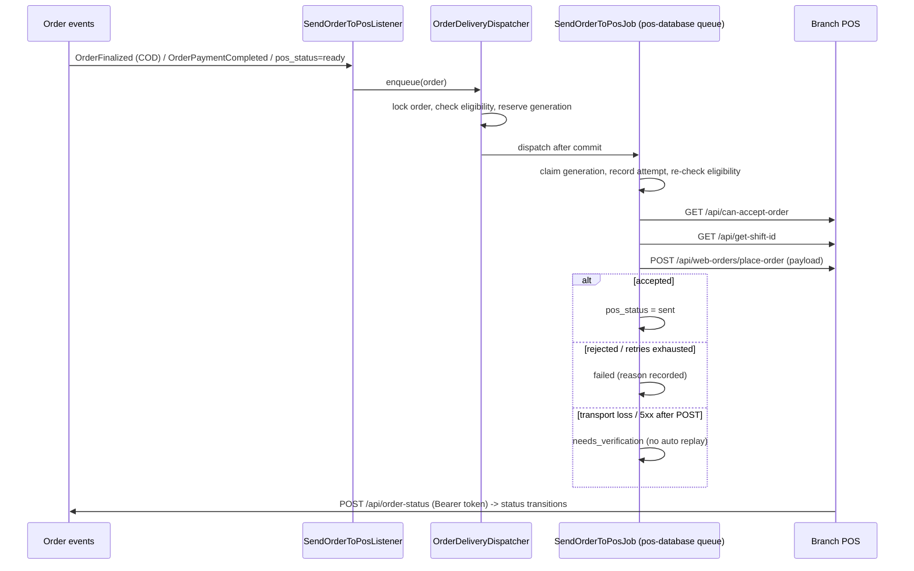
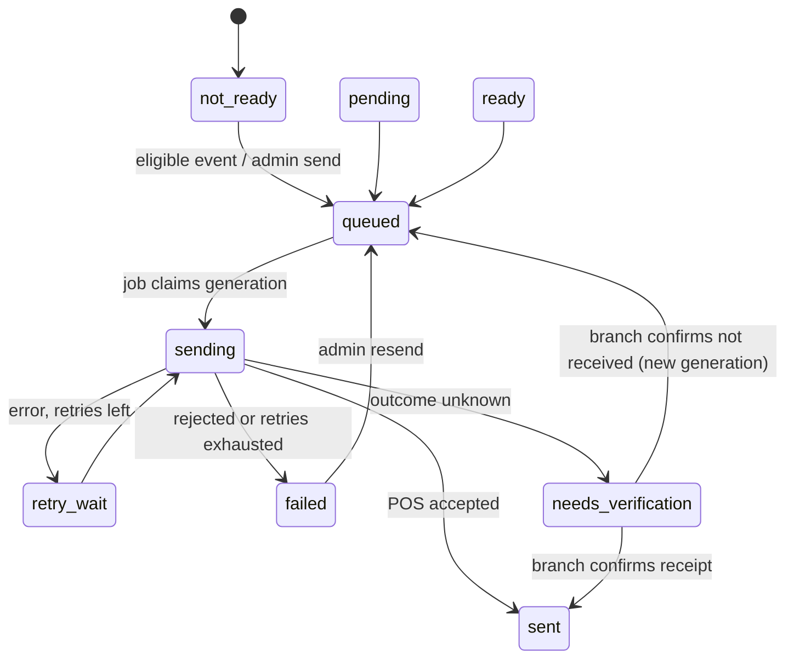

# POS integration

## Overview

Sends online orders to the branch's point-of-sale system, tracks every delivery attempt, receives order status updates back from the POS, and lets admins import products and sync prices from a master POS product repository.

**Status:** live (add-on) · **Plugin:** `pos-integration` ([plugin.json](../../app/Plugins/PosIntegration/plugin.json)) · **Depends on:** order-management, catalog-products, locations-delivery, store-settings · **Related:** [Checkout](checkout-and-orders.md), [Locations](locations-delivery.md) (branch `link`), [Payments](payments.md). POS API contract: [CREATE_ORDER_API_DOC.md](../../CREATE_ORDER_API_DOC.md). Detailed delivery design: [order-pos-delivery-monitor.md](../order-pos-delivery-monitor.md)

## How to use

### Store admin: connect branches

1. In **التوصيل والمناطق › الفروع** (Delivery & areas › Branches), set each branch's **link** to its POS base URL (public HTTPS address) and **مفتاح API لنقطة البيع** (POS API key) to that POS's `WEB_API_KEY`. The POS rejects website calls without it (401).
2. On the orders list, open **رمز التكامل** (Integration token), generate a token and give it to the POS vendor. The POS sends it as `Authorization: Bearer <token>` to `POST https://<store domain>/api/order-status`.
3. Map products: in a product's form, the POS section lets you pick the POS item per **الفرع** (branch), optionally per **التنويع** (variant) and **عنصر الإضافة** (add-on item). Extra options and combo packages have equivalent POS mapping fields.

### Store admin: import and price sync

1. Store settings › **نظام نقاط البيع (POS)** → **رابط مستودع المنتجات الرئيسي** (master product repository URL) and **مفتاح API لمستودع المنتجات الرئيسي** (the master POS `WEB_API_KEY`).
2. **الكتالوج والمنتجات › استيراد منتجات POS** (Import POS products): **تحديث القائمة** (refresh) lists POS products with category, name, reference number and type; select and **استيراد المحدد** (import selected).
3. **مزامنة الأسعار** (Sync prices): compare and update local prices from the POS.

### Store admin: monitor deliveries

1. Orders list: POS delivery column, failure filters and an overdue filter; the dashboard failed-orders widget lists failed deliveries.
2. Open an order: the delivery panel shows state, attempt/failure counts, queued/latest/next/sent times, latest error and who requested it; an attempts table holds history.
3. Actions: **إرسال لنقطة البيع** (send to POS) / **إعادة الإرسال لنقطة البيع** (resend), and **تسجيل نتيجة التحقق مع الفرع** (record branch verification result) for uncertain deliveries: call the branch, then record received / not received with **تفاصيل التحقق مع الفرع** (evidence). Not received enables a new retry.

Manual actions require an admin and an active POS plugin. They are refused, with the reason shown, for cancelled/completed orders (لا يمكن إرسال طلب ملغي أو مكتمل), non-web orders, refunded payments, online orders not yet paid (بانتظار تأكيد سداد الطلب), and orders without a valid branch ([`OrderDeliveryEligibility`](../../app/Plugins/PosIntegration/src/Services/OrderDeliveryEligibility.php)).

## How it works

### Flow

1. **Triggers:** [`SendOrderToPosListener`](../../app/Plugins/PosIntegration/src/Listeners/SendOrderToPosListener.php) on `OrderFinalized` (cash orders), `OrderPaymentCompleted` (paid online orders), and `OrderCreated`/`OrderStatusUpdated` when `pos_status` is `ready`.
2. **Dispatch:** [`OrderDeliveryDispatcher`](../../app/Plugins/PosIntegration/src/Services/OrderDeliveryDispatcher.php) locks the order, checks eligibility, rotates a delivery *generation* and dispatches after the tenant transaction commits. All automatic and manual paths go through it; orders already queued/sending/retry-wait/sent/uncertain are not queued again.
3. **Job:** [`SendOrderToPosJob`](../../app/Plugins/PosIntegration/src/Jobs/SendOrderToPosJob.php): 5 tries, 3 s backoff, 60 s timeout, on the `pos-database` connection pinned to the central DB ([config/queue.php](../../config/queue.php)). It checks tenant identity, claims the generation under lock, records the attempt ([`OrderDeliveryTracker`](../../app/Plugins/PosIntegration/src/Services/OrderDeliveryTracker.php)), re-checks eligibility, then calls [`OrderPOSService`](../../app/Plugins/PosIntegration/src/Services/OrderPOSService.php).
4. **POS calls:** [`POSApiClient`](../../app/Plugins/PosIntegration/src/Services/POS/POSApiClient.php) builds URLs from `branch.link` + `/api/can-accept-order`, `/api/get-shift-id`, `/api/web-orders/place-order` and sends `branch.pos_api_key` as `X-Api-Key` (the master client sends `products_repo_api_key` the same way), after [`PublicEndpointGuard`](../../app/Support/Network) rejects private addresses (unless `NETWORK_ALLOW_PRIVATE_HOSTS`). HTTP timeout 30 s per request. Payload: [`OrderPOSPayloadBuilder`](../../app/Plugins/PosIntegration/src/Services/POS/OrderPOSPayloadBuilder.php) with item ids from [`POSProductResolver`](../../app/Plugins/PosIntegration/src/Services/POS/POSProductResolver.php) (`product_pos_mappings`, `pos_line_mappings`) and customer data from [`POSCustomerDataFormatter`](../../app/Plugins/PosIntegration/src/Services/POS/POSCustomerDataFormatter.php); responses interpreted by [`POSErrorResponseHandler`](../../app/Plugins/PosIntegration/src/Services/POS/POSErrorResponseHandler.php).
5. **Outcomes:** branch cannot accept → deferral (counted as an attempt, not a failure); missing product mapping → recorded failure without exception; exception with retries left → `retry_wait`; terminal → `failed`; uncertain submission (transport loss during POST, POS 5xx, worker died after POST) → `needs_verification`, never replayed automatically because the POS contract does not guarantee deduplication by `orderNumber`.
6. **Idempotency:** the payload carries `order.idempotencyKey`, a SHA-256 of tenant key, order id and order number, identical for every send of the order. A POS that already saved the order (same key, customer phone, total and items) answers 200 with `already_received: true` and its `order.status`; [`OrderPOSService`](../../app/Plugins/PosIntegration/src/Services/OrderPOSService.php) records it as sent and moves the site order forward to that status through allowed transitions (never backwards), logging `order_status_events` with source `integration`. A POS that holds a *different* order under the number answers 409 `conflict: true` with `mismatches`; the delivery fails without retry and shows the mismatched fields.
6. **Review:** [`OrderDeliveryReview`](../../app/Plugins/PosIntegration/src/Services/OrderDeliveryReview.php) records admin verification; "received" marks sent, "not received" starts a new generation.
7. **Status callback:** the POS calls `POST /api/order-status` ([`OrderStatusController`](../../app/Plugins/OrderManagement/src/Http/Controllers/Api/OrderStatusController.php)), authenticated by [`VerifyIntegrationToken`](../../app/Plugins/OrderManagement/src/Http/Middleware/VerifyIntegrationToken.php) (`hash_equals` against the stored token), 60 requests/min, transition-checked, recorded in `order_status_events` with `source=integration`.
8. **Catalog:** [`HttpPosMasterClient`](../../app/Plugins/PosIntegration/src/Services/POS/HttpPosMasterClient.php) reads the master repository (5 s timeout); [`PosProductImporter`](../../app/Plugins/PosIntegration/src/Services/PosProductImporter.php) and [`PosCatalogDiff`](../../app/Plugins/PosIntegration/src/Services/PosCatalogDiff.php) drive the import and price pages.

### States

`orders.pos_status` ([`OrderPosStatus`](../../app/Plugins/OrderManagement/src/Enums/OrderPosStatus.php)):

### Data

| Entity | Notes |
| --- | --- |
| [`OrderPosDelivery`](../../app/Plugins/PosIntegration/src/Models/OrderPosDelivery.php), [`OrderPosDeliveryAttempt`](../../app/Plugins/PosIntegration/src/Models/OrderPosDeliveryAttempt.php) | Current delivery cycle and every attempt/verification |
| [`ProductPosMapping`](../../app/Plugins/PosIntegration/src/Models/ProductPosMapping.php), [`PosLineMapping`](../../app/Plugins/PosIntegration/src/Models/PosLineMapping.php) | Local product/variant/add-on/package → POS item per branch |
| `orders.pos_status`, `pos_failure_reason`, `shift_id` | On the order |

## Configuration

| Setting | Where | Effect |
| --- | --- | --- |
| Branch `link` | Branches resource | POS base URL per branch |
| Branch `pos_api_key` | Branches resource (added by this plugin) | Sent as `X-Api-Key` to that branch's POS; stored encrypted |
| Integration token | Orders list › رمز التكامل | Auth for POS callbacks |
| `products_repo_link` | Store settings › POS | Master product repository |
| `products_repo_api_key` | Store settings › POS | Sent as `X-Api-Key` to the master POS |
| `POS_QUEUE_DB_CONNECTION`, `DB_QUEUE_RETRY_AFTER` | `.env` | Queue storage (central) and visibility timeout (> 60 s) |
| `NETWORK_ALLOW_PRIVATE_HOSTS` | `.env` | Allow LAN POS URLs (development) |

**Rollout:** activate the plugin (runs its migrations, including delivery tracking tables `2026_11_05_000001_create_order_pos_deliveries`). For tenants that already had the plugin before that migration existed, run `php artisan tenants:plugin:migrate --plugin=pos-integration --force` before serving the new UI or starting workers. A central queue worker must run. Restart workers after deploying. Map products before going live; unmapped items cause delivery failures.

## Testing

- Automated: [tests/Feature/PosIntegration](../../tests/Feature/PosIntegration) (lifecycle, delivery tracking, request/response contracts for can-accept, shift id, place-order), [OrderDeliveryMonitorTest](../../tests/Feature/Filament/Resources/OrderDeliveryMonitorTest.php), [ComboPackagePosFlowTest](../../tests/Feature/Integration/ComboPackagePosFlowTest.php), unit tests in [tests/Unit/Services/POS](../../tests/Unit/Services/POS), [PublicEndpointGuardTest](../../tests/Feature/Security/PublicEndpointGuardTest.php). HTTP is faked.
- Manual: `php artisan app:create-test-order` inside a tenant creates an order with variants, extras and weights for POS testing ([command](../../app/Plugins/PosIntegration/src/Console/Commands/CreateTestOrder.php)).
- Not covered: real POS deduplication and availability; worker availability in production.

## Troubleshooting

| Symptom | Likely cause | Check | Fix |
| --- | --- | --- | --- |
| Orders stay `queued` | No worker on the central `jobs` table | `jobs` rows with queue `default`; worker process | Start `queue:work` |
| `retry_wait` repeatedly | POS unreachable or erroring | Latest error in delivery panel; log entries with `endpoint` | Fix POS/network; it retries up to 5 times |
| `failed` with missing product | Item not mapped for that branch | Failure reason | Map the product/variant/add-on, then resend |
| `needs_verification` | Uncertain outcome after POST | Attempts table | Call the branch; record the result. Do not resend before confirming |
| Overdue warning (> 5 min) | Worker killed mid-send or queue stalled | Worker logs | Verify with branch, then record result |
| POS URL rejected | Private/loopback address blocked | Log from endpoint guard | Use a public URL, or `NETWORK_ALLOW_PRIVATE_HOSTS=true` locally |
| Status callbacks 401 | Token missing/rotated | Response message | Share the current token |
| Delivery failed: «رقم الطلب مستخدم في الفرع لطلب مختلف» | POS has another order with this number (409 conflict) | Message lists what differs (key, customer, total, items) | Check the order on the POS; resend only if it is really missing |
| Status callback 409 | Disallowed transition | Response `from_status`/`to_status` | POS must send states in order |
| `queue:retry` did nothing useful | Old generation is stale by design | — | Use the order's resend action |

## History

- Unreleased (working tree): delivery tracking tables, attempt history, verification flow, failed-orders widget.
- 2026-10: POS contract fixes (place-order response handling, doc-valid payment methods, Scenario B orders marked failed), authenticated status callbacks, guarded branch endpoints.
- 2026-03: longer job backoff and more retries.
- 2025-11: first POS client, product importer, test-order command.
