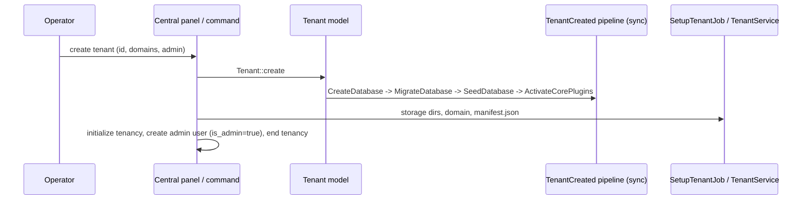

# Store provisioning (tenants)

## Overview

Platform operators create stores. Creating a store creates its database, runs the base tenant migrations, seeds a default account, activates the core plugins, creates its storage folders and PWA manifest, attaches its domain(s), and optionally creates the first store admin.

**Status:** live (host feature) · **Code:** [TenantResource](../../app/Filament/Central/Resources/TenantResource.php), [CreateTenant command](../../app/Console/Commands/CreateTenant.php), [TenantService](../../app/Services/TenantService.php), [TenancyServiceProvider](../../app/Providers/TenancyServiceProvider.php) · **Related:** [Plugin marketplace](plugin-marketplace.md), [Deployment](../deployment.md#adding-a-store-domain). Background: [saas-lifecycle-engine.md](../architecture/saas-lifecycle-engine.md)

## How to use

### Operator: from the central panel

1. Sign in at `https://<central domain>/central` and open **Tenants**.
2. Create: **Tenant ID** (becomes the database name `tenant<id>`; use lowercase letters/digits), **Admin Name**, **Admin Email**, **Admin Password**, and one or more **Domain** rows.
3. Save. The store is ready when the page returns; point the domain's DNS at the server.
4. The store admin signs in at `https://<domain>/admin` with the admin email/password and activates plugins in the marketplace.

### Operator: from the command line

```bash
php artisan app:create-tenant --id=acme --domain=acme.example.com
```

This does not create an admin user; promote or create one afterwards (see [Getting started](../getting-started.md#3-prepare-data)).

## How it works



1. `Tenant::create` fires `TenantCreated`, whose job pipeline runs synchronously (`shouldBeQueued(false)`): Stancl `CreateDatabase`, `MigrateDatabase` (`database/migrations/tenant`), `SeedDatabase` ([`DatabaseSeeder`](../../database/seeders/DatabaseSeeder.php): default account from `DEFAULT_USER_*`), then [`ActivateCorePlugins`](../../app/Core/Plugins/Jobs/ActivateCorePlugins.php) (`store-settings`, `media-optimizer`).
2. Central panel: [`CreateTenant` page](../../app/Filament/Central/Resources/TenantResource/Pages/CreateTenant.php) hashes the admin password, stores admin fields in the tenant's `data`, dispatches [`SetupTenantJob`](../../app/Jobs/SetupTenantJob.php) for the first domain, and creates the admin user inside the tenant.
3. Command: [`CreateTenant`](../../app/Console/Commands/CreateTenant.php) → [`TenantService::createTenant`](../../app/Services/TenantService.php) (if a `tenant<id>` database already exists it creates the record without events, so nothing is migrated or seeded) and `setupTenant` (storage folders `storage/tenant<id>/{app,framework/cache,logs}`, domain, manifest).
4. Deleting a tenant fires `TenantDeleted` → `DeleteDatabase` (synchronous).

## Configuration

| Setting | Effect |
| --- | --- |
| `DB_*` user privileges | Must allow `CREATE DATABASE` / `DROP DATABASE` |
| `DEFAULT_USER_*` | Account seeded into every new store |
| `tenancy.central_domains` ([config/tenancy.php](../../config/tenancy.php)) | Hosts that are never tenants |

## Testing

- Automated: [TenantResourceTest](../../tests/Feature/Filament/TenantResourceTest.php), [TenantIsolationTest](../../tests/Feature/Security/TenantIsolationTest.php), [Phase1CoreFoundationPluginsTest](../../tests/Feature/Phase1CoreFoundationPluginsTest.php).
- Manual: create a tenant locally, then `php artisan tenant:plugin:list <id>` shows the two core plugins active.

## Troubleshooting

| Symptom | Likely cause | Fix |
| --- | --- | --- |
| Creation fails with database error | DB user lacks `CREATE DATABASE`, or SQLite configured | Grant privileges; use MySQL |
| Store exists but has no tables | `tenant<id>` database already existed, so events were skipped | Run `php artisan tenants:migrate --tenants=<id>` and activate core plugins |
| Activation of core plugins failed | `plugins` table empty | `php artisan plugin:discover`, then `tenant:plugin:activate <id> store-settings` and `media-optimizer` |
| Domain shows 404 | Domain not saved or DNS elsewhere | Add the domain; fix DNS |
| `storage/tenant<id>` missing | `SetupTenantJob` not run (queued without worker) | Run worker or `app:create-tenant` with the same id and domain |

## History

- 2025-12: create-tenant command.
- 2025-11: tenant management in the central panel.
