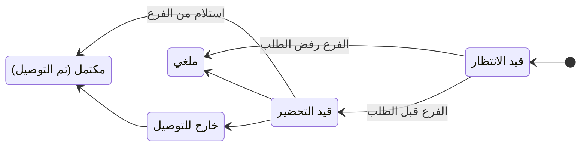

# إدارة الطلبات

الشاشة: إدارة المبيعات › الطلبات.

## قائمة الطلبات

- تبويبات حسب الحالة: **الكل**، و**قيد الانتظار**، و**قيد التحضير**، و**خارج للتوصيل**، و**مكتمل**، و**ملغي**، و**فشل الإرسال لنقطة البيع** (إذا كان الربط مفعلاً).
- يعرض الجدول رقم الطلب (`ORD-XXXXXXXX`)، والعميل، والإجمالي، والحالة، وحالة الدفع، وحالة الإرسال لنقطة البيع، مع فلاتر (منها فلتر الطلبات المتأخرة في الإرسال).

## تفاصيل الطلب

افتح الطلب لترى: بيانات العميل، والعنوان كما كان وقت الطلب، والفرع، والكوبون، والمنتجات بأحجامها وإضافاتها ومكونات الباقات، والإجماليات، وسجل تغيير الحالة (ومن غيّرها: نقطة البيع أو مدير).

**الإجمالي** = المنتجات − خصم الكوبون + الضريبة + رسوم الدفع عند الاستلام + رسوم التوصيل.

رسوم التوصيل تصبح صفراً إذا وصلت قيمة المنتجات بعد الخصم إلى **الحد الأدنى للشحن المجاني** في [إعدادات المتجر](../admin/store-settings.md#الطلبات)، أو إذا استخدم العميل كوبون شحن مجاني.

## دورة حياة الطلب

- الأصل أن **الكاشير في الفرع** هو من يحرّك الحالة، فيتحدث الموقع تلقائياً ويراها العميل في صفحة طلباته.
- تتقدم الحالة إلى الأمام فقط وبالترتيب. طلب **التوصيل** يجب أن يمر بحالة «خارج للتوصيل» قبل «مكتمل»، أما طلب **الاستلام من الفرع** فيمكن أن ينتقل من «قيد التحضير» إلى «مكتمل» مباشرة.
- **طلبات الدفع عند الاستلام**: عندما يصبح الطلب «مكتمل» تتحول حالة الدفع تلقائياً إلى «مكتمل (مدفوع)».
- **الطلبات المدفوعة إلكترونياً** (بطاقة أو محفظة): تُحدَّث حالة الدفع من بوابة الدفع. [الدفع الإلكتروني](../admin/payments.md).

## تغيير الحالة من اللوحة

إذا لم تكن في الفرع نقطة بيع، أو احتجت إلى تصحيح حالة: فعّل **السماح بالتعديل اليدوي لحالة الطلبات من لوحة الإدارة** في إعدادات المتجر › الطلبات. بعدها يظهر في الطلب زر **تحديث حالة الطلب (يدوي)**: اختر **الحالة الجديدة** واكتب **سبب التعديل اليدوي**. يُسجَّل التعديل في سجل الطلب باسمك.

## متابعة الإرسال لنقطة البيع

إذا كان الربط مع نقطة البيع مفعلاً، فلكل طلب **حالة إرسال**:

| الحالة | معناها | ماذا تفعل |
| --- | --- | --- |
| غير جاهز | لم يُرسل الطلب إلى الفرع بعد، وغالباً هو طلب إلكتروني ينتظر تأكيد الدفع | انتظر تأكيد الدفع، أو اضغط **إرسال لنقطة البيع** إذا كان الطلب نقدياً |
| في قائمة الإرسال / جارٍ الإرسال | الطلب في الطريق إلى الفرع | إذا بقي كذلك أكثر من 5 دقائق، فتواصل مع الدعم الفني (غالباً خدمة الخلفية متوقفة) |
| بانتظار إعادة المحاولة | الفرع غير متاح حالياً | يحاول الموقع 5 مرات سريعة بفاصل 3 ثوانٍ، وإذا استمر تعذر الوصول يجدول 5 جولات مؤجلة على مدار 24 ساعة (1، 2، 4، 8، 9 ساعات). يعرض تفاصيل الطلب «إعادة المحاولة المؤجلة X من 5» ووقت المحاولة التالية، مع زر **إعادة الإرسال الآن** |
| تم الإرسال | وصل الطلب إلى الكاشير | — |
| فشل الإرسال | رفض الفرع الطلب أو تعذر الوصول إليه لمدة 24 ساعة | اقرأ **سبب الفشل**، وأصلح السبب (أو تأكد من تشغيل نقطة البيع)، ثم اضغط **إعادة الإرسال لنقطة البيع** |
| تحتاج مراجعة مع الفرع | حدث خطأ غير متوقع بعد بدء الإرسال ولم يتأكد وصول الطلب | **تواصل مع الفرع أولاً**، ثم **تسجيل نتيجة التحقق مع الفرع** |

التفاصيل الكاملة في [الربط مع نقطة البيع](../integrations/pos.md#متابعة-الطلبات-المرسلة).

## رمز التكامل

زر **رمز التكامل** أعلى قائمة الطلبات يولّد كلمة السر التي يستخدمها الكاشير لتحديث حالات الطلبات. [طريقة استخدامه](../integrations/pos.md#الخطوة-3-رمز-التكامل).
