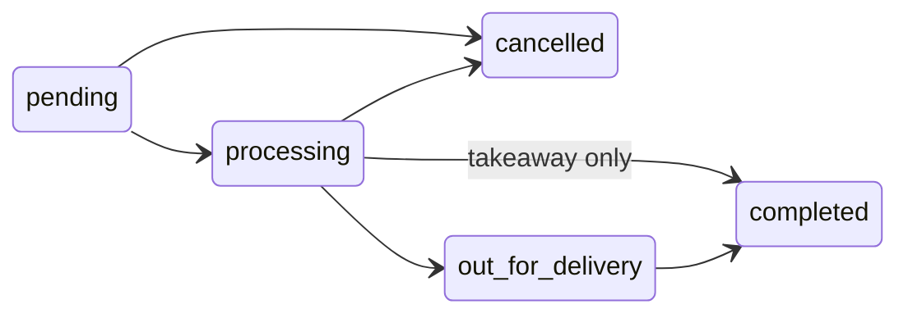

# Connecting a POS to the website

This page is the end-to-end setup and contract between a store on this website and its restaurant POS branches. The plugin internals (delivery tracking, retries, verification) are in [POS integration](features/pos-integration.md); the POS side is documented in the POS project's own handbook, and the names below match it.

## The two secrets

There are two different credentials, one per direction. Mixing them up is the most common setup mistake.

| Direction | Credential | Created where | Pasted where | Sent as |
| --- | --- | --- | --- | --- |
| Website → POS (place order, shift id, can accept, product import) | **POS web API key** | POS: الإعدادات › إدارة الفروع › مفتاح الربط (API) › «مفتاح API للموقع والفروع» (button «توليد مفتاح») | Website: each branch's **مفتاح API لنقطة البيع**, and for the master POS **مفتاح API لمستودع المنتجات الرئيسي** in Store settings › نظام نقاط البيع (POS) | `X-Api-Key: <key>` |
| POS → website (order status) | **Integration token** | Website: الطلبات › **رمز التكامل** (shown once; generating a new one revokes the old) | POS: الإعدادات › إدارة الفروع › مفتاح الربط (API) › «رمز التكامل من الموقع» | `Authorization: Bearer <token>` |

The POS also needs the website address: POS setting **رابط الموقع** (الإعدادات العامة), for example `https://shop.example.com`. Every slave POS and the website must hold the same web API key as the master POS. On the POS, `WEB_API_KEY` in `.env` is only a fallback when the setting is empty.

## Setup checklist

1. **POS:** generate the web API key («توليد مفتاح») and copy it.
2. **Website:** activate the **POS integration** plugin in سوق الإضافات (it depends on order management, catalog, locations and store settings).
3. **Website:** in التوصيل والمناطق › الفروع, set each branch's **الرابط** to that branch POS's public base URL (`https://pos-branch.example.com`) and paste the key into **مفتاح API لنقطة البيع**.
4. **Website:** in إعدادات المتجر › نظام نقاط البيع (POS), set **رابط مستودع المنتجات الرئيسي** (master POS URL) and **مفتاح API لمستودع المنتجات الرئيسي**.
5. **Website:** import products (الكتالوج والمنتجات › استيراد منتجات POS) or map existing products to POS items per branch. Unmapped items make deliveries fail.
6. **Website:** الطلبات › **رمز التكامل** → generate, copy (shown once).
7. **POS:** paste it into «رمز التكامل من الموقع» and set «رابط الموقع».
8. **Server:** make sure a queue worker runs on the central database ([Queue, workers & scheduler](queue-and-workers.md)).
9. **Test:** place a cash order on the website; it should appear in the branch POS, and accepting it on the POS should move the website order to «قيد التحضير».

## Contract

### Website → POS

All requests go to `branch.link` + path, with `X-Api-Key`, a 30 s timeout, and only to public addresses (unless `NETWORK_ALLOW_PRIVATE_HOSTS=true`).

| Call | Response used |
| --- | --- |
| `GET /api/can-accept-order` | `{can_accept}`. `false` defers the delivery (counts as an attempt, not a failure) |
| `GET /api/get-shift-id` | `{shift_id}`, stored on the order |
| `POST /api/web-orders/place-order` | see below |
| Master POS: `GET /api/all-products-refs-master`, `/api/all-products-prices-master`, `/api/get-products-master`, `/api/get-products-prices-master`, `/api/get-products-master-by-refs` | product import and price sync (5 s timeout) |

**Place order** payload ([`OrderPOSPayloadBuilder`](../app/Plugins/PosIntegration/src/Services/POS/OrderPOSPayloadBuilder.php)), in short:

- `order.orderNumber`, `order.type` (delivery / takeaway), totals, payment method, notes, customer data (name, phone, Arabic address: عمارة، الدور، شقة, area and governorate in Arabic).
- `order.idempotencyKey`: SHA-256 of tenant id, order id and order number. Identical for every send of the same order.
- `items[]`: one line per product (`productRef`, `quantity`, `price`, `notes`). Weighted items send the weight in kg as `quantity`. Every add-on mapped to a POS item is its own line (quantity = add-on qty × item count, × weight multiplier for weighted items) with the note «إضافة على: &lt;item&gt;». Unmapped add-ons and variant / weight choices go in the item notes.
- The delivery fee is folded into the POS `service` amount.

| POS answer | Website does |
| --- | --- |
| 200 created | `pos_status = sent` |
| 200 `already_received: true`, `order{id, order_number, status, total}` | Treats it as sent (a retry of an order the POS already saved) and moves the website status forward to the POS status, never backwards |
| 409 `conflict: true`, `mismatches`, `existing_order` | Another order already uses this number in the POS. Delivery **fails without retry**, and the admin sees which fields differ (key, phone, total, items) |
| 400 / 422 | Delivery fails with the message |
| timeout / 5xx after the POST was sent | `needs_verification`: the admin calls the branch and records whether it arrived. Never replayed automatically |

### POS → website

`POST https://<store domain>/api/order-status` with `Authorization: Bearer <integration token>` and body `{orderNumber, status}`. Limited to 60 requests/minute. Every change is logged in `order_status_events` with `source=integration`.

| POS status | Website status | Arabic label |
| --- | --- | --- |
| `pending` | pending | قيد الانتظار |
| `processing` (POS accepted) | processing | قيد التحضير |
| `out_for_delivery` | out_for_delivery | خارج للتوصيل |
| `completed` | completed | مكتمل (تم التوصيل) |
| `cancelled` (POS rejected) | cancelled | ملغي |

Allowed transitions ([`OrderStatusTransitions`](../app/Plugins/OrderManagement/src/Services/OrderStatusTransitions.php)):

Any other jump answers `409` with `from_status` / `to_status`. When the POS's status call fails, the POS rolls its own status change back, so the two sides stay in step. `processing → completed` is allowed only for takeaway orders (`web_takeaway`), because the POS completes them without an out-for-delivery step; delivery orders must pass through `out_for_delivery`.

| Response | Meaning |
| --- | --- |
| 200 | Status updated |
| 401 | Token missing, wrong or rotated |
| 404 | No order with that number in this store |
| 409 | Transition not allowed |
| 422 | Invalid body |

**Cash orders become paid on completion.** When a cash-on-delivery order reaches `completed` by any path (POS callback, admin action, or the already-received catch-up), its payment status becomes «مكتمل (مدفوع)». Online payments are untouched. *(Pending in PR #7 on `refactoring`; until it merges, cash orders stay "pending payment" after completion.)*

## Troubleshooting

| Symptom | Cause | Fix |
| --- | --- | --- |
| Every delivery fails with 401 | Branch **مفتاح API لنقطة البيع** differs from the POS key | Copy the key again from the POS «مفتاح API للموقع والفروع» |
| Import page is empty / 401 | Master key or URL wrong | Store settings › POS |
| Orders stay «في قائمة الإرسال» (`queued`) | No worker, or jobs written to a tenant DB | [Queue, workers & scheduler](queue-and-workers.md) |
| POS accepted the order but the website still shows «قيد الانتظار» | POS has no token, wrong token, or wrong «رابط الموقع» | Generate a new token on the website and paste it in the POS |
| «رقم الطلب مستخدم في الفرع لطلب مختلف» | 409 conflict | Check the order on the POS; resend only if it is really missing |
| Status update 409 | POS skipped a step (e.g. a delivery order completed from processing) | Move the order through the statuses in order |

More: [POS integration › Troubleshooting](features/pos-integration.md#troubleshooting).
